<h1 align="center">📡 LoRaWAN Node STM32 · SX1272 · RD49C Radioenge — Atuadores e Sensores</h1>

<p align="center">
  Firmware próprio para o <b>módulo LoRaWAN EndDevice da Radioenge</b> (STM32L071CZ + SX1272),<br>
  com a <b>LoRaMac-node v4.7.1</b>, ativação <b>ABP e OTAA num firmware só</b> (troca por <code>AT+NJM</code>, sem regravar), as <b>Classes A, B e C</b><br>
  e <b>todos os comandos AT do firmware original da Radioenge</b> (<code>AT+JOIN</code>, <code>AT+SEND</code>, <code>AT+GPIOC</code>, <code>AT+KEEPALIVE</code>...),<br>
  mais <b>relés</b> nos GPIOs do módulo, <b>medidores de energia PZEM-004T v3</b> (Modbus RTU) e o protocolo binário <b>ADAILSILVA_V1</b> com codec para o ChirpStack v4.
</p>

<p align="center">
  
  
  
  
  
  
  
  
  
  
  
</p>

O módulo da Radioenge vem de fábrica com um firmware de comandos AT (LoRaWAN 1.0.3, só Classes A e C). Este projeto **substitui esse firmware**: o STM32L071CZ de dentro do módulo passa a rodar a pilha LoRaWAN da Semtech diretamente, com tudo configurável pelo console da UART e gravado na EEPROM do próprio STM32, **sem perder nenhuma função do original**: os mesmos comandos AT (`AT+DADDR`, `AT+APPKEY`, `AT+NJM`, `AT+JOIN`, `AT+SEND`, `AT+SENDB`, `AT+TXCFM`, `AT+CHMASK`, `AT+KEEPALIVE`, `AT+GPIOC`, `AT+WPIN`, `AT+RPIN`, `AT+ADC`, `AT+BAUDRATE`...), as mesmas respostas (`AT OK`, `AT TX OK`, `AT JOIN OK`, `RX:<hex>:<RSSI>:<SNR>`), os GPIOs com entradas analógicas e interrupções, o keepalive, a serial transparente e os LEDs. Referência completa: [`doc/COMANDOS_AT_RADIOENGE.md`](doc/COMANDOS_AT_RADIOENGE.md).

> **Atuadores e sensores.** Além do nó LoRaWAN completo (ABP e OTAA, Classes A/B/C, comandos AT da Radioenge, página WEB e app), este firmware traz **relés** (0 a 8, em GPIOs do módulo, estados gravados na EEPROM), **medidores PZEM-004T v3** (0 a 4, Modbus RTU em GPIO0/GPIO1) e o protocolo binário **ADAILSILVA_V1** (comandos na porta 10, respostas na 11, telemetria TLV na 20), com codec para o ChirpStack v4. Veja [Relés e PZEM-004T](#-relés-e-pzem-004t-atuadores-e-sensores) e [Protocolo ADAILSILVA_V1](#-protocolo-adailsilva_v1-e-codec-do-chirpstack).

> **Um firmware só para ABP e OTAA.** Este projeto junta os antigos `LoRaWAN_Node_STM32L071CZT6_SX1272_RD49C_Radioenge_ABP` e `LoRaWAN_Node_STM32L071CZT6_SX1272_RD49C_Radioenge_OTAA`, que já tinham o mesmo código e só mudavam a ativação de fábrica no `app/node_build.h`. Agora as duas ativações estão sempre no mesmo binário (`build/radioenge_node_abp_otaa.hex`) e a escolha é feita **em tempo de execução**, como no firmware original da Radioenge: `AT+NJM=1` (OTAA, o padrão de fábrica) ou `AT+NJM=0` (ABP), também pelo console (`set njm`), pela página WEB e pelo app (seção **Ativação**). Um módulo que já rodava o antigo firmware ABP ou OTAA é atualizado com o **Atualizar** sem perder nada: continua na mesma ativação, com a mesma sessão LoRaWAN, o FCnt e o DevNonce ([detalhes](#-abp-e-otaa-num-firmware-só)).

> ⚠️ **Gravar este firmware apaga o firmware AT original da Radioenge, e não há como regravá-lo.** A Radioenge não publica o binário, e o STM32 vem com proteção de leitura. Separe um módulo para isso.

---

## Sumário

- [Destaques](#-destaques)
- [ABP e OTAA num firmware só](#-abp-e-otaa-num-firmware-só)
- [Hardware](#-hardware)
- [Comandos AT (compatíveis com o firmware Radioenge)](#-comandos-at-compatíveis-com-o-firmware-radioenge)
- [Relés e PZEM-004T (atuadores e sensores)](#-relés-e-pzem-004t-atuadores-e-sensores)
- [Protocolo ADAILSILVA_V1 e codec do ChirpStack](#-protocolo-adailsilva_v1-e-codec-do-chirpstack)
- [Classes LoRaWAN (A, B e C)](#-classes-lorawan-a-b-e-c)
- [Relógio do RTC (cristal ou LSI calibrado)](#-relógio-do-rtc-cristal-ou-lsi-calibrado)
- [Preparar o ambiente (Windows, Linux e macOS)](#-preparar-o-ambiente-windows-linux-e-macos)
- [Ligações para gravar e para o console](#-ligações-para-gravar-e-para-o-console)
- [Passo a passo: adaptador USB-serial externo](#-passo-a-passo-adaptador-usb-serial-externo)
- [Primeira gravação: tirar a proteção (RDP)](#-primeira-gravação-tirar-a-proteção-rdp)
- [Compilar e gravar](#-compilar-e-gravar)
- [Console (UART)](#-console-uart)
- [Página WEB (USB-serial e Bluetooth pelo navegador)](#-página-web-usb-serial-e-bluetooth-pelo-navegador)
- [App Android (USB OTG e Bluetooth)](#-app-android-usb-otg-e-bluetooth)
- [Valores de fábrica e EEPROM](#-valores-de-fábrica-e-eeprom)
- [Cadastro no ChirpStack](#-cadastro-no-chirpstack)
- [Downlinks: reset remoto e comandos](#-downlinks-reset-remoto-e-comandos)
- [LEDs e consumo](#-leds-e-consumo)
- [Arquitetura do firmware](#-arquitetura-do-firmware)
- [Repositório no GitHub, Releases e GitHub Pages](#-repositório-no-github-releases-e-github-pages)
- [Estrutura do repositório](#-estrutura-do-repositório)
- [Comandos de diagnóstico](#-comandos-de-diagnóstico)
- [Solução de problemas](#-solução-de-problemas)
- [Créditos e licenças](#-créditos-e-licenças)

---

## ✨ Destaques

| Recurso | Detalhe |
|---|---|
| 📶 **Classes A, B e C** | Troca em tempo de execução pelo console (`class B`) ou por downlink, gravada na EEPROM |
| 🧱 **LoRaMac-node v4.7.1** | A última versão da pilha da Semtech (com as correções de segurança de outubro/2026), LoRaWAN L2 1.0.4, RP002-1.0.3 |
| 🔐 **ABP e OTAA num firmware só** | Troca em tempo de execução (`AT+NJM`, `set njm`, página WEB ou app), sem regravar. **OTAA** (padrão de fábrica): JOIN pelo ar com DevEUI, JoinEUI e AppKey; DevEUI gerado do ID único do STM32 (ou fixo); DevNonce persistente. **ABP**: sessão pré-provisionada com DevAddr, NwkSKey e AppSKey (LoRaWAN 1.0.x), sem JOIN; FCnt gravado na EEPROM |
| 🌎 **AU915** | Sub-banda 1 (canais 8–15 + 65) por padrão, a mesma numeração do ChirpStack (`au915_1`) e dos gateways ESP32; qualquer sub-banda (0–7) ou todos os canais |
| 💾 **EEPROM** | Configuração, sessão LoRaWAN, contadores e DevNonce gravados na EEPROM de 6 KB do STM32 |
| 🔁 **Comandos AT da Radioenge** | Todos os comandos do firmware de fábrica (`Lora_AT_v1r3s35`), com as mesmas respostas: credenciais, `AT+NJM` (ABP ↔ OTAA sem regravar), `AT+JOIN`/`AT+AJOIN`, `AT+SEND`/`SENDB`/`TXCFM`/`TXBCFM`, `AT+CHMASK`, janelas RX/JOIN, `AT+BAUDRATE`, `AT+NBTRIALS`, `AT+KEEPALIVE`, GPIOs (`AT+GPIOC`, `WPIN`, `RPIN`, `ADC`), interrupções na porta 2, serial transparente na porta 4 e AT por downlink na porta 103 ([referência](doc/COMANDOS_AT_RADIOENGE.md)) |
| ⚡ **Relés** | 0 a 8 relés em GPIOs do módulo (`AT+RELECFG`), ativos em 0 ou em 1, estados gravados na EEPROM (só quando mudam, num anel de 32 registros) e restaurados no boot sem pulso falso; ligar, desligar, alternar, máscara e pulso de 100 ms a 24 h sem bloquear nada |
| 🔌 **PZEM-004T v3** | 0 a 4 medidores de energia por Modbus RTU (9600 8N1) em GPIO0/GPIO1: tensão, corrente, potência, energia, frequência, fator de potência e alarme; zerar energia e limite de potência. Exclusivo com a serial transparente (a configuração mais recente vence) |
| 📡 **Protocolo ADAILSILVA_V1** | Comandos na porta 10 com `seq` e deduplicação, respostas na 11 e telemetria TLV na 20 (relés, PZEM, alimentação, motivo do boot), dividida em vários uplinks quando não cabe no DR. Codec JavaScript para o ChirpStack v4, que decodifica também as portas 2, 5 e 103 |
| ⌨️ **Console** | `status`, `config`, `set`, `save`, `class`, `send`, `join`, `devtime`, `clock`, `factory`, `reboot`, `log`, `diag`, `classes`, `rele`, `pzem`, mais um modo JSON para a página e o app |
| 📝 **Log em RAM** | Até 3 KB do que o nó imprime (com o tempo desde que ligou), consultado pelo `log` ou baixado pela página e pelo app (**Baixar do nó**) |
| 🩺 **Diagnósticos** | Autoteste no firmware (`diag`: rádio, EEPROM, sessão, tráfego, relógio, VDD, pilha) e Ping, Traceroute e Nslookup feitos pelo computador (página WEB) ou pelo celular (app), já que o módulo não tem IP |
| ⏱️ **Relógio** | Detecta o cristal de 32,768 kHz; sem ele, calibra o LSI e corrige a base de tempo em software |
| 🔋 **Baixo consumo** | Modo STOP entre eventos; a UART acorda o MCU para o console |
| 🛡️ **Watchdog do rádio e do MCU** | O SX1272 volta a funcionar sozinho, com a mesma sessão: a cada 10 s e antes de cada uplink o firmware confere se ele responde no SPI, continua em LoRa com a sync word da rede e, na Classe C, recebendo; se não, reset do rádio com a configuração da LoRaMac-node (Classe C reaberta). TX ou janela RX sem fim recebem o timeout que faltou. MCU travado: o **IWDG** reinicia em 20–40 s e a sessão volta da EEPROM, sem novo JOIN. Para isso o RTC acorda o MCU a cada 10 s |
| 🌐 **Página WEB** | `web/index.html`: a mesma interface do app no navegador, pela porta USB-serial (Web Serial) ou Bluetooth (Web Bluetooth), sem instalar nada. Configuração com menu lateral e, no topo, **Logs**, **Diagnósticos** e **Classes**. Publicada no GitHub Pages |
| 📱 **App Android** | `app_flutter/`: abas Status, Config., Logs, Diagnóst. e Manutenção e Classes LoRaWAN, por USB OTG ou Bluetooth BLE |
| 🔄 **Reset remoto** | Comando de 1 a 16 bytes numa FPort (e `REINICIAR` do protocolo V1, com a resposta antes) |
| 🧪 **Testado em emulador** | Boot, console, EEPROM, troca de classe e DevNonce verificados no Renode (STM32L071), mais uma revisão independente do port. O rádio não é emulado: **falta validar no módulo**. O log em RAM, o autoteste e o `classes` foram compilados e o log testado no PC, mas ainda não rodaram no módulo |

---

## 🔐 ABP e OTAA num firmware só

Até a versão anterior havia dois repositórios, `..._Radioenge_ABP` e `..._Radioenge_OTAA`, com o mesmo código: só o `app/node_build.h` mudava a ativação de fábrica, e o `AT+NJM` já trocava uma pela outra. Como no firmware original da Radioenge a ativação também é só um parâmetro (`AT+NJM`), não fazia sentido manter dois firmwares. Agora é **um projeto, um binário e um app**, e nada dos dois se perdeu: tudo o que era do ABP e tudo o que era do OTAA está aqui.

| | OTAA (`AT+NJM=1`, padrão de fábrica) | ABP (`AT+NJM=0`) |
|---|---|---|
| Sessão | JOIN pelo ar (Join-request / Join-accept) | pré-provisionada, sem JOIN |
| Credenciais | DevEUI, JoinEUI (AppEUI), AppKey (NwkKey só no LoRaWAN 1.1) | DevAddr, NwkSKey, AppSKey, NetID (LoRaWAN 1.0.x: a NwkSKey vale para as três chaves de rede) |
| Chaves de sessão | derivadas da AppKey a cada JOIN aceito | as configuradas, fixas até você mudar |
| Contador que nunca volta | **DevNonce** (guardado à parte, sobrevive ao `factory`) | **FCnt** de uplink (gravado na EEPROM a cada 32 uplinks) |
| `join` / **Refazer JOIN** | novo Join-request | **Reativar sessão ABP**: reaplica DevAddr e chaves da EEPROM |
| ChirpStack | perfil com *Supports OTAA*; aba **OTAA keys** | perfil sem *Supports OTAA*; aba **Activation** |
| Classe C no ChirpStack | vale depois de um **novo JOIN** | vale depois de **(Re)activate device** |

**Como trocar** (o nó reinicia e a sessão LoRaWAN recomeça na outra ativação):

| Onde | OTAA | ABP |
|---|---|---|
| Comando AT | `AT+NJM=1` | `AT+NJM=0` |
| Console | `set njm 1` e `save` | `set njm 0` e `save` |
| Página WEB | **Ativação** → **OTAA** → **Salvar no nó** | **Ativação** → **ABP** → **Salvar no nó** |
| App Android | aba **Config.** → Ativação **OTAA** → Salvar | aba **Config.** → Ativação **ABP** → Salvar |
| Padrão de fábrica | `NODE_ACTIVATION` em `app/node_build.h` (`NODE_ACTIVATION_OTAA`) | troque para `NODE_ACTIVATION_ABP` se quiser que o `factory` e o **Do zero** voltem em ABP |

<table>
  <tr>
    <td width="50%" align="center"><a href="doc/images/web/web_07_ativacao_otaa.png">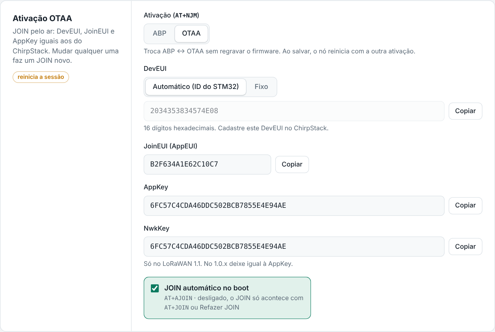</a><br><sub>Ativação OTAA</sub></td>
    <td width="50%" align="center"><a href="doc/images/web/web_07_ativacao_abp.png">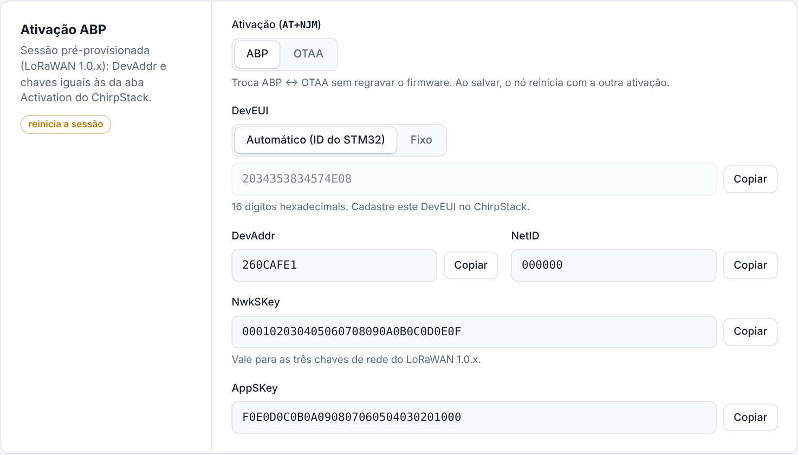</a><br><sub>Ativação ABP</sub></td>
  </tr>
</table>

**Atualizar um módulo que já rodava o firmware ABP ou OTAA antigo.** Use o **Atualizar** (mantém a EEPROM). A ativação fica gravada na configuração, então um módulo ABP continua ABP e um OTAA continua OTAA, com a mesma sessão LoRaWAN, o FCnt e o DevNonce: no 1º boot o firmware ajusta a impressão das credenciais da EEPROM ao formato do firmware único e mostra `[NVM] Configuração do firmware anterior (ABP ou OTAA) migrada; sessão mantida.` (só nos módulos que vieram do antigo firmware ABP; nos que vieram do OTAA nada muda). Só o **Do zero** apaga tudo e volta ao padrão de fábrica (OTAA).

**Arquivos exportados pelos firmwares antigos** (`configurations_backup/radioenge_abp_*.json` e `radioenge_otaa_*.json`) continuam valendo: em **Manutenção → Importar…** (página WEB) ou **Importar…** (app), um arquivo sem o campo `njm` (os do antigo firmware ABP) usa o `_mode` dele, e o nó volta para a mesma ativação ao salvar.

O que mudou de nome:

| Antes | Agora |
|---|---|
| `LoRaWAN_Node_STM32L071CZT6_SX1272_RD49C_Radioenge_ABP` e `..._OTAA` | `Node_STM32_SX1272_RD49C_Radioenge_ABP_e_OTAA` |
| `LoRaWAN_Node_STM32L071CZT6_SX1272_RD49C_Radioenge_ABP_e_OTAA` e, depois, `LoRaWAN_Node_STM32_SX1272_RD49C_Radioenge_ABP_e_OTAA` (pasta em `~/Apps/lorawan_workspace`, repositório no GitHub, arquivos das Releases e endereço do GitHub Pages) | `Node_STM32_SX1272_RD49C_Radioenge_ABP_e_OTAA`: o nome da pasta e do repositório deixa de citar o modelo exato do MCU, que continua sendo o STM32L071CZT6, e perde o prefixo `LoRaWAN_`. O `build/` gerado na pasta antiga é apagado e configurado de novo sozinho pelo `build.sh`; o repositório antigo no GitHub é renomeado pelo `scripts/create_github_repo.sh` (o GitHub redireciona o endereço antigo) |
| `build/radioenge_node_abp.{elf,hex,bin}` e `radioenge_node_otaa.*` | `build/radioenge_node_abp_otaa.{elf,hex,bin}` |
| banner `LoRaWAN Node Radioenge ABP` / `... OTAA` | `LoRaWAN Node Radioenge ABP e OTAA` |
| apps **Radioenge Node ABP** e **Radioenge Node OTAA** (`radioenge_node_abp_app`, `radioenge_node_otaa_app`) | um app só, **Radioenge Node ABP e OTAA** (`br.com.adailsilva.radioenge_node_abp_otaa_app`); os dois apps antigos podem ser desinstalados |

---

## 🔧 Hardware

| Item | Valor |
|---|---|
| Módulo | Radioenge LoRaWAN EndDevice (placa "LoRaMESH v4"), homologação ANATEL 02021-18-07215 |
| MCU | **STM32L071CZT6**: Cortex-M0+ 32 MHz, 192 KB de flash, 20 KB de RAM, 6 KB de EEPROM |
| Rádio | **SX1272**, saída PA_BOOST até +20 dBm, 915–928 MHz |
| Antena | Conector SMA (ou pino 18, se o SMA for retirado) |
| Alimentação | 4–12 V nos pinos VCC (regulador de fábrica) ou 3,3 V com o regulador trocado por 0 Ω |

### Pinagem interna (STM32 ↔ rádio)

Levantada pelo projeto [Radioenge-Module](https://github.com/ricaun/Radioenge-Module) (ricaun) e confirmada com a LMiC rodando no módulo.

| Sinal | Pino do STM32 | | Sinal | Pino do STM32 |
|---|---|---|---|---|
| SX1272 NSS | PA4 | | SX1272 DIO0 | PB10 |
| SX1272 SCLK | PA5 | | SX1272 DIO1 | PB2 |
| SX1272 MISO | PA6 | | SX1272 DIO2 | PB1 |
| SX1272 MOSI | PA7 | | SX1272 DIO3 | PB0 |
| SX1272 RESET | PB14 | | Chave RXTX | PB13 (1 = RX, 0 = TX) |
| | | | Chave RXTX2 | PB12 (sempre 0) |

### Pinos do módulo

| Pino | Função de fábrica | Pino do STM32 | Neste firmware |
|---:|---|---|---|
| 1, 8, 17, 19 | GND | — | GND |
| 2 | RX da UART de comandos | PB7 (USART1_RX) | **RX do console** |
| 3 | TX da UART de comandos | PB6 (USART1_TX) | **TX do console** |
| 4, 5 | VCC | — | alimentação |
| 6 | GPIO0 / ADC3 | PA3 (USART2_RX) | `AT+GPIOC` (entrada, saída, analógica) ou RX da serial transparente (RX do console com `CONSOLE_UART=2`) |
| 7 | GPIO1 / ADC2 | PA2 (USART2_TX) | `AT+GPIOC` (entrada, saída, analógica) ou TX da serial transparente (TX do console com `CONSOLE_UART=2`) |
| 9–16 | GPIO2–GPIO9 | PA15, PA10, PA9, PA8, PB15, PA0, PA1, PB11 | `AT+GPIOC`: entrada, saída, analógica (GPIO7/8) ou interrupção (GPIO2, 4, 5, 6, 9) |
| 18 | RF | — | antena |
| pads de baixo | SWDIO, GND, SWCLK, RESET | PA13, —, PA14, NRST | gravação |
| LEDs | vermelho / verde / amarelo | PB5 / PB8 / PB9 | TX / RX / serial, como no original (acendem em 0) |

<p align="center">
  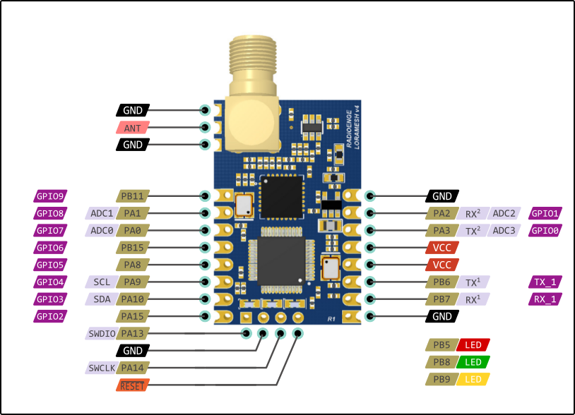
  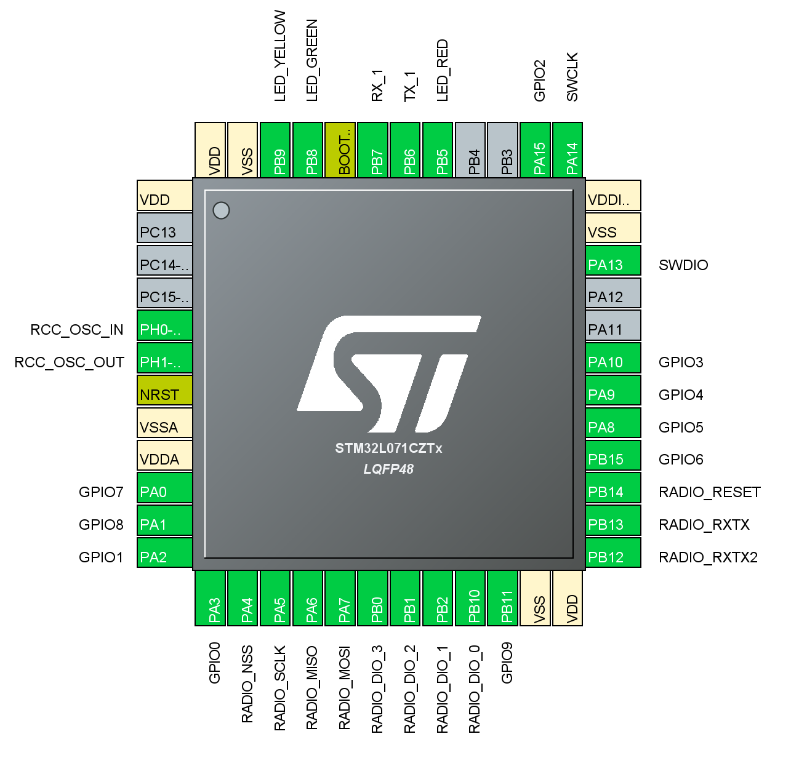
</p>
<p align="center"><sub>Imagens: projeto Radioenge-Module, de ricaun (licença MIT).</sub></p>

### O módulo nas imagens do manual da Radioenge

| <a href="doc/images/radioenge_enddevice/radioenge_enddevice_foto.png">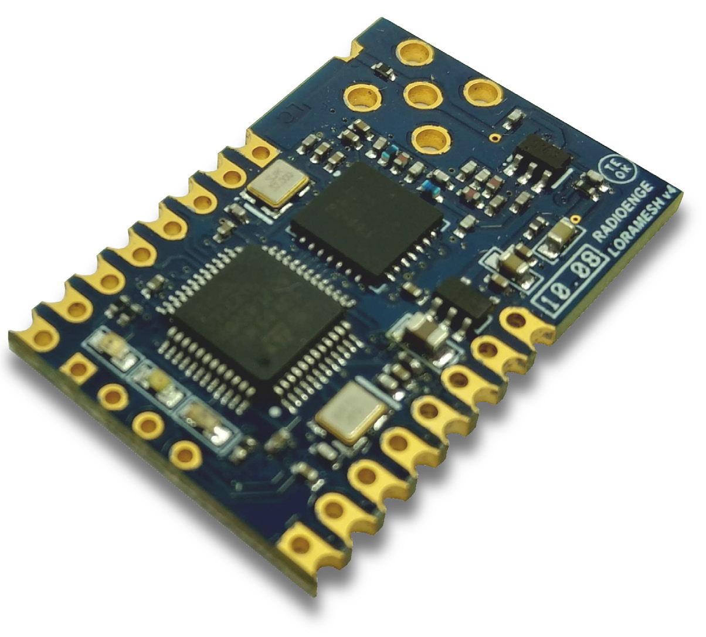</a> | <a href="doc/images/radioenge_enddevice/radioenge_enddevice_pinagem.png">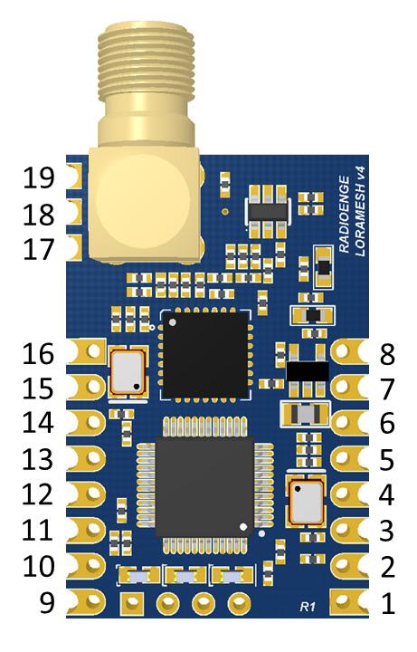</a> |
|:---:|:---:|
| Módulo LoRaWAN EndDevice (RD49C / "LoRaMESH v4"): STM32L071CZT6 + SX1272, 33 × 22 × 3 mm | Numeração dos pinos 1–19 (pino 18 = RF, SMA no alto) |
| <a href="doc/images/radioenge_enddevice/radioenge_enddevice_leds.png">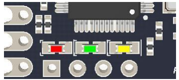</a> | <a href="doc/images/radioenge_enddevice/radioenge_enddevice_bypass_regulador.png">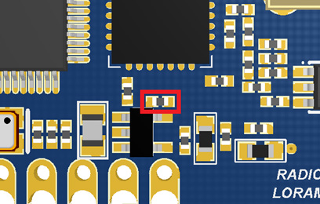</a> |
| LEDs vermelho (TX), verde (RX) e amarelo (serial) | Bypass do regulador: resistor 0 Ω (0402) no lugar marcado, para alimentar direto em 3,3 V (mínimo consumo) |
| <a href="doc/images/radioenge_enddevice/radioenge_enddevice_dimensoes.png">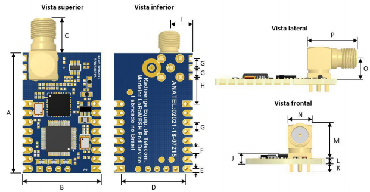</a> | <a href="doc/images/radioenge_enddevice/radioenge_enddevice_footprint.png">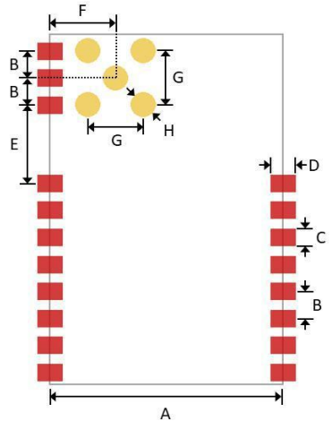</a> |
| Vistas e dimensões | Footprint recomendado para placa-base |

<p align="center">
  <a href="doc/images/radioenge_enddevice/radioenge_enddevice_exemplo_aplicacao.png">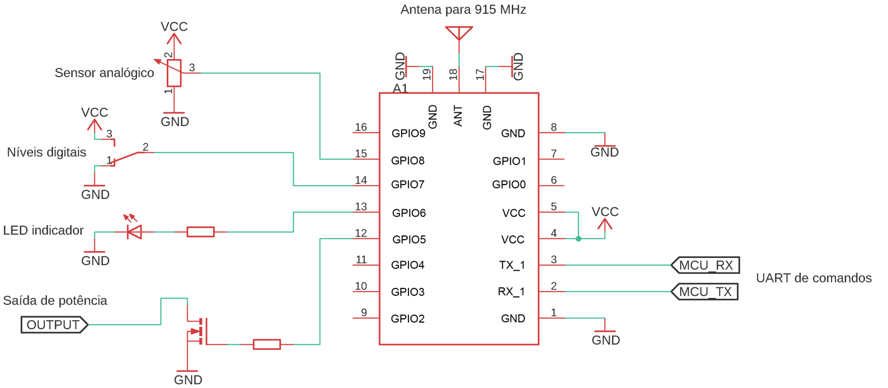</a>
</p>
<p align="center"><sub>Imagens do Manual de Utilização do Mote LoRa Radioenge (rev. mar/2019 e abr/2021). Exemplo de aplicação: sensor analógico, nível digital, LED e saída de potência nos GPIOs, usados com <code>AT+GPIOC</code>.</sub></p>

---

## 🔁 Comandos AT (compatíveis com o firmware Radioenge)

Os comandos AT entram **na mesma UART do console** (pinos 2/3), ao lado dos comandos de texto: linhas que começam com `AT` vão para o interpretador AT. Também funcionam no campo de comando da página WEB e do app, e **por downlink** na FPort 103. A referência completa (faixas, pacotes, GPIOs, roteiros para ChirpStack, TTN e Everynet, diferenças) está em [`doc/COMANDOS_AT_RADIOENGE.md`](doc/COMANDOS_AT_RADIOENGE.md).

| Grupo | Comandos |
|---|---|
| Sistema | `AT`, `ATZ`, `AT?`, `AT+VER`, `AT+BAT`, `AT+BAUDRATE` |
| Credenciais | `AT+DEUI`, `AT+DADDR`, `AT+APPEUI`, `AT+APPKEY`, `AT+NWKSKEY`, `AT+APPSKEY`, `AT+NWKID` |
| Ativação | `AT+NJM` (0 ABP / 1 OTAA), `AT+JOIN`, `AT+AJOIN`, `AT+NJS` |
| Rádio e MAC | `AT+ADR`, `AT+DR`, `AT+TXP`, `AT+DCS`, `AT+PNM`, `AT+CHMASK`, `AT+CLASS` (A, B, C) |
| Janelas | `AT+RX1DL`, `AT+RX2DL`, `AT+RX2FQ`, `AT+RX2DR`, `AT+JN1DL`, `AT+JN2DL` |
| Envio | `AT+SEND`, `AT+SENDB`, `AT+TXCFM`, `AT+TXBCFM`, `AT+CFM`, `AT+NBTRIALS`, `AT+KEEPALIVE` |
| Recepção | `RX:<hex>:<RSSI>:<SNR>` a cada downlink, `AT+SNR`, `AT+RSSI` |
| GPIOs | `AT+GPIOC`, `AT+WPIN`, `AT+RPIN`, `AT+ADC` (interrupções → porta 2; serial transparente → porta 4) |
| Relés, PZEM e telemetria (novos) | `AT+RELECFG`, `AT+RELE`, `AT+RELEPULSO`, `AT+PZEMCFG`, `AT+PZEM`, `AT+PZEMZERA`, `AT+PZEMLIM`, `AT+PZEMEND`, `AT+TELEM` ([seção 8 da referência](doc/COMANDOS_AT_RADIOENGE.md#8-relés-pzem-004t-e-telemetria-comandos-novos-deste-firmware)) |

```
AT+CHMASK=?
ff0000000000000000020000
AT+GPIOC=7:5:0
AT OK
AT+ADC=7
1873
AT+SEND=5:teste
AT TX OK
RX:0102030506:-105:5
```

> 🧪 Os comandos AT foram compilados para o STM32L071 (ABP e OTAA) e o interpretador, as faixas, as respostas e a migração da EEPROM v1 → v2 foram testados no PC. GPIOs, ADC, interrupções, serial transparente e keepalive **ainda precisam ser validados no módulo**.

> Credenciais, canais e `AT+NJM` reiniciam o módulo 5 s depois do último comando (uma sequência inteira de `AT+...` vale de uma vez); `AT+JOIN`/`ATZ` reiniciam na hora. A velocidade de fábrica continua **115200** (a da página e do app); `AT+BAUDRATE=9600` deixa como o módulo original.

---

## ⚡ Relés e PZEM-004T (atuadores e sensores)

Os atuadores e sensores deste firmware: **relés** em GPIOs do módulo, **medidores de energia PZEM-004T v3** por Modbus RTU e o protocolo binário **ADAILSILVA_V1** (seção seguinte). Eles convivem com tudo o que o nó já fazia, sem mudar nada: portas 2, 4, 5, 101, 102, 103 e 224, comandos AT, console, página e app.

### Diagrama de ligação

Dois relés nos GPIO4 e GPIO5 (o exemplo `AT+RELECFG=4,5:1`) e um PZEM-004T v3 em GPIO0/GPIO1 pelo conversor de nível. Os fios de alimentação aparecem como rótulos: **mesmo rótulo (5 V, 3V3, GND) = mesmo fio**.

<p align="center">
  <a href="doc/images/wiring_radioenge_rele_pzem.png">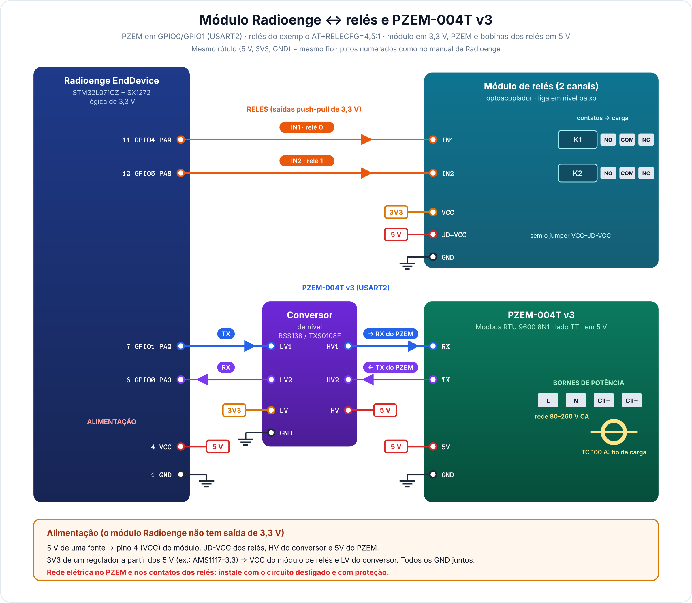</a>
</p>
<p align="center"><sub>🔍 Alta resolução (PNG, 2400 px de largura): clique na imagem para ampliar · versão vetorial: <a href="doc/images/wiring_radioenge_rele_pzem.svg"><code>wiring_radioenge_rele_pzem.svg</code></a></sub></p>

| Pino do módulo | Sinal | Destino |
|---:|---|---|
| 11 (GPIO4, PA9) | relé 0 | `IN1` do módulo de relés |
| 12 (GPIO5, PA8) | relé 1 | `IN2` do módulo de relés |
| 7 (GPIO1, PA2) | TX da USART2 | `LV1` do conversor → `HV1` → `RX` do PZEM |
| 6 (GPIO0, PA3) | RX da USART2 | `LV2` do conversor ← `HV2` ← `TX` do PZEM |
| 4 (VCC) | 5 V da fonte | também `JD-VCC` dos relés, `HV` do conversor e `5V` do PZEM |
| 1 (GND) | GND | GND comum de tudo |

> ℹ️ **O módulo Radioenge não tem saída de 3,3 V** (o regulador dele é interno). O 3V3 do `VCC` do módulo de relés e do `LV` do conversor vem de um regulador ligado nos mesmos 5 V (ex.: AMS1117-3.3), com GND comum.

### Relés

| Item | Como funciona |
|---|---|
| Quantidade | 0 a 8 relés (canais 0..7), cada um num GPIO0..GPIO9 do módulo (`AT+RELECFG=4,5:1` = relé 0 no GPIO4 e relé 1 no GPIO5, ativos em 0) |
| Pinos permitidos | qualquer GPIO do módulo; os pinos do rádio (SPI, DIO0–3, RESET e chave de antena do SX1272) não são GPIOs do módulo e nunca podem ser relés. GPIO0/GPIO1 só sem PZEM e sem serial transparente |
| Exclusividade | o pino vira **saída push-pull** e é só do relé: `AT+GPIOC` e `AT+WPIN` nele respondem `AT ERROR` até ele sair da lista (`AT+RELECFG`). `AT+RPIN` continua lendo o nível |
| Ativo em nível baixo | por relé (`:1`): liga com o pino em 0, como nos módulos de relé com optoacoplador |
| Boot | o nível é escrito **antes** de o pino virar saída: o relé volta ao último estado gravado sem pulso falso. Até o firmware configurar o pino (alguns ms), o STM32 deixa o pino em alta impedância |
| Estados na EEPROM | gravados a cada mudança, **só quando mudam**, num anel de 32 registros de 8 bytes (`0x1700–0x17FF`): cada registro aguenta ~100 mil gravações, então o anel aguenta ~3,2 milhões de mudanças. Um pulso não é gravado (no boot volta ao estado anterior a ele) |
| Pulso | `RELE_PULSO` / `AT+RELEPULSO`: 100 ms a 24 h, com um `TimerEvent` da LoRaMac-node (não bloqueia o rádio nem o modo STOP). No fim o relé volta ao estado anterior e sai uma telemetria com o TLV de relés |
| Mudança local | ligar/desligar pelo console, AT, página ou app também manda uma telemetria com os relés (para o servidor saber o estado real) |

**Ligação.** O GPIO do STM32 fornece poucos mA a 3,3 V: ele **não aciona a bobina** do relé. Use um módulo de relé com transistor/optoacoplador (ou um transistor NPN/MOSFET + diodo de roda-livre na bobina). Nos módulos de relé "ativos em 0" alimentados com 5 V no VCC, o nível alto de 3,3 V às vezes não apaga totalmente o LED do optoacoplador: prefira módulos com entrada para 3,3 V, ou alimente o VCC (lado do optoacoplador) com 3,3 V e a bobina com 5 V separado (jumper JD-VCC), com GND comum.

```
 Módulo Radioenge                 Módulo de relé (2 canais, ativo em 0)
 GPIO4 (pino 11) ───────────────► IN1
 GPIO5 (pino 12) ───────────────► IN2
 3V3 (regulador) ───────────────► VCC      (lado do optoacoplador)
                         5 V ───► JD-VCC   (bobinas; tire o jumper VCC–JD-VCC)
 GND ───────────────────────────► GND      (GND comum com a fonte de 5 V)
```

### PZEM-004T v3

| Item | Como funciona |
|---|---|
| Barramento | Modbus RTU, **9600 8N1**, na USART2: GPIO0 (pino 6, PA3) = RX do módulo, GPIO1 (pino 7, PA2) = TX do módulo |
| Medidores | 0 a 4, cada um com o seu endereço Modbus (`AT+PZEMCFG=01,02`). `f8` é o endereço genérico: **só com um medidor** no barramento (padrão de fábrica: um medidor em `f8`). Para dar endereços diferentes, ligue um medidor por vez e use `AT+PZEMEND=02` |
| Leitura | 10 registradores de entrada (função 0x04); corrente, potência e energia vêm em duas palavras com a **baixa primeiro** e viram o u32 big-endian do protocolo |
| Comandos | `PZEM_LER`, `PZEM_ZERAR_ENERGIA` (função 0x42) e `PZEM_LIMITE_POTENCIA` (registrador 0x0001) pelo protocolo V1; `AT+PZEM`, `AT+PZEMZERA`, `AT+PZEMLIM` e `pzem ler` no console |
| Tempo | assíncrono: o quadro sai por interrupção, a resposta chega por interrupção e um timer limita a espera em **500 ms por medidor**. Sem resposta: TLV `PZEM_FALHA` na telemetria e status `FALHA_PERIFERICO` no comando. Durante a troca de quadros o MCU fica em SLEEP (não em STOP); fora dela, STOP normal |
| Exclusividade | o PZEM e a **serial transparente** usam os mesmos pinos e a mesma USART: ligar um desliga o outro, e a configuração mais recente vence (`AT+PZEMCFG=f8` desliga a transparente; `AT+GPIOC=0:3:0` ou qualquer `AT+GPIOC` em GPIO0/GPIO1 desliga o PZEM). Com o console em `CONSOLE_UART=2` não há PZEM |

**Ligação e níveis de tensão.** O lado TTL do PZEM-004T v3 (RX, TX, 5V, GND) é isolado por optoacopladores e alimentado pelos **5 V** do conector; o módulo Radioenge trabalha em **3,3 V**. Não ligue direto: use um **conversor de nível bidirecional** (módulo com BSS138, ou TXS0108E/TXB0104 nos dois sinais), com o lado de alta em 5 V e o de baixa em 3,3 V. Só como alternativa mínima: um divisor resistivo no TX do PZEM (ex.: 10 kΩ + 20 kΩ, para ~3,3 V no GPIO0) e um transistor/MOSFET no RX do PZEM; o 3,3 V direto no RX do PZEM costuma deixar o LED do optoacoplador meio aceso e a comunicação falha. A parte de potência do PZEM (fase, neutro e o TC de corrente) é **rede elétrica**: instale com o circuito desligado e com proteção.

```
 Módulo Radioenge (3,3 V)      conversor de nível        PZEM-004T v3 (lado TTL)
 3V3 (regulador) ───────────► LV            HV ◄─────── 5 V (fonte) ───► 5V
 GPIO1 / TX (pino 7) ───────► LV1          HV1 ───────────────────────► RX
 GPIO0 / RX (pino 6) ◄─────── LV2          HV2 ◄─────────────────────── TX
 GND ───────────────────────► GND          GND ───────────────────────► GND
```

> 🧪 Compilado para o STM32L071 sem avisos. No PC foram testados: a codificação do protocolo (`app/node_v1.c` contra os vetores da seção 6, deduplicação, divisão da telemetria, resposta truncada, REINICIAR), o anel de estados e os pulsos dos relés (`app/node_relay.c`), a migração da configuração v2 → v3 (com a EEPROM gerada pela versão anterior) e o codec. A USART2/Modbus com um PZEM de verdade e os relés **ainda precisam ser validados no módulo**.

Mais de um PZEM: os TX ficam em paralelo no mesmo fio (cada medidor só responde ao seu endereço). Ligue os RX e TX de todos ao mesmo par de sinais do conversor.

---

## 📡 Protocolo ADAILSILVA_V1 e codec do ChirpStack

Contrato completo: [`doc/PROTOCOLO_ADAILSILVA_V1.md`](doc/PROTOCOLO_ADAILSILVA_V1.md). Resumo:

| FPort | Sentido | Conteúdo |
|---:|---|---|
| 10 | downlink | comando `seq(1) \| opcode(1) \| parâmetros` |
| 11 | uplink | resposta `seq \| opcode \| status \| dados` (não confirmada, alta prioridade: sai logo depois da resposta de AT por downlink) |
| 20 | uplink | telemetria em blocos TLV `tipo \| canal \| tamanho \| valor` |
| 101 | downlink | reset remoto (8 bytes fixos, `rstcmd`) |

- **Opcodes:** `STATUS` 0x01, `INTERVALO` 0x02 (5..86400 s), `ENVIAR_AGORA` 0x03, `CONFIRMADO` 0x04, `CLASSE` 0x05 (`'A'` ou `'C'`; a Classe B continua pelo `AT+CLASS`/`class B`), `REINICIAR` 0x06 (a resposta sai **antes** do reinício), `RELE_DEFINIR` 0x20, `RELE_PULSO` 0x21, `RELE_MASCARA` 0x22, `RELE_LER` 0x23, `PZEM_LER` 0x30, `PZEM_ZERAR_ENERGIA` 0x31, `PZEM_LIMITE_POTENCIA` 0x32.
- **Status:** 0 OK, 1 OPCODE_DESCONHECIDO, 2 PARAMETRO_INVALIDO, 3 PERIFERICO_AUSENTE, 4 FALHA_PERIFERICO, 5 OCUPADO.
- **Deduplicação:** o nó guarda em RAM o último `seq` (≠ 0) e a resposta dada. O mesmo `seq` de novo **não executa outra vez**: só reenvia a resposta guardada (seguro para repetir um ALTERNAR ou um PULSO). `seq` 0 sempre executa.
- **Telemetria** (porta 20) a cada `interval` segundos, logo depois de `ENVIAR_AGORA`, no fim de um pulso e quando um relé muda por comando local. Blocos: `RELES` (0x01), `PZEM` (0x10, 18 bytes por medidor, lidos na hora), `PZEM_FALHA` (0x11), `ALIMENTACAO` (0x30, VDD em mV, a mesma medida do `AT+BAT`) e `BOOT` (0x31, só na primeira telemetria depois de ligar: 1 energização, 2 software, 3 watchdog, 5 pino de reset, 0 desconhecido; no STM32L0 a queda de tensão marca o mesmo bit da energização e sai como 1).
- **Uplink periódico:** `AT+TELEM=1` (padrão deste projeto) = telemetria V1 na porta 20; `AT+TELEM=0` = o payload fixo (`payload`) na FPort `port` (101). O `send` sem argumento do console e o comando `05` da porta 102 seguem o mesmo modo.
- **Tamanho do DR:** se a resposta não cabe no DR atual, sai só `seq | opcode | status` (3 bytes). Se a telemetria não cabe, sai em vários uplinks, sempre com blocos inteiros.

> ⚠️ **Com PZEM, use DR3 ou maior.** No AU915 com dwell time, DR2 aceita só 11 bytes e um bloco PZEM tem 21 (com o cabeçalho): em DR2 o bloco é descartado (aviso no log) e a resposta do `PZEM_LER` sai truncada em 3 bytes. Em DR3 (53 bytes) cabem relés + um PZEM + alimentação + boot num uplink só; com dois ou mais medidores a telemetria se divide. Com ADR ligado, a rede pode baixar o DR: deixe o ADR desligado ou limite o DR mínimo no perfil.

### Instalar o codec no ChirpStack v4

1. **Device profiles** → o perfil do nó → aba **Codec** → *Payload codec*: **JavaScript functions**.
2. Cole o conteúdo de [`doc/codec/codec_adailsilva_v1_chirpstack_v4.js`](doc/codec/codec_adailsilva_v1_chirpstack_v4.js) e salve.
3. Os eventos de uplink passam a ter o objeto decodificado (`object`): porta 20 → `reles`, `pzem`, `pzemFalha`, `alimentacao`, `boot`; porta 11 → `resposta`; e as outras portas do nó: 2 → `interrupcao`, 5 → `keepalive`, 103 → `at.linhas`, 4 → `serial`, 101 → `payload`.
4. Para mandar comandos pelo objeto (Queue → *JSON*), use `encodeDownlink` na **FPort 10**: `{ "seq": 7, "comando": "RELE_DEFINIR", "canal": 0, "acao": "LIGAR" }`. Parâmetros: `segundos` (INTERVALO), `confirmado`, `classe`, `atraso_ms` (REINICIAR), `canal` (número ou `"todos"`), `acao` (`DESLIGAR`/`LIGAR`/`ALTERNAR`), `estado` e `duracao_ms` (PULSO), `mascara` e `valores`, `watts`.

No ChirpStack v3 use [`doc/codec/codec_adailsilva_v1_chirpstack_v3.js`](doc/codec/codec_adailsilva_v1_chirpstack_v3.js) (*Custom JavaScript codec functions*, `Decode` / `Encode`): é o mesmo codec com as funções de entrada do v3.

Teste do codec (todos os vetores da seção 6 do protocolo, os objetos da seção 7, as portas 2, 5 e 103, a versão do ChirpStack v3 e o CRC Modbus da seção 5.3); roda também no GitHub Actions:

```bash
node doc/codec/teste_codec.js        # 24 ok, 0 falha(s)
```

### Exemplos de downlink (FPort 10, base64 para a fila do ChirpStack)

| Comando | Hex | Base64 |
|---|---|---|
| seq 1, STATUS | `01 01` | `AQE=` |
| seq 2, ENVIAR_AGORA | `02 03` | `AgM=` |
| seq 7, RELE_DEFINIR relé 0 ligar | `07 20 00 01` | `ByAAAQ==` |
| seq 3, RELE_DEFINIR todos desligar | `03 20 FF 00` | `AyD/AA==` |
| seq 8, RELE_PULSO relé 1 ligado por 5000 ms | `08 21 01 01 00 00 13 88` | `CCEBAQAAE4g=` |
| seq 9, RELE_MASCARA máscara 0x0003, valores 0x0001 | `09 22 00 03 00 01` | `CSIAAwAB` |
| seq 10, PZEM_LER medidor 0 | `0A 30 00` | `CjAA` |
| seq 6, PZEM_ZERAR_ENERGIA medidor 0 | `06 31 00` | `BjEA` |
| seq 7, PZEM_LIMITE_POTENCIA medidor 0, 2300 W | `07 32 00 08 FC` | `BzIACPw=` |
| seq 11, INTERVALO 300 s | `0B 02 00 00 01 2C` | `CwIAAAEs` |
| seq 5, CLASSE C | `05 05 43` | `BQVD` |
| seq 4, REINICIAR em 2000 ms | `04 06 07 D0` | `BAYH0A==` |

Lembre de trocar o `seq` a cada comando novo (1..255, pulando o 0): repetir o mesmo `seq` só traz a resposta guardada.

### Impacto em flash e RAM

Medido com o `arm-none-eabi-gcc` 13.2.1 (Release, `-Os` do toolchain do projeto), STM32L071CZ com 192 KB de flash e 20 KB de RAM:

| Build | Flash | RAM (estática) |
|---|---:|---:|
| Sem os acréscimos (só LoRaWAN, comandos AT, console e GPIOs) | 142.408 B (72,4 %) | 15.432 B (75,4 %) |
| Este firmware (relés + PZEM + ADAILSILVA_V1) | 158.636 B (80,7 %) | 16.112 B (78,7 %) |
| Diferença | +16.228 B (sobram ~37 KB) | +680 B (sobram ~4,3 KB para pilha e heap) |

A RAM estática inclui o log em RAM (3 KB); o resto dos 20 KB é a pilha (o `diag` mostra o pico de uso). Nada foi cortado para caber.

---

## 📶 Classes LoRaWAN (A, B e C)

### O que é uma "classe"

A classe define **quando o dispositivo final (nó) está escutando downlinks**, isto é, mensagens que vêm do servidor para o nó: comandos, confirmações (ACK), ajustes de ADR, reset remoto etc.

- O **uplink** (nó → servidor) é igual nas três classes: o nó transmite quando quer.
- O que muda é o **downlink** (servidor → nó): quanto tempo ele espera para chegar e quanta energia o nó gasta mantendo o rádio ligado.
- **Todo** dispositivo LoRaWAN precisa suportar a **Classe A**. As classes B e C são modos *adicionais*, ligados por cima da A.
- A classe é uma característica do **nó** e do **perfil de dispositivo no servidor**. O **gateway não tem classe**: ele só repassa os pacotes e transmite os downlinks no horário que o servidor pede.

### Resumo rápido

| Classe | Quando o nó escuta | Atraso do downlink | Consumo | Uso típico |
|:---:|---|---|---|---|
| **A** | Só em 2 janelas curtas (RX1 e RX2) logo depois de cada uplink | Até o **próximo uplink** (segundos a horas) | 🔋 **Mínimo** | Sensores a bateria: medidores, temperatura, nível, rastreadores |
| **B** | Janelas A + **ping slots** em horários sincronizados por *beacon* | Até o próximo ping slot (**1 s a 128 s**, configurável) | 🔋🔋 Baixo/médio | Atuadores a bateria que precisam receber comando com atraso previsível |
| **C** | **O tempo todo**, exceto enquanto transmite | **Quase imediato** (< 1 s + rede) | 🔌 **Alto**: rádio sempre ligado | Equipamentos ligados à rede elétrica: relés, iluminação pública, válvulas, alarmes |

### Classe A: o nó fala, depois escuta

É o modo básico e obrigatório. Depois de **cada uplink**, o nó abre duas janelas de recepção curtas e depois dorme:

```
        uplink              RX1                 RX2
Nó:   [■■■■■■■■]·· 1 s ··[▒▒]······ 1 s ······[▒▒]········· dormindo ·········[■■■■■■■■]··
                           ↑ mesma faixa do       ↑ frequência e DR fixos
                             uplink (DR ajustado)   (AU915: 923,3 MHz, DR8)
```

- **RX1** abre `RECEIVE_DELAY1` (1 s no AU915) depois do fim do uplink; **RX2** abre 1 s depois da RX1. No JOIN OTAA os atrasos são de 5 s e 6 s.
- Se o servidor tiver algo para o nó, ele manda em RX1 ou RX2. Se não houver nada, o nó volta a dormir.
- **Consequência:** o servidor **não consegue falar com o nó quando quer**. Um comando fica na fila do ChirpStack até o nó mandar o próximo uplink. Com uplink a cada 15 min, o comando pode levar até 15 min para chegar.

**Use quando:** o dispositivo funciona a bateria e quase só envia dados; downlink é raro e pode esperar (configuração, ADR, ACK, ajuste de intervalo).

**Exemplos:** medidor de energia/água/gás, sensor de temperatura e umidade, nível de reservatório, estação meteorológica, rastreador de ativos, contador de pulsos.

### Classe B: escuta em horários combinados

A Classe B acrescenta **janelas de recepção agendadas** (*ping slots*) para que o servidor alcance o nó com um atraso **conhecido**, sem obrigar o rádio a ficar ligado o tempo todo.

```
beacon                                                                        beacon
 [B]──ps──────ps──────ps──────ps──────ps──────ps──────ps── … ──ps──────ps──────[B]
  │   ↑ ping slots: janelas curtas (~30 ms) em horários combinados                │
  │←──────────────────────────────── 128 s ────────────────────────────────────→│
```

- Os **gateways** transmitem um **beacon** a cada **128 s**, sincronizado pela **hora do GPS**. No AU915 o beacon vai em 923,3 MHz + n × 600 kHz (8 canais), DR8 (SF12 / BW500).
- O nó se sincroniza com o beacon e, a partir dele, calcula os **ping slots**. A periodicidade é `2^k` segundos, com `k` de 0 a 7: **um ping slot a cada 1 s, 2 s, 4 s … até 128 s**.
- Para entrar em Classe B o nó: (1) procura e trava no beacon (pode levar mais de 128 s), (2) informa a periodicidade ao servidor (`PingSlotInfoReq`) e (3) passa a enviar os uplinks com o bit **Class B** ligado. Se perder beacons por cerca de 2 h, volta para a Classe A.
- As janelas RX1/RX2 da Classe A continuam valendo.

**Exige:** gateways com **GPS e PPS** (pulso por segundo) ligados ao concentrador, para que o beacon e os ping slots saiam na hora certa; servidor com Classe B habilitada no perfil do dispositivo.

**Use quando:** o dispositivo é a bateria, mas precisa **receber comandos** com atraso previsível (segundos ou poucos minutos).

**Exemplos:** fechadura inteligente, válvula de irrigação ou de corte de água a bateria, atuador de estacionamento, sirene/avisador remoto, dispositivo que recebe *multicast* agendado.

### Classe C: escuta o tempo todo

Na Classe C o rádio fica **em recepção contínua** com os parâmetros da RX2, e só para enquanto o nó transmite:

```
        uplink         RX1
Nó:   [■■■■■■■■][▒▒ RXC ▒▒][▒▒][▒▒▒▒▒▒▒▒▒▒▒▒ RX2 contínua (RXC) ▒▒▒▒▒▒▒▒▒▒▒▒▒▒▒▒][■■■■■■■■][▒▒ …
```

- O servidor pode mandar downlink **a qualquer momento** (o ChirpStack envia em modo *imediato*), e o atraso fica limitado à rede (internet, servidor, gateway).
- O custo é energia: o rádio em recepção gasta da ordem de **10–12 mA** o tempo todo (SX1276/RFM95W), contra cerca de **0,2 µA** dormindo. Duas pilhas AA (~2 500 mAh) durariam cerca de **10 dias** só com o rádio em recepção.
- No LoRaWAN 1.0.x não há aviso no protocolo: o servidor trata o nó como Classe C porque o **perfil do dispositivo** diz isso. Se o perfil disser C e o nó estiver em A, os downlinks se perdem.

**Exige:** alimentação contínua (rede elétrica, fonte, painel solar bem dimensionado); servidor com Classe C habilitada no perfil.

**Use quando:** o dispositivo já é ligado à rede elétrica e precisa reagir rápido a comandos.

**Exemplos:** relé/disjuntor remoto, controlador de iluminação pública, tomada inteligente, painel/display, alarme e sirene, válvula motorizada com fonte, atualização de firmware por rádio (**FUOTA** multicast costuma usar Classe C temporária).

### Comparativo

| | **Classe A** | **Classe B** | **Classe C** |
|---|---|---|---|
| Obrigatória | ✅ Sim, em todo nó | ➖ Opcional | ➖ Opcional |
| Janelas de recepção | RX1 + RX2 depois de cada uplink | RX1/RX2 + ping slots a cada 1–128 s | Contínua (RX2), exceto durante o TX |
| Quem inicia o downlink | Só depois de um uplink do nó | O servidor, no próximo ping slot | O servidor, a qualquer momento |
| Atraso máximo do downlink | Intervalo entre uplinks | Periodicidade do ping slot (1–128 s) | ~imediato |
| Consumo do rádio | Mínimo (dorme quase sempre) | Baixo/médio (acorda nos beacons e ping slots) | Alto (escuta sempre) |
| Alimentação típica | Bateria (anos) | Bateria (meses a anos) | Rede elétrica / fonte |
| Exige do gateway | Nada especial | **GPS + PPS** (beacon e hora precisa) | Nada especial (TX "imediato") |
| Exige do servidor | — | Classe B no perfil + periodicidade | Classe C no perfil |
| Multicast (ex.: FUOTA) | ❌ | ✅ | ✅ |

### Qual classe usar

1. **O dispositivo quase só envia dados e o downlink pode esperar até o próximo envio?** → **Classe A**. É o padrão e a escolha certa para a maioria dos sensores.
2. **Precisa receber comandos com atraso previsível, mas funciona a bateria?** → **Classe B**, desde que todos os gateways da área tenham **GPS com PPS**.
3. **Está ligado na rede elétrica e precisa obedecer comandos rapidamente?** → **Classe C**.
4. **Só precisa de um downlink mais rápido de vez em quando?** Antes de mudar de classe, considere continuar em **Classe A** e reduzir o intervalo de uplink, ou mandar um uplink extra quando o nó espera resposta.

> 💡 Classe B e Classe C **não devem ser usadas ao mesmo tempo** no mesmo nó. Escolha uma delas como modo adicional à Classe A.

### Classes no ChirpStack v4

A classe é definida no **perfil do dispositivo** (*Device profiles* → perfil → abas):

| Aba | Campo | Para que serve |
|---|---|---|
| **Class-B** | *Device supports Class-B* | Liga o envio de downlinks em ping slots |
| | *Ping-slot periodicity* | Precisa ser a mesma configurada no nó (1 s a 128 s) |
| | *Class-B confirmed downlink timeout* | Quanto esperar o ACK de um downlink confirmado |
| **Class-C** | *Device supports Class-C* | Liga o envio imediato de downlinks |
| | *Class-C confirmed downlink timeout* | Quanto esperar o ACK de um downlink confirmado |

Sem nenhuma das duas marcadas, o dispositivo é tratado como **Classe A**: os downlinks da fila saem só nas janelas RX1/RX2 depois de cada uplink.

O ChirpStack passa ao gateway como e quando transmitir cada downlink, e o packet forwarder traduz assim (UDP Semtech e MQTT):

| Classe | No ChirpStack (MQTT, `timing`) | No packet forwarder (UDP, `txpk`) |
|---|---|---|
| A | `delay` (1 s ou 2 s depois do uplink) | `"tmst"`: contador do concentrador no fim do uplink + atraso |
| B | `gpsEpoch` (hora GPS do ping slot) | `"tmms"`: milissegundos desde 06/01/1980 (GPS) |
| C | `immediately` | `"imme": true` |

### Suporte nas pilhas LoRaWAN

| Pilha | Classe A | Classe B | Classe C | Observação |
|---|:---:|:---:|:---:|---|
| LMiC original (IBM) | ✅ | ✅ | ❌ | Base das versões da MCCI |
| **MCCI LMiC 3.x** (ex.: 3.3.0) | ✅ | 🧪 | ❌ | Classe B no código (beacon e ping slots), mas a MCCI a lista como **não testada** |
| **MCCI LMiC ≥ 5.0.0** (ex.: 6.0.1) | ✅ | 🧪 | ✅ | Classe C a partir da 5.0.0; precisa ser ligada na compilação (`LMIC_ENABLE_class_c`) **e** em tempo de execução (`LMIC_enableClassC(1)`) |
| Semtech LoRaMac-node | ✅ | ✅ | ✅ | Arquivada pela Semtech em 02/11/2026 (a v4.7.1 é a última); a Semtech recomenda o LoRa Basics Modem para projetos novos |
| Semtech LoRa Basics Modem | ✅ | ✅ | ✅ | Pilha atual da Semtech |
| Zephyr RTOS (subsistema LoRaWAN) | ✅ | ➖ | ✅ | Baseado na LoRaMac-node |

Legenda: ✅ suportada · 🧪 presente, mas sem validação · ❌ não existe · ➖ não exposta pela API

### Neste firmware

Este firmware usa a **LoRaMac-node v4.7.1** (Semtech), que implementa as **três classes**. A classe é escolhida em tempo de execução e fica gravada na EEPROM.

| Classe | Neste firmware | Observação |
|:---:|:---:|---|
| **A** | ✅ | Padrão. RX1/RX2 depois de cada uplink |
| **B** | ✅ | `DeviceTimeReq` → busca do beacon → `PingSlotInfoReq` → Classe B. Exige **gateway com GPS e PPS** transmitindo beacon e, no módulo, um **relógio preciso** (ver abaixo) |
| **C** | ✅ | Recepção contínua na RX2 (AU915: 923,3 MHz, DR8). Exige alimentação contínua |

#### Como trocar a classe

| Onde | Como |
|---|---|
| Console (UART) | `class A`, `class B` ou `class C` (troca na hora e grava) |
| Página WEB (`web/index.html`) | seção **Ações** → Classe A/B/C (na hora), ou **Rádio e classe** → **Salvar no nó** |
| App Android (`app_flutter/`) | aba **Manutenção** → Classe A/B/C (manda o mesmo `class X` pela UART, via USB OTG ou BLE), ou aba **Config.** |
| Downlink | FPort **102** (`cmdport`): `01 00` = A, `01 01` = B, `01 02` = C |
| Padrão de fábrica | `DEF_CLASS` em `app/node_build.h` |
| Periodicidade do ping slot (B) | console `set ping 0..7` (2^n s) ou downlink `03 nn` na FPort 102 |

O firmware sempre passa pela Classe A entre B e C, como a especificação pede. Depois da troca, ele manda um uplink na hora: na Classe B, o uplink leva o bit **Class B** e avisa o servidor.

#### Classe B e o relógio do módulo

A Classe B depende do relógio do RTC entre um beacon e outro (128 s):

- **Com cristal de 32,768 kHz (LSE) em PC14/PC15:** ~50 ppm, funciona como nas placas de referência da Semtech.
- **Sem o cristal:** o RTC roda no oscilador interno (LSI), calibrado pelo firmware ao ligar e a cada 10 min. Calibrado pelo cristal HSE (se houver) fica em centenas de ppm; pelo HSI16, ~1 %. As Classes A e C funcionam, e a margem das janelas RX é aumentada automaticamente. Já os **ping slots da Classe B podem ser perdidos**, e o firmware avisa isso no console.

O levantamento de pinos do módulo mostra PC14/PC15 sem uso, então é provável que o módulo **não** tenha o cristal. O firmware detecta sozinho e mostra no boot e no comando `clock`:

```
Relógio do RTC : LSE 32,768 kHz (cristal), 32768 Hz, ~50 ppm
```
ou
```
Relógio do RTC : LSI calibrado pelo HSI16, 37012 Hz, ~10000 ppm
                 Sem cristal de 32,768 kHz: Classes A e C ok; Classe B instável.
```

#### Cadastro no ChirpStack conforme a classe

| Classe no nó | Perfil do dispositivo (ChirpStack v4) |
|:---:|---|
| A | *Class-B* e *Class-C* desmarcadas |
| B | **Class-B** marcada, *ping-slot periodicity* igual à do nó (`ping`, padrão 4 = 16 s) |
| C | **Class-C** marcada |

No LoRaWAN 1.0.x a Classe C não é avisada pelo protocolo: se o perfil disser C e o nó estiver em A, os downlinks se perdem. Quando trocar a classe do nó, troque também o perfil (os [32 perfis de exemplo](#perfis-de-dispositivo-de-exemplo-32) têm um por classe) e refaça o JOIN (OTAA) ou reative a sessão no ChirpStack (ABP, *(Re)activate device*): o ChirpStack só lê a Classe C do perfil nesse momento ([detalhes](#classe-c-no-chirpstack-só-vale-depois-de-um-novo-join-otaa-ou-da-reativação-abp)).

### Classe C no ChirpStack: só vale depois de um novo JOIN (OTAA) ou da reativação (ABP)

**Sintoma:** o nó está em Classe C (o `status` e o topo da página WEB mostram **Classe C**), o perfil do dispositivo no ChirpStack tem **Class-C** marcada, mas o downlink enfileirado fica parado na aba **Queue** (*Pending: no*) e só chega ao nó na RX2 logo depois do próximo uplink, como na Classe A. Nos **Events**, todo `txack` aparece cerca de 2 s depois de um `up`, nunca sozinho.

**Causa:** o ChirpStack v4 não consulta o perfil a cada downlink. Ele guarda a classe ativa no próprio dispositivo (coluna `enabled_class` da tabela `device`) e só a decide nestes momentos:

| Momento | O que o ChirpStack grava em `enabled_class` |
|---|---|
| **JOIN OTAA** (JoinAccept) | Perfil com MAC **1.0.x** e Class-C marcada → `C`; senão → `A` |
| **(Re)ativação ABP** (aba *Activation*) | A mesma regra |
| **Cada uplink**, só se o perfil tiver **Class-B** marcada | Bit *Class B* do FCtrl = 1 → `B`; = 0 → `A` |

Neste projeto, isso acontece no **JOIN** (JoinAccept), com o nó em OTAA, ou na **(re)ativação ABP** (aba *Activation*, botão *(Re)activate device*), com o nó em ABP. Marcar Class-C no perfil, ou mudar o dispositivo para outro perfil, **não altera** uma sessão que já existe. O agendador de downlinks imediatos do ChirpStack só olha os dispositivos com `enabled_class` = `B` ou `C`; com `A`, o downlink espera o próximo uplink.

No LoRaWAN 1.1 o nó avisa a troca de classe pelo comando MAC `DeviceModeInd`. No 1.0.x não existe esse aviso, por isso o ChirpStack decide a classe só no JOIN (OTAA) ou na ativação (ABP). No código do ChirpStack: `set_device_mode()` em `chirpstack/src/uplink/join.rs`, a ativação em `chirpstack/src/api/device.rs` e o bit *Class B* em `handle_class_b_beacon_locked()` (`chirpstack/src/uplink/data.rs`).

#### Conferir a classe que o ChirpStack gravou

**Pela interface:** *Devices* → dispositivo → **Events** → clique em um evento `up` → campo `deviceInfo.deviceClassEnabled` (`CLASS_A`, `CLASS_B` ou `CLASS_C`). Mostra a classe que valia no momento daquele uplink.

**Pelo banco (PostgreSQL do ChirpStack no Kubernetes), da máquina local com o `kubectl`:**

```bash
# Pod e namespace do PostgreSQL do ChirpStack (o sufixo do pod muda a cada reinício,
# por isso ele é procurado pelo nome do deployment)
POD=$(kubectl get pods -A --no-headers | awk '/chirpstack-v4-ns-as-postgresql/ {print $2; exit}')
NS=$(kubectl get pods -A --no-headers | awk '/chirpstack-v4-ns-as-postgresql/ {print $1; exit}')

# DevEUI do nó, igual ao cadastro no ChirpStack (16 dígitos hex)
DEV_EUI=f38df5e5a31e63de

# Classe ativa do dispositivo
kubectl exec -n "$NS" "$POD" -- sh -c "psql -U \"\${POSTGRES_USER:-chirpstack}\" -d chirpstack -c \"
SELECT encode(dev_eui, 'hex') AS dev_eui, enabled_class, scheduler_run_after
FROM device
WHERE dev_eui = decode('$DEV_EUI', 'hex');\""
```

Saída (aqui, a sessão criada antes de marcar Class-C no perfil):

```
Defaulted container "chirpstack-v4-ns-as-postgresql" out of: chirpstack-v4-ns-as-postgresql, ...
     dev_eui      | enabled_class |      scheduler_run_after
------------------+---------------+-------------------------------
 f38df5e5a31e63de | A             | 2026-11-09 16:33:41.017283+00
(1 row)
```

A linha `Defaulted container ...` é normal: o pod tem containers de inicialização e o `kubectl` escolhe o do PostgreSQL. Se o banco tiver outro nome, liste com `psql -U ... -l` e troque o `-d chirpstack`.

Para ver a classe junto com o perfil que o dispositivo usa:

```bash
kubectl exec -n "$NS" "$POD" -- sh -c "psql -U \"\${POSTGRES_USER:-chirpstack}\" -d chirpstack -c \"
SELECT d.name, d.enabled_class, dp.name AS profile, dp.mac_version,
       dp.supports_class_b, dp.supports_class_c
FROM device d JOIN device_profile dp ON dp.id = d.device_profile_id
WHERE d.dev_eui = decode('$DEV_EUI', 'hex');\""
```

**Pela REST API** (precisa de uma *API key* do ChirpStack):

```bash
curl -s -H "Grpc-Metadata-Authorization: Bearer $API_KEY" \
  https://chirpstack-v4-rest-api.adailsilva.com.br/api/devices/$DEV_EUI | jq .classEnabled
```

| `enabled_class` | Significado | O que fazer |
|:---:|---|---|
| `C` | Downlinks saem na hora (o agendador manda em 1–2 s) | Nada |
| `A` | A sessão foi criada com o perfil sem Class-C (ou com outro perfil) | OTAA: novo JOIN · ABP: reativar a sessão (abaixo) |
| `B` | Os uplinks chegam com o bit *Class B* e o perfil tem Class-B marcada | Se o nó deveria estar em C: perfil sem Class-B e novo JOIN (OTAA) ou reativação (ABP) |

#### Corrigir

1. Confira se o dispositivo está no perfil certo, com **Class-C** marcada (e **Class-B** desmarcada, veja as regras abaixo).
2. **Nó em OTAA:** refaça o JOIN no nó: console `join`, página WEB **Status → Refazer JOIN** (ou **Ações**), app Android aba **Manutenção**, ou reinicie o módulo. Espere o `[JOIN] Conectado! ...`.
   **Nó em ABP:** no ChirpStack, abra **Devices → dispositivo → Activation**, confira *Device address*, *Network session key* e *Application session key* (os mesmos do nó) e clique em **(Re)activate device**. Os contadores voltam para os valores do formulário: preencha o *Uplink frame-counter* com o FCnt atual do nó (`status`) ou deixe **Disable frame-counter validation** marcado no dispositivo enquanto testa.
3. Espere **um uplink** do nó (no OTAA, depois do JOIN). É esse uplink que diz ao ChirpStack por qual gateway mandar os downlinks.
4. Confira o `enabled_class` (comandos acima): tem que estar `C`.
5. Só então enfileire o downlink. Com *Flush queue on activate* ligado no perfil, o JOIN (OTAA) ou a reativação (ABP) apaga a fila do dispositivo.

No ABP, o `join` do console (e **Reativar sessão ABP** na página e no app) só reinicia a sessão **no nó**: no ABP não há troca de mensagens, então o ChirpStack só recalcula a classe pelo botão *(Re)activate device*.

Teste: enfileire o downlink logo depois de um uplink. Com `enabled_class` = `C`, ele aparece nos **Logs** do nó em poucos segundos, sem esperar o próximo `[TX]`, e nos **Events** surge um `txack` sem `up` antes.

**Paliativo para testar sem refazer o JOIN ou reativar** (vale só até o próximo JOIN ou reativação; com Class-B marcada no perfil, o próximo uplink volta para `A`):

```bash
kubectl exec -n "$NS" "$POD" -- sh -c "psql -U \"\${POSTGRES_USER:-chirpstack}\" -d chirpstack -c \"
UPDATE device SET enabled_class = 'C'
WHERE dev_eui = decode('$DEV_EUI', 'hex');\""
```

#### Regras práticas

- Mudou a classe no perfil, ou mudou o dispositivo de perfil? **Refaça o JOIN (OTAA) ou reative a sessão ABP no ChirpStack** (*(Re)activate device*). Vale nos dois sentidos: desmarcar Class-C também só vale depois disso, e até lá o ChirpStack continua mandando os downlinks na hora (que se perdem se o nó voltou para a Classe A).
- Trocar a classe do nó (console `class C`, página, app ou downlink `01 02` na FPort 102) **não avisa** o ChirpStack no LoRaWAN 1.0.x. Para usar a Classe C: perfil com Class-C **e** novo JOIN (OTAA) ou reativação no ChirpStack (ABP).
- Para um nó em Classe C, **não marque Class-B e Class-C no mesmo perfil**: com Class-B marcada, cada uplink sem o bit *Class B* volta o `enabled_class` para `A`.
- A Classe B não depende do JOIN nem da reativação: o ChirpStack passa para `B` no primeiro uplink com o bit *Class B* (o firmware manda esse uplink logo depois de entrar na Classe B).
- Para downlinks **confirmados** na Classe C, use um *Class-C confirmed downlink timeout* maior que 0 (ex.: 5 s). Com 0, o prazo do ACK vence no mesmo instante e o ChirpStack não espera a confirmação do nó.

### Referências

- LoRa Alliance: *LoRaWAN® L2 1.0.4 Specification* e *RP002-1.0.3 LoRaWAN® Regional Parameters* (AU915: RX2, beacon e ping slots).
- MCCI: [arduino-lmic (README)](https://github.com/mcci-catena/arduino-lmic), [Class C](https://mcci-catena.github.io/arduino-lmic/md_doc_2_c_l_a_s_s-_c.html) e [CHANGELOG](https://mcci-catena.github.io/arduino-lmic/md__c_h_a_n_g_e_l_o_g.html).
- Semtech: [LoRaMac-node](https://github.com/Lora-net/LoRaMac-node) e o protocolo do packet forwarder ([`PROTOCOL.md`](https://github.com/Lora-net/packet_forwarder/blob/master/PROTOCOL.TXT)).
- ChirpStack v4: perfis de dispositivo (*Device profiles*, abas Class-B e Class-C).


---

## ⏱️ Relógio do RTC (cristal ou LSI calibrado)

A LoRaMac-node marca o tempo das janelas RX, dos beacons e dos ping slots pelo **RTC** do STM32, que normalmente roda num cristal de **32,768 kHz (LSE)** em PC14/PC15. O levantamento de pinos do módulo mostra PC14/PC15 **sem uso**, então é provável que ele não tenha esse cristal. Por isso o firmware decide sozinho ao ligar:

| Situação | RTC roda em | Precisão | Classes |
|---|---|---|---|
| Cristal de 32,768 kHz presente | LSE | ~50 ppm | A, B e C |
| Sem LSE, com cristal HSE em PH0/PH1 | LSI calibrado contra o HSE | centenas de ppm | A e C; B pode perder ping slots |
| Sem LSE e sem HSE | LSI calibrado contra o HSI16 | ~1 % | A e C; B instável |

Como funciona sem o LSE:

1. O LSI (~37 kHz) é medido com o TIM21. Se houver cristal HSE, ele é medido também e serve de referência, o que cancela o erro do HSI16.
2. O prescaler do RTC é escolhido para o tick ficar perto de 1024 Hz, e a diferença que sobra é corrigida em software: as conversões ms ↔ ticks e o relógio do sistema (SysTime) usam a taxa medida.
3. A margem das janelas RX (`SystemMaxRxError`) cresce com a imprecisão estimada: 10 ms com LSE, ~13–20 ms com o LSI calibrado pelo HSE e ~160 ms pelo HSI16.
4. O LSI é medido de novo a cada 10 min (ou com `clock recal`), com a MAC parada. Uma medida ruim é descartada, e o relógio (timers e hora do sistema) não dá saltos quando a taxa muda.

O boot e o comando `clock` mostram o que foi encontrado. Para testar o modo LSI num módulo com cristal: `RTC_FORCE_LSI=ON sh scripts/build.sh flash`.

---

## 🧰 Preparar o ambiente (Windows, Linux e macOS)

### Ferramenta oficial recomendada: STM32CubeCLT

O **STM32CubeCLT** (*STM32Cube Command-Line Toolset*) é o pacote oficial da ST para compilar e gravar pela linha de comando. É o equivalente, para o STM32, do que o ESP-IDF é para o ESP32. **Um instalador por sistema** traz tudo o que este projeto usa:

| Componente do STM32CubeCLT **1.22.0** | Versão | Para que serve aqui |
|---|---|---|
| GNU tools for STM32 (`arm-none-eabi-gcc`) | 14.3.rel1 | compilar |
| CMake | 4.3.1 | gerar o build |
| Ninja (e Make) | 1.13.2 | compilar mais rápido |
| **STM32CubeProgrammer** (`STM32_Programmer_CLI`) | 2.23.0 | **gravar** pelo SWD, apagar, tirar o RDP |
| ST-LINK USB driver + ST-LINK server | 2.0.2 / 2.1.x | o computador reconhecer o gravador |

- **Sistemas suportados pela ST** nesta versão: Windows 10 e 11 (x64), Ubuntu 26.04 LTS e Fedora 44 (outras distribuições recentes costumam funcionar com o instalador genérico), macOS 15 e 26 (Intel e Apple Silicon).
- **Download:** [st.com/stm32cubeclt](https://www.st.com/en/development-tools/stm32cubeclt.html). É gratuito, mas pede uma conta *myST*.
- O `scripts/build.sh` encontra o STM32CubeCLT sozinho nos caminhos padrão (`/opt/st/stm32cubeclt_*`, `/opt/ST/STM32CubeCLT_*`, `C:\ST\STM32CubeCLT_*`), mesmo que ele não esteja no `PATH`. Se você instalou em outro lugar: `export STM32CLT_PATH=/caminho/do/STM32CubeCLT`.
- A ST anunciou que um *bundle manager* vai substituir o STM32CubeCLT no futuro, mas ele continua sendo a ferramenta oficial e não tem data para sair de linha.
- **Opcional:** o **STM32CubeProgrammer** com interface gráfica (download separado, [st.com/stm32cubeprog](https://www.st.com/en/development-tools/stm32cubeprog.html)), para gravar clicando e para atualizar o firmware do ST-LINK.

**Alternativa livre** (sem conta na ST): o GCC da distribuição ou o [Arm GNU Toolchain](https://developer.arm.com/downloads/-/arm-gnu-toolchain-downloads), mais o **OpenOCD** ou o **stlink-tools** para gravar. Tudo funciona igual pelo `scripts/build.sh`, com uma diferença: o `st-flash` não tira o RDP, então a primeira gravação precisa do STM32CubeProgrammer ou do OpenOCD.

| Ferramenta de gravação | `unlock` (RDP) | `erase` | gravar | `TOOL=` |
|---|:---:|:---:|:---:|---|
| STM32CubeProgrammer (no STM32CubeCLT) | ✅ | ✅ | ✅ | `cubeprog` (padrão quando instalado) |
| OpenOCD | ✅ | ✅ | ✅ | `openocd` |
| stlink-tools (`st-flash`) | ❌ | ✅ | ✅ | `stflash` |

### O gravador: ST-LINK

| Gravador | Funciona | Observação |
|---|:---:|---|
| **ST-LINK/V2** (inclusive os clones baratos, "pendrive") | ✅ | O mais comum. Ligue também o pino **RST** |
| ST-LINK/V2-1 (de uma placa Nucleo) | ✅ | Tem porta serial virtual (`/dev/ttyACM0`), que pode ser o console |
| **STLINK-V3** (MINIE, SET) | ✅ | Também tem porta serial virtual |

Os comandos deste README supõem esta organização de pastas:

```
~/Apps/lorawan_workspace/      ← pasta de trabalho; este projeto é clonado dentro dela
```

| Sistema | Caminho recomendado | `scripts/build.sh` e comandos com log |
|---|---|---|
| 🐧 Linux | STM32CubeCLT (instalador `.sh`) | funcionam como estão |
| 🍎 macOS | STM32CubeCLT (instalador `.pkg`) | funcionam com o `sed` do GNU e um ajuste no `script` |
| 🪟 Windows | **nativo**, com o instalador `.exe` (recomendado) | use o `cmake` e o `STM32_Programmer_CLI` direto no PowerShell |
| 🪟 Windows | WSL2 + Ubuntu + `usbipd` | funcionam como no Linux |

### 🐧 Linux (Ubuntu / Debian / Fedora)

**1. Pacotes do sistema** (console serial, `script`, `fuser` e git)

```bash
sudo apt-get update
sudo apt-get install -y git picocom python3-serial util-linux psmisc libusb-1.0-0
```

Fedora: `sudo dnf install git picocom python3-pyserial util-linux psmisc libusbx`. Arch: `sudo pacman -S --needed git picocom python-pyserial util-linux psmisc libusb`.

**2. Instalar o STM32CubeCLT.** Baixe o pacote do Linux em [st.com/stm32cubeclt](https://www.st.com/en/development-tools/stm32cubeclt.html) e descompacte. Escolha o arquivo do seu sistema: `deb_bundle.sh` (Ubuntu/Debian), `rpm_bundle.sh` (Fedora) ou o `.sh` genérico.

```bash
cd ~/Downloads
unzip en.st-stm32cubeclt_1.22.0_*_amd64.deb_bundle.sh.zip
chmod +x st-stm32cubeclt_1.22.0_*_amd64.deb_bundle.sh
sudo sh ./st-stm32cubeclt_1.22.0_*_amd64.deb_bundle.sh     # aceite a licença no terminal
```

Ele vai para `/opt/st/stm32cubeclt_1.22.0/`. Saia e entre de novo na sessão (ou reinicie) para o `PATH` valer. Se preferir fixar o `PATH` à mão:

```bash
CLT=$(ls -d /opt/st/stm32cubeclt_* | sort -V | tail -1)
echo "export PATH=\"$CLT/GNU-tools-for-STM32/bin:$CLT/STM32CubeProgrammer/bin:$CLT/CMake/bin:$CLT/Ninja/bin:\$PATH\"" >> ~/.bashrc
source ~/.bashrc
```

**3. Permissão no USB do ST-LINK e na porta serial** (uma vez só; depois saia e entre de novo na sessão)

O pacote da ST costuma instalar as regras do udev do ST-LINK (`st-stlink-udev-rules`). Confira, e se não houver nenhuma, crie uma regra que vale para todos os ST-LINK (fabricante USB `0483`):

```bash
ls /etc/udev/rules.d/ /lib/udev/rules.d/ | grep -i stlink
echo 'SUBSYSTEMS=="usb", ATTRS{idVendor}=="0483", MODE="0666", TAG+="uaccess"' | sudo tee /etc/udev/rules.d/49-stlink.rules
sudo udevadm control --reload-rules && sudo udevadm trigger
sudo usermod -aG dialout $USER      # porta serial do console (no Arch: uucp)
```

**4. Conferir o gravador.** Com o ST-LINK no USB:

```bash
lsusb | grep -i 0483                # 0483:3748 = ST-LINK/V2, 374b = V2-1, 374e/374f/3753/3754 = V3
STM32_Programmer_CLI --version
STM32_Programmer_CLI -l st-link     # lista o ST-LINK e o número de série
arm-none-eabi-gcc --version
```

**5. Clonar este projeto e compilar**

```bash
cd ~/Apps/lorawan_workspace
git clone https://github.com/AdailSilva/Node_STM32_SX1272_RD49C_Radioenge_ABP_e_OTAA_IO.git
cd Node_STM32_SX1272_RD49C_Radioenge_ABP_e_OTAA_IO && sh scripts/build.sh build
```

**Alternativa livre no Linux** (no lugar do passo 2):

```bash
sudo apt-get install -y gcc-arm-none-eabi libnewlib-arm-none-eabi cmake ninja-build openocd stlink-tools
```

O pacote `openocd` já instala as regras do udev. Com ele, o `scripts/build.sh` escolhe o OpenOCD sozinho.

### 🍎 macOS (Intel ou Apple Silicon)

**1. Ferramentas da Apple e pacotes do [Homebrew](https://brew.sh)**

```bash
xcode-select --install
brew install git picocom gnu-sed
```

**2. Instalar o STM32CubeCLT.** Baixe o pacote do macOS em [st.com/stm32cubeclt](https://www.st.com/en/development-tools/stm32cubeclt.html), descompacte o `.tar.gz` e dê dois cliques em `st-stm32cubeclt_1.22.0_*.pkg` (Continuar → Concordo → Instalar). Depois instale também o `ST-Link-server_*.pkg` que vem no mesmo pacote. Ele vai para `/opt/ST/STM32CubeCLT_1.22.0/`.

Os pacotes não são assinados pela Apple. Se o macOS bloquear, abra **Ajustes do Sistema → Privacidade e Segurança → Abrir Mesmo Assim**.

**3. `PATH` e `sed` do GNU** (o comando que limpa os logs usa `\x1B`, que o `sed` do macOS não entende)

```bash
CLT=$(ls -d /opt/ST/STM32CubeCLT* | sort -V | tail -1)
echo "export PATH=\"$CLT/GNU-tools-for-STM32/bin:$CLT/STM32CubeProgrammer/bin:$CLT/CMake/bin:$CLT/Ninja/bin:\$PATH\"" >> ~/.zshrc
echo 'export PATH="$(brew --prefix)/opt/gnu-sed/libexec/gnubin:$PATH"' >> ~/.zshrc
source ~/.zshrc
```

**4. Gravador e porta serial.** O macOS não precisa de driver para o ST-LINK: `STM32_Programmer_CLI -l st-link` deve listá-lo. O adaptador USB-serial do console aparece como `/dev/cu.usbserial-*` (CP210x, FTDI) ou `/dev/cu.wchusbserial*` (CH340). Liste com `ls /dev/cu.*` e use sempre o `/dev/cu.*`, não o `/dev/tty.*`. Se não aparecer, instale o driver do chip USB-serial (links no Windows abaixo).

**5. Clonar e compilar:** os mesmos comandos do passo 5 do Linux.

**Alternativa livre no macOS:** `brew install --cask gcc-arm-embedded && brew install cmake ninja open-ocd stlink`.

### 🪟 Windows

**Opção A: Windows nativo (recomendada).**

1. **STM32CubeCLT:** baixe o instalador do Windows em [st.com/stm32cubeclt](https://www.st.com/en/development-tools/stm32cubeclt.html) e rode o `st-stm32cubeclt_1.22.0_*_x86_64.exe` **como administrador**. Na tela de componentes, deixe marcados os **drivers do ST-LINK**. O instalador põe o compilador, o CMake, o Ninja e o `STM32_Programmer_CLI` no `PATH`. Ele vai para `C:\ST\STM32CubeCLT_1.22.0\` (o caminho é curto e sem espaços; mantenha assim).
2. **Conferir o ST-LINK:** com ele no USB, o Gerenciador de Dispositivos mostra **STMicroelectronics STLink dongle** (V2) ou **ST-Link Debug** (V3) em *Dispositivos de barramento serial universal*. Se aparecer um ponto de exclamação, instale o driver separado [STSW-LINK009](https://www.st.com/en/development-tools/stsw-link009.html).
3. **Driver do adaptador USB-serial** do console, se o Windows não o reconhecer: [CP210x (Silicon Labs)](https://www.silabs.com/developers/usb-to-uart-bridge-vcp-drivers) ou [CH340 (WCH)](https://www.wch-ic.com/downloads/CH341SER_EXE.html). Ele aparece como `COMx` em *Portas (COM e LPT)*.
4. **Git** e **Python** (para o console): `winget install Git.Git Python.Python.3.12`, depois `python -m pip install pyserial`. Também serve o [PuTTY](https://www.putty.org/) (`winget install PuTTY.PuTTY`).
5. Abra um **PowerShell novo** e confira: `arm-none-eabi-gcc --version`, `cmake --version`, `STM32_Programmer_CLI --version` e `STM32_Programmer_CLI -l st-link`.

O `scripts/build.sh`, o `script` e o `sed` são de Linux. No PowerShell use os comandos diretos da tabela [Windows nativo (PowerShell)](#windows-nativo-powershell).

**Opção B: WSL2 + Ubuntu.** Tudo funciona como no Linux, inclusive o `scripts/build.sh` e os comandos com log.

1. No PowerShell **como administrador**: `wsl --install -d Ubuntu-24.04` e `winget install --exact dorssel.usbipd-win`. Reinicie.
2. No Ubuntu, siga os passos do **Linux** (o instalador `.sh` do STM32CubeCLT para Linux, as regras do udev e o grupo `dialout`).
3. Passe o **ST-LINK** e o **USB-serial** para o WSL (PowerShell como administrador; o `bind` é só na primeira vez):

   ```powershell
   usbipd list                                     # anote o BUSID de cada um, por exemplo 2-3 e 2-4
   usbipd bind --busid 2-3
   usbipd attach --wsl --busid 2-3 --auto-attach
   ```

   Repita para o outro BUSID num segundo PowerShell. Deixe as janelas abertas: o `--auto-attach` reconecta o ST-LINK quando ele reinicia (ele reconecta no USB depois de cada gravação).

### ✅ Conferir a instalação

Com o ST-LINK ligado ao módulo (próxima seção) e o módulo alimentado:

```bash
sh scripts/build.sh info      # mostra o ST-LINK e conecta no STM32 (Device ID 0x447, STM32L07x/L08x/L010)
sh scripts/build.sh build     # termina com "Pronto: build/radioenge_node_abp_otaa.hex"
```

**Firmware do ST-LINK.** O STM32CubeProgrammer pode avisar que o firmware do ST-LINK está desatualizado. Num ST-LINK original, atualize pela interface gráfica (**Firmware upgrade**). Num **clone**, não é preciso: a gravação funciona assim mesmo, e a atualização pode inutilizar o clone.

---

## 🔌 Ligações para gravar e para o console

<p align="center">
  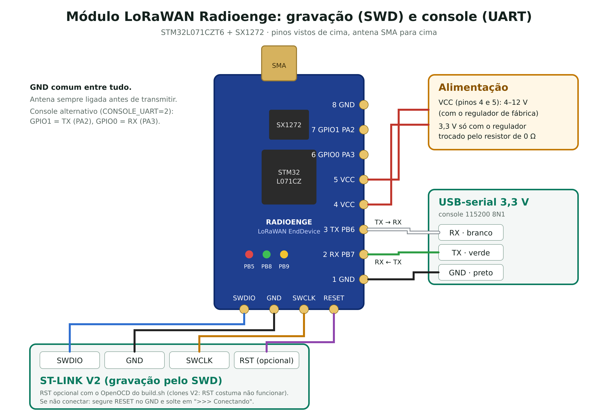
</p>

| ST-LINK V2 | Módulo |
|---|---|
| SWDIO | pad **SWDIO** (PA13) |
| SWCLK | pad **SWCLK** (PA14) |
| GND | pad **GND** |
| RST | pad **RESET** (NRST); opcional com o OpenOCD (veja abaixo) |
| 3,3 V | ver abaixo |

| USB-serial (3,3 V) | Módulo |
|---|---|
| RX | pino **3** (TX, PB6) |
| TX | pino **2** (RX, PB7) |
| GND | pino **1** (GND) |

- **Alimentação:** com o regulador de fábrica, alimente os pinos **4/5 (VCC) com 4–12 V** (ex.: 5 V do USB-serial). O projeto de referência grava alimentando o módulo pelo 3,3 V do ST-LINK, que funciona na prática, mas fica abaixo da faixa do regulador.
- Os pads de SWD ficam na borda de baixo do módulo. Solde uma barra de pinos para facilitar.
- **Conectar com o núcleo dormindo.** O firmware de fábrica (e este, entre eventos) deixa o STM32 em modo STOP, e aí o SWD não consegue parar o núcleo. O STM32CubeProgrammer e o st-flash usam a **conexão sob reset** (`mode=UR`, `--connect-under-reset`), que depende do fio de RST.
- **OpenOCD sem o fio de RST (padrão do `build.sh`).** Em muitos clones do ST-LINK V2 o pino RST não funciona em SWD (o `reset halt` dá `timed out while waiting for target halted`). Por isso o `build.sh` com `TOOL=openocd` liga o debug nos modos SLEEP/STOP/STANDBY (`mww 0x40015804 7`) e tenta parar o núcleo a cada 100 ms por até 10 s; as linhas `timed out` durante as tentativas são normais, o que vale é aparecer `>>> Núcleo parado`. Antes de gravar ele dá um reset por software (`reset halt`) e limpa as flags de erro da flash: um firmware anterior parado no meio pode deixar a flash travada (`failed erasing sectors`). Depois de gravar, o reset também é por software. O OpenOCD usa o `target/stm32l0_dual_bank.cfg`, porque o L071CZ tem dois bancos de 96 KB e o firmware passa de 96 KB (o `stm32l0.cfg` só declara o primeiro). Se nem assim conectar, segure o RESET no GND ao iniciar o comando e solte quando aparecer `>>> Conectando`. Com o fio de RST funcionando, `OCD_RESET=hw` volta à conexão sob reset.
- Testado em 08/11/2026 com um clone **ST-LINK V2J37S7** (RST sem efeito): `info`, `unlock` e gravação passaram a funcionar assim.
- Com um ST-LINK/V2-1 ou STLINK-V3, a porta serial virtual dele (TX/RX do conector) pode fazer o papel do USB-serial: aí o console fica em `/dev/ttyACM0`.
- O **ST-LINK/V2** (inclusive os clones "pendrive") **não tem porta serial**: para o console, a página WEB e o app, use um adaptador USB-serial externo. Veja o [passo a passo](#-passo-a-passo-adaptador-usb-serial-externo).

---

## 🔗 Passo a passo: adaptador USB-serial externo

O módulo da Radioenge **não tem conversor USB**: ele expõe só a UART do STM32 nos pinos 2 e 3. O **ST-LINK/V2 também não serve de porta serial**, porque ele só fala SWD (gravação e depuração) e não cria `/dev/ttyUSB*`, `/dev/ttyACM*` nem `COMx`. Por isso o console, a [página WEB](#-página-web-usb-serial-e-bluetooth-pelo-navegador) e o [app Android](#-app-android-usb-otg-e-bluetooth) precisam de um **adaptador USB-serial externo** (ou de um módulo BLE-serial, veja [Ligações do app](#ligações-do-app)). O ST-LINK e o adaptador podem ficar ligados ao mesmo tempo: um grava, o outro conversa com o firmware.

<p align="center">
  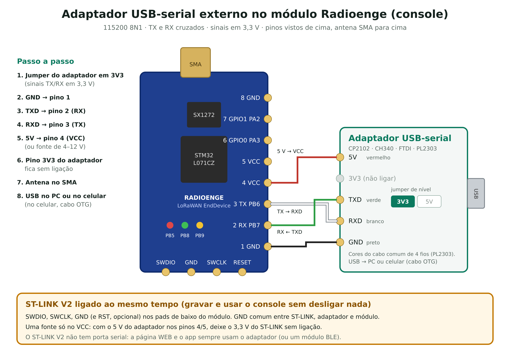
</p>

### 1. O que você precisa

| Item | Detalhe |
|---|---|
| Adaptador USB-serial (USB-TTL) | **CP2102/CP210x**, **CH340/CH341/CH9102**, **FTDI FT232R/FT231X** ou **PL2303**. São os chips que o app Android reconhece; a página WEB aceita qualquer porta serial do sistema |
| 4 fios jumper | fêmea-fêmea ou fêmea-macho, conforme a barra de pinos do módulo |
| Cabo ou adaptador OTG | só para usar o app no celular (no Android, a página WEB conecta apenas por Bluetooth) |
| Antena | no conector SMA, sempre ligada antes de o nó transmitir |

Os adaptadores mais comuns têm os pinos **3V3, 5V, TXD, RXD e GND** (alguns também DTR, CTS ou RTS, que não são usados aqui).

### 2. Deixar os sinais em 3,3 V

O STM32 trabalha em **3,3 V**. Antes de ligar ao módulo:

- **CH340 e FTDI** costumam ter um **jumper** (ou chave) que escolhe o nível dos sinais: coloque em **3V3**.
- **CP2102** normalmente já tem TX/RX em 3,3 V, mesmo quando a placa oferece um pino de 5 V.
- **Na dúvida, meça:** com o adaptador só no USB (sem ligar ao módulo), o **TXD em repouso** deve marcar perto de **3,3 V** em relação ao GND. Se marcar 5 V, mude o jumper ou use outro adaptador.

### 3. Fazer as ligações (com o USB desconectado)

| Adaptador USB-serial | Módulo Radioenge | Observação |
|---|---|---|
| **GND** | pino **1** (GND) | ligue primeiro |
| **TXD** | pino **2** (RX, PB7) | cruzado: o que um transmite o outro recebe |
| **RXD** | pino **3** (TX, PB6) | cruzado |
| **5V** | pino **4** (VCC) | alimenta o módulo (o regulador de fábrica aceita 4–12 V) |
| 3V3 | — | **não ligue**: fica abaixo da faixa do regulador do módulo |

**Alimentação, escolha uma só:**

- **Pelo adaptador** (mais simples): o 5V do adaptador no pino 4 (ou 5), como na tabela.
- **Por fonte externa** de 4–12 V nos pinos 4/5: aí **não** ligue o 5V do adaptador, mas mantenha o **GND** do adaptador ligado ao GND do módulo.

**Com o ST-LINK ligado ao mesmo tempo** (para gravar sem desfazer nada):

- ST-LINK nos pads de baixo: SWDIO, SWCLK, GND e RST (veja [Ligações para gravar e para o console](#-ligações-para-gravar-e-para-o-console)).
- **GND comum** entre ST-LINK, adaptador e módulo.
- **Uma fonte só no VCC**: com o 5V do adaptador alimentando o módulo, deixe o 3,3 V do ST-LINK **sem ligação**.

#### Exemplo: cabo PL2303 de 4 fios (vermelho, branco, preto e verde)

O cabo USB-serial azul de 4 fios (chip **PL2303HX** ou clone) não tem jumper nem pino 3V3: só os fios soltos com conector dupont fêmea. As cores mais comuns são estas:

<p align="center">
  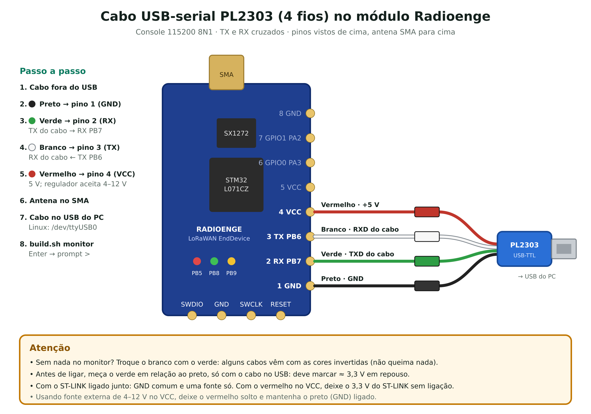
</p>

| Fio do cabo | Função no cabo | Módulo Radioenge |
|---|---|---|
| ⚫ **Preto** | GND | pino **1** (GND) |
| 🟢 **Verde** | TXD (sai do PC) | pino **2** (RX, PB7) |
| ⚪ **Branco** | RXD (entra no PC) | pino **3** (TX, PB6) |
| 🔴 **Vermelho** | +5 V do USB | pino **4** (VCC, regulador 4–12 V) |

- **Confira o nível antes de ligar:** só com o cabo no USB, o **verde** em relação ao **preto** deve marcar perto de **3,3 V** em repouso. Se der 5 V, não ligue no pino 2 sem um divisor resistivo (1 kΩ em série e 2 kΩ para o GND).
- **Cores invertidas:** alguns fabricantes trocam o branco com o verde. Se o console não mostrar nada, inverta os dois. Isso não danifica nada.
- **Fonte externa** de 4–12 V no VCC: deixe o vermelho solto (isolado) e mantenha o preto ligado ao GND.
- **Com o ST-LINK junto:** o vermelho alimenta o módulo e o 3,3 V do ST-LINK fica sem ligação; GND comum entre os três.
- No Linux ele aparece como `/dev/ttyUSB0` (driver `pl2303` já vem no kernel). No Windows, clones antigos do PL2303HX podem dar **código 10** com o driver atual da Prolific; nesse caso, instale uma versão antiga do driver.

**Console alternativo:** num firmware compilado com `CONSOLE_UART=2`, o console vai para a USART2. Aí o **TXD** do adaptador vai no pino **6** (GPIO0, PA3, RX) e o **RXD** no pino **7** (GPIO1, PA2, TX).

### 4. Conferir a porta no computador

Plugue o adaptador no USB e veja o nome que o sistema deu à porta:

**🐧 Linux**

```bash
sudo dmesg | tail -5             # ex.: cp210x converter now attached to ttyUSB0
ls /dev/ttyUSB*                  # CP210x, CH340, FTDI e PL2303 viram /dev/ttyUSB0, ttyUSB1...
ls -l /dev/serial/by-id/         # nome fixo, ex.: usb-Silicon_Labs_CP2102_USB_to_UART_Bridge_Controller_0001-if00-port0
groups | grep dialout            # precisa aparecer; senão: sudo usermod -aG dialout $USER e saia/entre da sessão
```

- A pasta `/dev/serial/by-id/` só existe enquanto algum adaptador está plugado.
- **CH340 no Ubuntu:** se a porta aparece e some logo em seguida, o serviço `brltty` (leitor de braille) tomou o adaptador. Remova com `sudo apt remove brltty` e plugue de novo.

**🪟 Windows:** Gerenciador de Dispositivos → **Portas (COM e LPT)** → por exemplo *Silicon Labs CP210x USB to UART Bridge (COM5)*. Se aparecer com ponto de exclamação, instale o driver do chip (links em [Windows](#-windows)). No **WSL2**, passe o adaptador com `usbipd attach --wsl --busid <BUSID>`; ele vira `/dev/ttyUSB0` no Ubuntu.

**🍎 macOS:** `ls /dev/cu.*` → `/dev/cu.usbserial-*` (CP210x, FTDI) ou `/dev/cu.wchusbserial*` (CH340). Use sempre o `/dev/cu.*`.

### 5. Testar com o terminal

```bash
sh scripts/build.sh monitor /dev/ttyUSB0     # /dev/ttyUSB0 é o padrão; no macOS use o /dev/cu.*
```

1. Tecle **Enter**: aparece o prompt `>` do console.
2. Digite `help` para ver os comandos e `status` para ver a sessão LoRaWAN.
3. Para ver o banner de início, aperte o RESET do módulo ou digite `reboot`.
4. Saia com **Ctrl+A** e depois **Ctrl+X** (picocom) ou **Ctrl+]** (miniterm).

No Windows nativo: `python -m serial.tools.miniterm --eol CRLF COM5 115200` (troque `COM5` pela sua porta) ou o PuTTY em *Serial*, 115200.

Se nada aparecer, veja a [Solução de problemas](#-solução-de-problemas): quase sempre é TX/RX invertido ou o nível do jumper.

### 6. Usar com a página WEB e o app

- **Página WEB (computador):** feche o terminal (a porta só abre num programa por vez), rode `sh scripts/build.sh web`, clique em **Conectar USB-serial** e escolha o adaptador na lista do navegador (por exemplo *CP2102 USB to UART Bridge Controller (ttyUSB0)*). O ST-LINK/V2 não aparece nessa lista, porque não tem porta serial.
- **App Android:** ligue o adaptador ao celular com o cabo OTG. O Android pergunta se quer abrir o **Radioenge Node ABP e OTAA**: marque *usar por padrão* e confirme. O celular alimenta o adaptador, e o 5V dele alimenta o módulo pelo pino 4.
- **Sem fio:** troque o adaptador por um módulo BLE-serial nos mesmos pinos 2/3 (veja [Ligações do app](#ligações-do-app)).

---

## 🔓 Primeira gravação: tirar a proteção (RDP)

O STM32 sai da Radioenge com a **proteção de leitura nível 1 (RDP = 0xBB)**. Confira antes com `sh scripts/build.sh info`: se `0x1ff80000` terminar em `aa`, o módulo já está sem proteção e esta etapa pode ser pulada. Antes da primeira gravação ela precisa ir para **0xAA**, e essa troca **apaga toda a flash e a EEPROM**, inclusive o firmware AT. Isso é feito **uma vez por módulo**.

```bash
sh scripts/build.sh unlock       # pede confirmação: digite APAGAR
```

Depois **desligue e ligue** o módulo e siga para o **Do zero** da próxima seção.

Pela interface gráfica do STM32CubeProgrammer: **ST-LINK → Port: SWD → Mode: Under reset → Reset mode: Hardware reset → Connect**, aba **OB** (*Option bytes*) → **Read Out Protection → RDP = AA → Apply**.

### Exemplo real: clone ST-LINK V2 sem RST, com OpenOCD (08/11/2026)

Sequência que funcionou num módulo com um clone **ST-LINK V2J37S7**, cujo pino RST não age sobre o módulo, usando o OpenOCD 0.12.0 no Linux. Ligações: SWDIO, SWCLK e GND do ST-LINK nos pads de baixo. O módulo foi alimentado pelo fio vermelho de um [cabo PL2303](#exemplo-cabo-pl2303-de-4-fios-vermelho-branco-preto-e-verde) no VCC, ou pelo 3,3 V do ST-LINK quando só ele estava ligado.

**1. Ver o chip e o RDP**

```bash
sh scripts/build.sh info
```

```text
>>> Conectando (até 10 s). Se não conectar, segure o RESET no GND e solte agora.
[stm32l0.cpu] halted due to debug-request, current mode: Thread
>>> Núcleo parado
Info : Device: STM32L0xx (Cat.5)
Info : STM32L flash has dual banks. Bank (0) size is 96kb, base address is 0x8000000
0x1ff80000: ff5500aa
```

O último byte de `0x1FF80000` é o RDP: **`aa` = nível 0** (sem proteção) e **`bb` (ou outro valor) = nível 1**, que é o de fábrica. `cc` seria o nível 2, que bloqueia o SWD para sempre. Um módulo que já foi regravado (por exemplo com o LMiC) aparece com `aa`, e aí o `unlock` não é obrigatório.

**2. Tirar a proteção (só se não for `aa`)**

```bash
sh scripts/build.sh unlock       # digite APAGAR
```

```text
STM32Lx unlocked, takes effect after power cycle.
```

**3. Desligar e ligar a alimentação**

A troca das option bytes só vale depois de **cortar a energia**: tire o USB-serial e o ST-LINK, espere uns 3 s e ligue de novo. Um reset não basta. Se você gravar sem esse ciclo de energia, o apagamento falha com `Error: failed erasing sectors 0 to 23`.

**4. Gravar**

```bash
sh scripts/build.sh flash
```

```text
erased sectors 0 through 23 on flash bank 0 in 6.437502s
erased sectors 0 through 23 on flash bank 1 in 6.409852s
6144 bytes written at address 0x08080000
verified 6144 bytes in 0.298574s (20.096 KiB/s)
wrote 106496 bytes from file .../build/radioenge_node_abp.elf in 27.796112s (3.742 KiB/s)
verified 103536 bytes in 4.107832s (24.614 KiB/s)
==> Gravado.
```

(Esta gravação foi feita com o antigo firmware ABP separado. Hoje o arquivo é `build/radioenge_node_abp_otaa.elf`.)

(Saída do **Do zero**: `erase` seguido de `flash`.) A partir daí o firmware deste projeto roda e dorme em STOP com o debug desligado. Para regravar com o clone sem RST, **segure o RESET no GND antes de rodar o comando** e solte em `>>> Conectando`, ou compile com `USE_DEBUGGER=ON` (o SWD continua acessível dormindo, ao custo de mais consumo).

**O que já deu errado e como foi resolvido**

| Sintoma | Causa | Solução no `build.sh` |
|---|---|---|
| `timed out while waiting for target halted` em todos os comandos | O firmware deixa o STM32 em STOP, e o RST do clone não faz a conexão sob reset | `OCD_RESET=sw` (padrão): liga o debug no STOP (`DBGMCU_CR = 7`) e tenta o `halt` a cada 100 ms por 10 s. As linhas `timed out` durante as tentativas são normais |
| `** Unable to reset target **` ao gravar | O `program` do OpenOCD sempre faz `reset init` pelo pino RST | A gravação usa `flash write_image erase`, `verify_image` e `reset run` (reset por software) |
| `failed erasing sectors 0 to 23` com o RDP já em `aa` | O firmware anterior, parado no meio, deixou a controladora da flash travada | Antes de gravar: `reset halt` (por software) e limpeza do `FLASH_SR` (`mww 0x40022018 0x00032F02`) |
| `stm32lx mass erase failed` no `erase` | O `mass_erase` do OpenOCD no L0 passa o RDP para 1 e de volta para 0, e o recarregamento das option bytes derruba a conexão sem o fio de RST | O `erase` apaga os dois bancos por setor e grava zeros na EEPROM (6 KB em 0x08080000) |
| `failed erasing` logo depois do `unlock` | As option bytes ainda não foram carregadas | Desligar e ligar a alimentação |
| `Error: init mode failed (unable to connect to the target)` ao **regravar** | Este firmware, compilado sem `USE_DEBUGGER`, desliga o debug no STOP (`HAL_DBGMCU_DisableDBGStopMode`): dormindo, o SWD nem responde. Sem o fio de RST, a conexão por software não alcança o núcleo | Segure o RESET no GND **antes** de rodar o comando e solte em `>>> Conectando`. Para não precisar disso a cada gravação, compile com `USE_DEBUGGER=ON` durante o desenvolvimento |
| Gravação para em 96 KB | O `target/stm32l0.cfg` só declara o banco 0 (96 KB); o firmware tem cerca de 128 KB | O OpenOCD usa o `target/stm32l0_dual_bank.cfg` (bancos 0x08000000 e 0x08018000) |

**Registradores úteis** (com o núcleo parado, `mdw <endereço>`):

| Endereço | Registrador | Valor visto | Leitura |
|---|---|---|---|
| `0x40022004` | `FLASH_PECR` | `00000007` | flash e option bytes travadas (normal em repouso) |
| `0x40022018` | `FLASH_SR` | `0000000c` | `READY` + `ENDHV`, sem flags de erro |
| `0x4002201C` | `FLASH_OPTR` | `807900aa` | byte baixo `aa` = RDP nível 0 |
| `0x40022020` | `FLASH_WRPROT1` | `00000000` | nenhum setor com proteção de escrita |
| `0x1FF80000` | option bytes (RDP) | `ff5500aa` | `aa` = nível 0 |

Apagar a flash à mão, sem o fio de RST:

```bash
openocd -f interface/stlink.cfg -f target/stm32l0_dual_bank.cfg -c "reset_config none" -c "init" \
  -c 'for {set i 0} {$i < 100} {incr i} { catch {mww 0x40015804 7}; if {![catch {halt 100}]} break }' \
  -c "catch {reset halt}" -c "mww 0x40022018 0x00032F02" \
  -c "flash erase_sector 0 0 last" -c "flash erase_sector 1 0 last" -c "shutdown"
```

---

## 🛠️ Compilar e gravar

### Passo a passo

1. **Ligações:** ST-LINK no SWD do módulo e USB-serial no console ([Ligações](#-ligações-para-gravar-e-para-o-console)). Alimente o módulo.
2. **Conferir:** `sh scripts/build.sh info` precisa mostrar o ST-LINK e o STM32L07x.
3. **Só na primeira vez em cada módulo:** `sh scripts/build.sh unlock`, e desligue e ligue o módulo.
4. **Gravar:** o comando **Do zero** (módulo novo, ou para voltar tudo ao padrão de fábrica) ou o **Atualizar** (mantém a configuração; é o caminho para quem vem do antigo firmware ABP ou OTAA). Para trocar entre ABP e OTAA não é preciso regravar: use `AT+NJM` ([ABP e OTAA num firmware só](#-abp-e-otaa-num-firmware-só)).
5. **Console:** o comando de gravação já abre o console. Aparece o banner `LoRaWAN Node Radioenge Atuadores e Sensores` e depois, em OTAA, o JOIN (`[JOIN] Conectado! DevAddr ...`) e o primeiro uplink; em ABP, o primeiro uplink (`[TX] FCnt 0 ...`).
6. **ChirpStack:** cadastre o dispositivo com os valores do console ([Cadastro no ChirpStack](#-cadastro-no-chirpstack)) e ajuste a configuração com `set` / `save` ou pelo app.

### Comandos do `scripts/build.sh`

| Comando | O que faz |
|---|---|
| `sh scripts/build.sh build` | compila → `build/radioenge_node_abp_otaa.{elf,hex,bin}` (ABP e OTAA no mesmo binário) |
| `sh scripts/build.sh clean` | apaga `build/` |
| `sh scripts/build.sh unlock` | RDP 0xBB → 0xAA (só na 1ª vez; apaga o firmware AT) |
| `sh scripts/build.sh erase` | apaga a flash **e a EEPROM** (configuração, sessão LoRaWAN, FCnt, DevNonce) |
| `sh scripts/build.sh upload` | compila e grava, sem abrir o console |
| `sh scripts/build.sh flash [porta]` | compila, grava e abre o console (padrão `/dev/ttyUSB0`) |
| `sh scripts/build.sh monitor [porta]` | só abre o console, 115200 8N1 (picocom: sair com **Ctrl+A** e **Ctrl+X**; miniterm: **Ctrl+]**) |
| `sh scripts/build.sh info` | mostra o ST-LINK e o STM32 conectados |
| `sh scripts/build.sh web [porta]` | abre a [página WEB](#-página-web-usb-serial-e-bluetooth-pelo-navegador) em `http://localhost:8101` |

| Variável | Efeito |
|---|---|
| `TOOL=cubeprog` / `openocd` / `stflash` | escolhe a ferramenta de gravação (padrão: a primeira encontrada) |
| `CONSOLE_UART=2` | console em GPIO1 (TX) / GPIO0 (RX) em vez dos pinos 2/3 |
| `RTC_FORCE_LSI=ON` | ignora o cristal de 32,768 kHz (teste do modo LSI) |
| `USE_DEBUGGER=ON` | mantém o SWD ativo em SLEEP/STOP (gasta mais). Com ele, o OpenOCD regrava sem o fio de RST e sem segurar o RESET. Use durante o desenvolvimento e compile sem ele (padrão) para medir o consumo |
| `STM32CLT_PATH=/caminho` | STM32CubeCLT fora do caminho padrão |
| `CONFIRM=APAGAR` | responde a pergunta do `unlock` (para scripts) |
| `OCD_RESET=sw` / `hw` | OpenOCD: `sw` (padrão) conecta sem o fio de RST, tentando parar o núcleo por 10 s; `hw` usa o RST do ST-LINK (conexão sob reset) |

### Gravar e acompanhar o log

Os comandos abaixo seguem o mesmo padrão dos projetos ESP32 e valem para Linux e WSL2. No macOS e no Windows nativo, veja as variações logo depois.

- A saída da compilação, da gravação e do console vai para `logs/radioenge_<data>.log`.
- Uma cópia sem códigos de cor vai para `logs/radioenge_<data>_limpo.log`.
- A porta é a do **adaptador USB-serial do console**, normalmente `/dev/ttyUSB0`. Com o console na porta virtual de um ST-LINK/V2-1 ou V3, use `/dev/ttyACM0`. Se houver outra placa ligada, confira com `ls /dev/ttyUSB* /dev/ttyACM*`.

| Comando | O que faz | EEPROM (configuração e sessão) |
|---|---|---|
| **Primeira gravação** | tira o RDP (pede `APAGAR`). Depois, desligue e ligue o módulo e rode o **Do zero** | **apagada**, junto com o firmware AT |
| **Do zero** | libera a porta, apaga `build/`, apaga a flash e a EEPROM (`erase`), compila, grava e abre o console | **apagada**: volta ao `app/node_build.h` |
| **Atualizar** | libera a porta, apaga `build/`, compila do zero, grava e abre o console | mantida |
| **Só monitorar** | libera a porta e abre o console, sem compilar nem gravar | mantida |

`sudo fuser -k <porta> 2>/dev/null ;` fecha o programa que estiver usando a porta serial, como um console esquecido em outro terminal. A linha termina com `;` e não com `&&` de propósito: quando a porta já está livre, o `fuser` retorna erro e a sequência continua mesmo assim.

**O que o Do zero apaga.** O `erase` apaga a flash e a EEPROM inteira. Use num módulo novo ou para voltar tudo ao padrão de fábrica. O nó volta aos valores do `app/node_build.h` (ativação **OTAA**) e:

- **OTAA:** o **DevNonce volta a 0**: no ChirpStack, limpe os DevNonces do dispositivo, senão o JOIN é recusado com *DevNonce has already been used*. Para voltar ao padrão sem zerar o DevNonce, use o comando `factory` no console.
- **ABP:** configure de novo `njm 0`, DevAddr e chaves (ou importe o JSON exportado antes), e o **FCnt volta a 0**: no ChirpStack, zere os contadores do dispositivo ou marque *Disable frame-counter validation*.

Para regravar mantendo a configuração (e a ativação em uso), use o **Atualizar**. Trocar entre ABP e OTAA não pede regravação: é o `AT+NJM`.

#### Node_STM32_SX1272_RD49C_Radioenge_ABP_e_OTAA_IO (`/dev/ttyUSB0`)

**Primeira gravação:** tira a proteção de leitura (uma vez por módulo)

```bash
cd ~/Apps/lorawan_workspace/Node_STM32_SX1272_RD49C_Radioenge_ABP_e_OTAA_IO && \
mkdir -p logs && \
LOG=logs/radioenge_unlock_$(date +%Y%m%d_%H%M%S).log && \
script -f -q -c "sh scripts/build.sh info && sh scripts/build.sh unlock" "$LOG" ; \
sed -r 's/\x1B\[[0-9;]*[mK]//g; s/\r//g' "$LOG" > "${LOG%.log}_limpo.log" && \
echo "Logs salvos em: $LOG e ${LOG%.log}_limpo.log"
```

**Do zero:** apaga a flash e a EEPROM, compila do zero, grava e abre o console

```bash
sudo fuser -k /dev/ttyUSB0 2>/dev/null ; \
cd ~/Apps/lorawan_workspace/Node_STM32_SX1272_RD49C_Radioenge_ABP_e_OTAA_IO && \
mkdir -p logs && \
LOG=logs/radioenge_$(date +%Y%m%d_%H%M%S).log && \
script -f -q -c "rm -rf build && sh scripts/build.sh erase && sh scripts/build.sh flash /dev/ttyUSB0" "$LOG" ; \
sed -r 's/\x1B\[[0-9;]*[mK]//g; s/\r//g' "$LOG" > "${LOG%.log}_limpo.log" && \
echo "Logs salvos em: $LOG e ${LOG%.log}_limpo.log"
```

**Atualizar:** compila do zero, grava e abre o console (mantém a configuração, a ativação ABP/OTAA, a sessão, o FCnt e o DevNonce; também para quem vem do antigo firmware ABP ou OTAA)

```bash
sudo fuser -k /dev/ttyUSB0 2>/dev/null ; \
cd ~/Apps/lorawan_workspace/Node_STM32_SX1272_RD49C_Radioenge_ABP_e_OTAA_IO && \
mkdir -p logs && \
LOG=logs/radioenge_update_$(date +%Y%m%d_%H%M%S).log && \
script -f -q -c "rm -rf build && sh scripts/build.sh flash /dev/ttyUSB0" "$LOG" ; \
sed -r 's/\x1B\[[0-9;]*[mK]//g; s/\r//g' "$LOG" > "${LOG%.log}_limpo.log" && \
echo "Logs salvos em: $LOG e ${LOG%.log}_limpo.log"
```

**Só monitorar:** sem compilar nem gravar

```bash
sudo fuser -k /dev/ttyUSB0 2>/dev/null ; \
cd ~/Apps/lorawan_workspace/Node_STM32_SX1272_RD49C_Radioenge_ABP_e_OTAA_IO && \
mkdir -p logs && \
LOG=logs/radioenge_monitor_$(date +%Y%m%d_%H%M%S).log && \
script -f -q -c "sh scripts/build.sh monitor /dev/ttyUSB0" "$LOG" ; \
sed -r 's/\x1B\[[0-9;]*[mK]//g; s/\r//g' "$LOG" > "${LOG%.log}_limpo.log" && \
echo "Logs salvos em: $LOG e ${LOG%.log}_limpo.log"
```

#### Compilar sem gravar

```bash
cd ~/Apps/lorawan_workspace/Node_STM32_SX1272_RD49C_Radioenge_ABP_e_OTAA_IO && \
rm -rf build && sh scripts/build.sh build
```

#### macOS

O `script` do macOS tem outra sintaxe (`script -q <arquivo> <comando>`, sem `-c` e `-f`), e o `fuser` não existe. O **Do zero** fica assim (troque a porta pela sua `/dev/cu.*`):

```bash
cd ~/Apps/lorawan_workspace/Node_STM32_SX1272_RD49C_Radioenge_ABP_e_OTAA_IO && \
mkdir -p logs && \
LOG=logs/radioenge_$(date +%Y%m%d_%H%M%S).log && \
script -q "$LOG" sh -c "rm -rf build && sh scripts/build.sh erase && sh scripts/build.sh flash /dev/cu.usbserial-0001" ; \
sed -r 's/\x1B\[[0-9;]*[mK]//g; s/\r//g' "$LOG" > "${LOG%.log}_limpo.log" && \
echo "Logs salvos em: $LOG e ${LOG%.log}_limpo.log"
```

No **Atualizar**, tire o `sh scripts/build.sh erase &&`. No **Só monitorar**, use só `sh scripts/build.sh monitor /dev/cu.usbserial-0001`. Sem log, os atalhos funcionam iguais: `sh scripts/build.sh flash /dev/cu.usbserial-0001`.

#### Windows nativo (PowerShell)

Na pasta do projeto (troque `COM5` pela porta do adaptador USB-serial):

```powershell
cd C:\Apps\lorawan_workspace
git clone https://github.com/AdailSilva/Node_STM32_SX1272_RD49C_Radioenge_ABP_e_OTAA_IO.git
cd Node_STM32_SX1272_RD49C_Radioenge_ABP_e_OTAA_IO

# compilar
cmake -S . -B build -G Ninja -DCMAKE_TOOLCHAIN_FILE=cmake/toolchain-arm-none-eabi.cmake
cmake --build build

# gravar e abrir o console
STM32_Programmer_CLI -c port=SWD mode=UR reset=HWrst -w build\radioenge_node_abp_otaa.hex -v -rst
python -m serial.tools.miniterm --eol CRLF COM5 115200
```

| Para | No PowerShell |
|---|---|
| Primeira gravação (RDP) | `STM32_Programmer_CLI -c port=SWD mode=UR reset=HWrst -ob RDP=0xAA` (apaga o firmware AT); depois desligue e ligue o módulo |
| Compilar do zero | `Remove-Item -Recurse -Force build -ErrorAction SilentlyContinue` e depois os dois `cmake` |
| Apagar a flash | `STM32_Programmer_CLI -c port=SWD mode=UR reset=HWrst -e all` |
| Apagar a EEPROM | `New-Item -ItemType Directory -Force build \| Out-Null; [IO.File]::WriteAllBytes("$PWD\build\eeprom_zeros.bin", (New-Object byte[] 6144))` e `STM32_Programmer_CLI -c port=SWD mode=UR reset=HWrst -w build\eeprom_zeros.bin 0x08080000` |
| Ver o ST-LINK e o STM32 | `STM32_Programmer_CLI -l st-link` e `STM32_Programmer_CLI -c port=SWD mode=UR reset=HWrst` |
| Só monitorar | `python -m serial.tools.miniterm --eol CRLF COM5 115200` (sair: **Ctrl+]**), ou o PuTTY em *Serial*, `COM5`, 115200 |
| Salvar o log | `Start-Transcript -Path logs\radioenge_$(Get-Date -Format yyyyMMdd_HHmmss).log` antes, `Stop-Transcript` depois |

#### Gravação manual (qualquer sistema)

```bash
# STM32CubeProgrammer (STM32CubeCLT)
STM32_Programmer_CLI -c port=SWD mode=UR reset=HWrst -w build/radioenge_node_abp_otaa.hex -v -rst
# OpenOCD com o fio de RST funcionando (conexão sob reset)
openocd -f interface/stlink.cfg -f target/stm32l0_dual_bank.cfg \
  -c "reset_config srst_only srst_nogate connect_assert_srst" \
  -c "program build/radioenge_node_abp_otaa.elf verify reset exit"
# OpenOCD sem o fio de RST (clones do ST-LINK V2): tenta parar o núcleo por 10 s
openocd -f interface/stlink.cfg -f target/stm32l0_dual_bank.cfg -c "reset_config none" -c "init" \
  -c 'for {set i 0} {$i < 100} {incr i} { catch {mww 0x40015804 7}; if {![catch {halt 100}]} break }' \
  -c "catch {reset halt}" -c "mww 0x40022018 0x00032F02" \
  -c "flash write_image erase build/radioenge_node_abp_otaa.elf" -c "verify_image build/radioenge_node_abp_otaa.elf" \
  -c "reset run" -c "shutdown"
# st-flash (stlink-tools)
st-flash --reset --connect-under-reset --format ihex write build/radioenge_node_abp_otaa.hex
```

#### Pela interface gráfica do STM32CubeProgrammer

1. **ST-LINK** (canto direito) → *Port* **SWD**, *Mode* **Under reset**, *Reset mode* **Hardware reset** → **Connect**.
2. Aba **Erasing & Programming** → *File path*: `build/radioenge_node_abp_otaa.hex` → marque **Verify programming** e **Run after programming** → **Start Programming**.
3. **Disconnect** e abra o console (PuTTY, picocom ou `sh scripts/build.sh monitor`).

Tamanho atual (com os comandos AT): ~128 KB de flash (de 192 KB) e ~14 KB de RAM estática (de 20 KB; o resto é pilha e heap).

---

## ⌨️ Console (UART)

**115200 8N1** (troque com `AT+BAUDRATE`), pinos 2 (RX) e 3 (TX) do módulo. Os comandos de texto abaixo e os **comandos AT** da Radioenge ([seção](#-comandos-at-compatíveis-com-o-firmware-radioenge)) entram na mesma porta. Ao ligar:

```
==================================================
 LoRaWAN Node Radioenge Atuadores e Sensores  v0.0.1
 LoRaMac-node v4.7.1 · STM32L071CZ + SX1272 · AU915
 Comandos AT do firmware Radioenge (AT+...) e console de texto
==================================================
Relógio do RTC : LSI calibrado pelo HSI16, 37012 Hz, ~10000 ppm
                 Sem cristal de 32,768 kHz: Classes A e C ok; Classe B instável.
Configuração   : EEPROM
Reinício       : pino NRST (ST-LINK ou botão)
Ativação       : OTAA
DevEUI         : 2034353834574E08 (do ID único do STM32)
JoinEUI        : B2F634A1E62C10C7
Classe         : A · uplink a cada 60 s na FPort 101
Digite 'help' para ver os comandos.

[LoRaWAN] Iniciando o JOIN (OTAA)...
[JOIN] Join-request enviado (tentativa 1, DevNonce 1).
[JOIN] Conectado! DevAddr 01A2B3C4, DR2 (Join-request em 916,8 MHz).
[TX] FCnt 0 · não confirmado · DR5 · 917,2 MHz · 14 dBm · canal 10 · porta 101 · 14 bytes
```

Em ABP (`AT+NJM=0`), o mesmo boot mostra a ativação, o DevAddr e a sessão restaurada da EEPROM:

```
Ativação       : ABP (padrão de fábrica: OTAA)
DevEUI         : 2034353834574E08 (do ID único do STM32)
DevAddr        : 260CAFE1
Classe         : A · uplink a cada 60 s na FPort 101
Digite 'help' para ver os comandos.

[LoRaWAN] Sessão restaurada da EEPROM (DevAddr 260CAFE1).
[TX] FCnt 42 · não confirmado · DR5 · 917,2 MHz · 14 dBm · canal 10 · porta 101 · 14 bytes
```

Cada envio mostra a **frequência** e a **potência** usadas, lidas do rádio no instante da transmissão (o canal muda a cada envio dentro da sub-banda; com a SB1, de 916,8 a 918,2 MHz, mais 917,5 MHz no canal de 500 kHz). O Join-request também: `[JOIN] Sem Join-accept (Join-request em 917,4 MHz, DR2, 14 dBm)`. A página WEB mostra a última no card **Próximo envio** (`jstatus`: `freq` em Hz e `txpow` em dBm).

**DR e potência do JOIN não são os configurados**, e isso é o normal no AU915: a LoRaMac-node escolhe o canal e o DR de cada Join-request pelas regras da região. Em cada 9 tentativas, 8 vão nos canais de 125 kHz da sub-banda em **DR2** (SF10, o menor DR permitido com o dwell time de 400 ms) e 1 vai no canal de 500 kHz em **DR6** (SF8/500 kHz, 917,5 MHz na SB1), sempre com a **potência máxima**. A potência mostrada é a que o SX1272 aplica de fato (até +20 dBm pelo PA_BOOST), não o valor de EIRP que a MAC pede. O `dr` e o `txpower` da configuração valem para os **uplinks depois do JOIN** (com ADR desligado; com ADR, o servidor ajusta).

| Comando | O que faz |
|---|---|
| `help` | lista os comandos |
| `status` | sessão, DevAddr, classe em uso, beacon, contadores, último downlink, hora GPS, relógio, energia |
| `config` | configuração em uso |
| `keys` | chaves da sessão LoRaWAN em uso: DevAddr, NwkSKey e AppSKey (no OTAA, derivadas da AppKey no JOIN aceito; no ABP, as configuradas). `jkeys` é a versão em JSON (`@K {...}`) usada pela página WEB e pelo app |
| `set <campo> <valor>` | altera um campo na RAM (`set` sozinho lista os campos) |
| `save` | grava na EEPROM e aplica. Credenciais e canais reiniciam a sessão LoRaWAN |
| `class A\|B\|C` | troca a classe agora e grava |
| `send [texto]` / `send hex:A1B2` | uplink agora (sem argumento: o payload configurado) |
| `join` | OTAA: refaz o JOIN · ABP: reativa a sessão ABP (reaplica DevAddr e chaves da EEPROM) |
| `devtime` | pede a hora ao servidor (`DeviceTimeReq`) |
| `clock` / `clock recal` | relógio do RTC; mede o LSI de novo |
| `factory` / `factory nonce` | volta ao padrão de fábrica (o DevNonce é mantido; com `nonce`, zera também) |
| `reboot` | reinicia |
| `mode app` / `mode human` | modo de máquina usado pelo app (sem eco/prompt, respostas `@OK`/`@ERR`) / volta ao terminal |
| `info` / `jstatus` / `jconfig` / `jio` | firmware, status, configuração e GPIOs em JSON (`@I`, `@S`, `@C`, `@IO`), para a página e o app |
| `rele` · `rele <canal\|todos> liga\|desliga\|alterna` · `rele pulso <canal> <0\|1> <ms>` | estado dos relés; liga/desliga/alterna; pulso (volta sozinho ao estado anterior) |
| `pzem` · `pzem ler [canal]` | últimas leituras dos PZEM-004T; `ler` lê agora (o resultado sai como `PZEM0: ...`) |
| `jdev` | relés, PZEM e protocolo V1 em JSON (`@DV`), para a página e o app |
| `set uplinkmode 0\|1` | conteúdo do uplink periódico: 0 payload fixo, 1 telemetria ADAILSILVA_V1 (porta 20) |
| `log` / `log clear` | **log do nó guardado em RAM** (até 3 KB, o mais antigo primeiro, com `[hh:mm:ss]` = tempo ligado) / apaga. Guarda o que o firmware imprime por conta própria (banner, `[TX]`, `[RX]`, `[JOIN]`, `[Classe]`...) e os comandos que mudam algo (`> set interval 30`; as chaves aparecem como `(oculta)`); as respostas das consultas (`status`, `jstatus`...) não entram. Um reinício apaga |
| `jlog [de]` | o mesmo log em blocos para a página e o app: linhas `@L <texto>` e, no fim, `@LN {"start","next","end","size"}`; repita `jlog <next>` até `next == end` |
| `diag` / `jdiag` | **autoteste do nó**: rádio SX1272 no SPI (registrador de versão 0x22), configuração na EEPROM, credenciais, sessão LoRaWAN, uplinks/erros/ACKs, último downlink, relógio do RTC, hora da rede, VDD, pico de uso da pilha, log em RAM e causa do último reinício. `jdiag` responde `@D {json}` |
| `classes` | resumo das classes LoRaWAN A, B e C e o que este nó suporta (o mesmo da página **Classes** e do app) |

Campos do `set`:

| Campo | Valores | Padrão |
|---|---|---|
| `njm` | **0 = ABP, 1 = OTAA** (o mesmo do `AT+NJM`): troca a ativação sem regravar; ao salvar, a sessão LoRaWAN recomeça | 1 (OTAA) |
| `ajoin` | 0/1: JOIN automático no boot (OTAA, `AT+AJOIN`) | 1 |
| `deveui` | 16 dígitos hex, ou `auto` (ID único do STM32). No ABP, só identificação | `auto` |
| **OTAA:** `joineui` | 16 dígitos hex | `B2F634A1E62C10C7` |
| **OTAA:** `appkey` | 32 dígitos hex (também vira a NwkKey, LoRaWAN 1.0.x) | a mesma cadastrada no ChirpStack |
| **OTAA:** `nwkkey` | 32 dígitos hex (só LoRaWAN 1.1) | igual à AppKey |
| **ABP:** `devaddr` | 8 dígitos hex | `00000000` (configure!) |
| **ABP:** `nwkskey` | 32 dígitos hex (vale para as 3 chaves de rede do 1.0.x) | zeros (configure!) |
| **ABP:** `appskey` | 32 dígitos hex | zeros (configure!) |
| **ABP:** `netid` | hex, 24 bits | `000000` |
| `subband` | 0–7 (SB *n* = canais 8n…8n+7 + 500 kHz 64+n, como no ChirpStack `au915_n`) ou 8 = todos os canais | 1 (canais 8–15 + 65) |
| `ch500` | 0/1: canal de 500 kHz da sub-banda | 1 |
| `adr` | 0/1 | 0 |
| `dr` | 2–6 (AU915 com dwell time de 400 ms: DR0/DR1 não são permitidos; DR2 leva até 11 bytes) | 5 (SF7/BW125) |
| `txpower` | 2–20 dBm (conduzida, aproximada). Acima de 17 dBm o SX1272 liga o modo +20 dBm, que o datasheet limita a ~1 % do tempo de TX | 14 |
| `class` | A, B ou C | A |
| `ping` | 0–7: ping slot a cada 2^n s (Classe B) | 4 (16 s) |
| `interval` | 5–86400 s | 60 |
| `port` | 1–223 | 101 |
| `confirmed` | 0/1 | 0 |
| `payload` / `payloadhex` | texto ou hexadecimal, até 51 bytes | `AdailSilva-IoT` |
| `rst`, `rstport`, `rstcmd`, `rstdelay` | reset remoto | ligado, 101, `ADA1DEADBEEF0D0A`, 2000 ms |
| `cmdport` | 0 (desligado) ou 1–223 | 102 |
| `lowpower` | 0 sem STOP, 1 STOP + console pronto, 2 STOP econômico | 1 |
| `extpower` | 0/1: alimentação externa (nível de bateria = 0 no `DevStatusAns`) | 1 |
| `leds` | 0/1 | 1 |
| `verbose` | 0/1: diagnóstico de sessão a cada envio (DevAddr, NwkSKey, AppSKey, *Frame raw*, FCnt e MIC). Vale na hora | 1 |

Exemplo:

```
> set interval 30
OK (falta 'save').
*> set class C
OK (falta 'save').
*> save
Gravado.
[Classe] Agora em Classe C.
```

Com `verbose 1` (padrão), cada quadro que vai ao ar aparece nos Logs. O quadro é copiado no `Send( )` do rádio (`board/RadioengeL071/sx1272-board.c`), já cifrado e com o MIC, e impresso pelo laço principal, fora do tempo crítico da MAC. `FCnt/up` é o FCnt *deste* quadro (o `seqnoUp` da LMiC mostra o próximo, +1). O bloco sai só no console (página, app e *Baixar sessão*); o log em RAM do nó não guarda as chaves.

```
EV_TXSTART
LoRaMac DevAddr: 0x011177D1
LoRaMac NwkSKey: 2B6FFF80567C69BF3E2184AE1BBF3E8C
LoRaMac AppSKey: DBF70FAF9C85242EA343DDE16BFFC849

Frame raw: 40 D1 77 11 01 00 02 00 65 ... 3F 08 EA 12
FCnt/up: 2
FCnt/down: 1
  MIC: 3F-08-EA-12
Packet queued.
EV_TXCOMPLETE (includes waiting for RX windows)
[TX] FCnt 2 · não confirmado · DR5 · 917,0 MHz · 20 dBm · canal 9 · porta 101 · 14 bytes
```

O Join-request também aparece (`EV_TXSTART (Join-request)`, com JoinEUI, DevEUI, DevNonce, *Frame raw* e MIC), e cada quadro recebido nas janelas de RX sai como `Frame raw (RX): ...`.

#### Formato do log — igual nos três nós (`[TX]` / `[RX]`)

Os nós ESP32 (ABP e OTAA, LMiC) e o nó Radioenge (LoRaMac-node) imprimem **as mesmas linhas, na mesma ordem**. Só o prefixo das chaves muda (`LMiC` ou `LoRaMac`), para dizer qual pilha gerou o quadro. O bloco de diagnóstico (chaves, *Frame raw*, FCnt e MIC) sai com o **Diagnóstico de sessão** ligado (`verbose 1`); sem ele, ficam só o cabeçalho e as linhas `[TX]`/`[RX]`.

**Uplink**

```
EV_TXSTART
LMiC DevAddr: 0x00B4EE08                  ┐
LMiC NwkSKey: 1CBA2DF8550A20705E019FE28759C753
LMiC AppSKey: 91BC8CAEB18DE97BAABD485787FAC3B4
                                          │ diagnóstico de sessão
Frame raw: 40 08 EE B4 00 00 CA 00 65 BF 7D … 08 7E A3 A7
FCnt/up: 202                              │ FCnt deste quadro
FCnt/down: 2                              │ último downlink recebido
  MIC: 08-7E-A3-A7                        ┘
Packet queued.
EV_TXCOMPLETE (includes waiting for RX windows)
[TX] FCnt 202 · não confirmado · DR5 · 917,0 MHz · 14 dBm · canal 9 · porta 101 · 14 bytes
```

**Downlink** (logo depois do `[TX]` do uplink que abriu a janela; na Classe C do Radioenge, a qualquer momento)

```
[RX] RX1 · DR13 · 924,5 MHz · porta 1 · 1 bytes FF · RSSI -34 dBm · SNR 6 dB · FCntDown 3
RX:ff:-34:6

Frame raw (RX): 60 08 EE B4 00 80 03 00 01 B0 2D A7 C1 6C      ┐ diagnóstico
FCnt/down (quadro): 3                                          │ de sessão
  MIC: 2D-A7-C1-6C                                             ┘
```

- **`[TX]`**: FCnt do quadro, confirmado ou não, DR, **frequência do uplink**, potência aplicada no rádio, canal, porta e tamanho. Pode terminar com `sem payload (só comandos MAC)` ou `retransmissão N`. Nos confirmados, termina com `ACK` ou `sem ACK`.
- **`[RX]`**: janela (**RX1**, **RX2**; no Radioenge também `Classe C (RXC)` e as de Classe B), o **DR** e a **frequência em que o downlink chegou** (lidos do rádio no instante da recepção), porta, bytes (já decifrados), RSSI, SNR e FCntDown. `RX:<hex>:<RSSI>:<SNR>` é a linha do formato do firmware AT original.
- **`Frame raw (RX)`**: o quadro como veio do ar (cifrado, com MHDR e MIC).
- **JOIN (OTAA)**: `EV_TXSTART (Join-request)` com JoinEUI, DevEUI, DevNonce, *Frame raw* e MIC; depois `[TX] JoinRequest · DR2 · 916,8 MHz · 20 dBm · canal 8` e, se for aceito, `[RX] JoinAccept · RX1 · DR10 · 923,3 MHz · RSSI … · SNR …` e `Frame raw (RX, Join-accept cifrado): …`. Em seguida vem o bloco da sessão nova, igual nos três nós: `  DevAddr : 0x01034B99`, `  NwkSKey : 40-D8-48-…`, `  AppSKey : 5F-9D-E0-…` e `  NetID   : 0`. No Radioenge, depois desse bloco, ainda vem a linha `[JOIN] Conectado! …`. Ela é usada para colorir o log na página e no app. Uma tentativa sem resposta mostra `EV_JOIN_TXCOMPLETE: no JoinAccept` e o `[TX] JoinRequest`.

No AU915, o RX1 usa 923,3 + 0,6 × (canal do uplink mod 8) MHz, com DR = DR do uplink + 8. O RX2 fica em 923,3 MHz, DR8. Nos ESP32, a frequência, o DR, o RSSI/SNR e o quadro cifrado de cada downlink vêm de um gancho no driver de rádio da LMiC (`lmic_node_rx_hook`, chamado a cada RxDone). A LMiC não entrega o `EV_RXSTART` ao `onEvent` e decifra o payload no próprio buffer. No Radioenge, o gancho é o `HookRadioRxDone` em `board/RadioengeL071/sx1272-board.c`.

Na página e no app, as linhas `[TX]` e `[RX]` têm cor própria e podem ser filtradas por `[TX]` / `[RX]`.


Passar um nó para ABP pelo console (os mesmos valores da aba *Activation* do ChirpStack):

```
> set njm 0
> set devaddr 260CAFE1
> set nwkskey 000102030405060708090A0B0C0D0E0F
> set appskey F0E0D0C0B0A090807060504030201000
> save
```

---

## 🌐 Página WEB (USB-serial e Bluetooth pelo navegador)

O módulo Radioenge não tem Wi-Fi, então o firmware não serve uma página própria. No lugar, o arquivo [`web/index.html`](web/index.html) roda **no navegador do computador** e fala direto com o console do firmware, com a mesma interface e o mesmo protocolo do app Android. É um arquivo só, sem dependências e sem servidor.

<p align="center">
  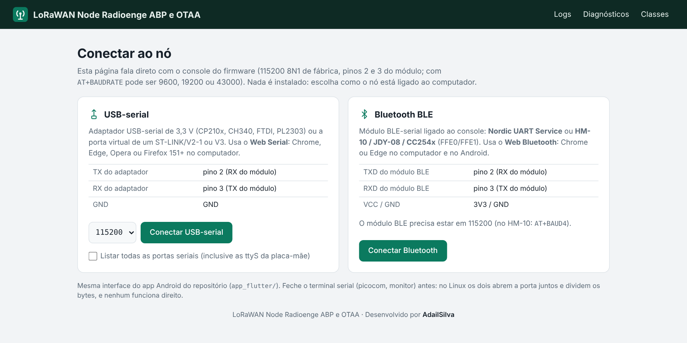
</p>

| Ligação | API do navegador | Navegadores |
|---|---|---|
| **USB-serial** (adaptador de 3,3 V nos pinos 2/3, veja o [passo a passo](#-passo-a-passo-adaptador-usb-serial-externo), ou a porta virtual de um ST-LINK/V2-1 ou V3) | Web Serial | Chrome, Edge, Opera ou **Firefox 151+** no computador (Windows, Linux, macOS) |
| **Bluetooth BLE** (Nordic UART Service ou HM-10/JDY-08, FFE0/FFE1) | Web Bluetooth | Chrome ou Edge no computador e no Android |

O Firefox tem o Web Serial desde a versão 151 (maio/2026), mas não tem o Web Bluetooth; o Safari não tem nenhum dos dois. As ligações são as mesmas do app: veja [Ligações do app](#ligações-do-app).

**Linux: `Failed to execute 'open' on 'SerialPort': Failed to open serial port`**, mesmo com a porta livre (`sudo fuser -v /dev/ttyUSB0` vazio) e o picocom abrindo normalmente: o problema é o navegador, não o adaptador.

- **Chrome listando só `ttyS0`…`ttyS31`:** são as portas seriais da placa-mãe, não o adaptador, e não abrem. A página filtra a lista pelos fabricantes de adaptadores USB-serial (PL2303, CP210x, CH340/CH343, FTDI, ST-LINK); escolha **PL2303 Serial Port** (ou o seu adaptador). A opção **Listar todas as portas seriais** volta a mostrar as `ttyS`. Se uma `ttyS` ficou como *Paired*, remova em 🔒 (à esquerda do endereço) → **Configurações do site** → **Portas seriais**.
- **Chrome aberto antes de você entrar no grupo `dialout`:** fechar as janelas não basta, porque o Chrome continua rodando em segundo plano. Abra `chrome://restart` (ou `pkill chrome`) e abra de novo. O Firefox, aberto depois, já conecta.
- **Chromium do snap** (padrão no Ubuntu) não acessa portas seriais: `sudo snap connect chromium:raw-usb` e reabra o navegador, ou use o Google Chrome em `.deb`.
- **Só um programa por vez:** a porta conectada no Firefox, no Chrome ou no picocom fica bloqueada para os outros.
- O Firefox 151+ pede permissão e conecta (testado em 08/11/2026 com um cabo PL2303).

**Como abrir.** Prefira `https://` (GitHub Pages) ou `http://localhost` (`build.sh web`). Abrir o arquivo direto (`file:///…/web/index.html`) também conecta pela porta serial no Chrome e no Firefox, mas aí os **Diagnósticos** ficam no modo do navegador (sem traceroute, sem ping ICMP) e o Bluetooth pode não ser liberado:

- **Pelo GitHub Pages:** `https://<seu-usuário>.github.io/Node_STM32_SX1272_RD49C_Radioenge_ABP_e_OTAA_IO/`, publicada pelo GitHub Actions a cada push (veja [Repositório no GitHub](#-repositório-no-github-releases-e-github-pages)).
- **Localmente:** `sh scripts/build.sh web` serve a pasta `web/` em `http://localhost:8101` com o [`scripts/web_server.py`](scripts/web_server.py), que também faz os **diagnósticos de rede neste computador**, e abre o navegador (precisa só do `python3`). No Windows nativo: `python scripts\web_server.py 8101`, depois abra `http://localhost:8101`.

**Uso.**

1. Feche o terminal serial (picocom, `monitor`): a porta só abre em um programa por vez.
2. Clique em **Conectar USB-serial** (ou **Conectar Bluetooth**) e escolha a porta (ou o módulo BLE) na janela do navegador.
3. A página manda `mode app`, lê `info`, `jconfig`, `jstatus`, `jkeys`, `jio` e `jdev` e mostra tudo. O status, as chaves de sessão, os GPIOs, os relés e os PZEM atualizam a cada 5 s.
4. Edite a configuração e clique em **Salvar no nó**: a página manda só os campos que mudaram (`set ...`) e depois `save`. Credenciais, sub-banda, canal de 500 kHz, máscara de canais e ativação (ABP/OTAA) pedem confirmação, porque reiniciam a sessão LoRaWAN. Ao trocar a velocidade da serial, a página reabre a porta na nova velocidade sozinha.
5. **Ler do nó** (barra de baixo, ao lado de **Descartar**) manda `jconfig` de novo e refaz o formulário com a configuração gravada na EEPROM do nó. Com alterações não salvas, pede confirmação antes de descartá-las.
6. **O formulário acompanha o nó sozinho.** O `jstatus` traz `cfgrev`, um contador que muda a cada alteração da configuração no nó (`save`, `set`, `class`, comandos AT, downlink de comando na porta 102 ou AT por downlink na 103). Quando ele muda, a página e o app leem o `jconfig` de novo: sem edições no formulário, ele é refeito com os valores reais (e aparece um aviso); com edições, elas ficam e aparece uma faixa amarela sugerindo **Ler do nó**. Com firmware antigo, sem `cfgrev`, a página compara só a classe gravada (`cfgcls`) com a do `jconfig`.

<p align="center">
  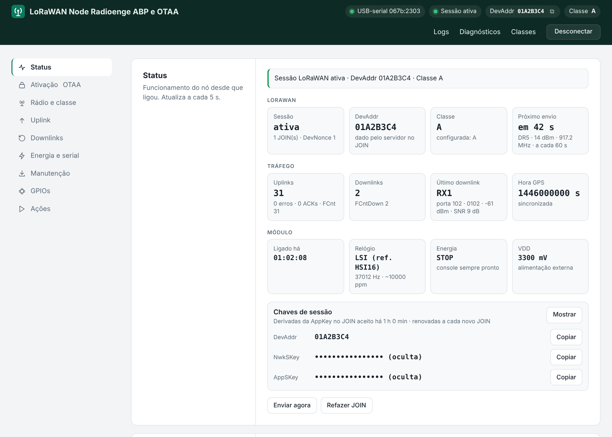
</p>

O mesmo nó em ABP (`AT+NJM=0`): a página troca sozinha o menu **Ativação ABP**, as credenciais, o texto das chaves de sessão e o botão **Reativar sessão ABP**:

<p align="center">
  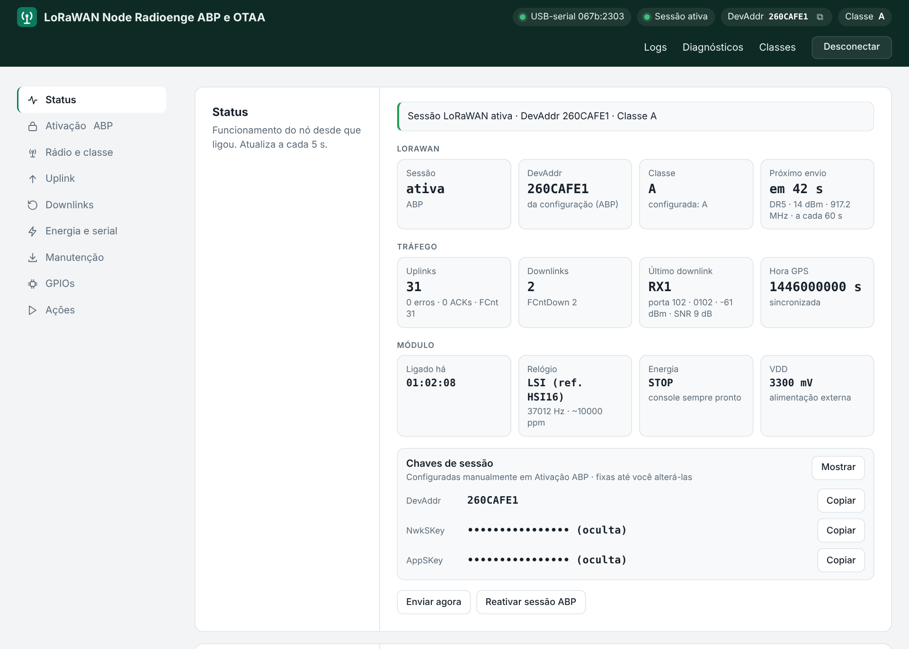
</p>

| Seção | O que tem |
|---|---|
| **Status** | sessão, DevAddr, classe em uso, beacon, uplinks, **próximo envio com DR, potência e frequência da última transmissão**, último downlink, hora GPS, relógio do RTC, VDD, modo de energia; aviso de Classe B sem cristal; painel **Chaves de sessão** (DevAddr, NwkSKey e AppSKey, ocultas até clicar em **Mostrar**, cada uma com **Copiar**); botões **Enviar agora** e **Refazer JOIN** (OTAA) / **Reativar sessão ABP** (ABP) |
| **Ativação ABP / OTAA** | ativação **ABP ↔ OTAA** (`AT+NJM`, [imagens](#-abp-e-otaa-num-firmware-só)), DevEUI, credenciais do modo escolhido (DevAddr, NetID, NwkSKey, AppSKey ou JoinEUI, AppKey, NwkKey) e **JOIN automático no boot** (`AT+AJOIN`) |
| **Rádio e classe** | sub-banda ou **máscara personalizada** (`AT+CHMASK`, com o resumo dos canais), data rate, potência em dBm ou por índice (`AT+TXP`), canal de 500 kHz, ADR, classe e ping slot; **janelas de recepção e rede**: atrasos da RX1/RX2 (`RX1DL`/`RX2DL`), frequência e DR da RX2 (`RX2FQ`/`RX2DR`), janelas do JOIN (`JN1DL`/`JN2DL`), rede pública (`AT+PNM`) e duty cycle (`AT+DCS`) |
| **Uplink** | intervalo, FPort, confirmado, tentativas (`AT+NBTRIALS`), payload em texto ou hexadecimal (conta os bytes e avisa o limite do DR2) e **keepalive** (`AT+KEEPALIVE`: liga, FPort, período, confirmado) |
| **Downlinks** | reset remoto (FPort, comando, espera), a FPort dos comandos, a **FPort dos comandos AT** e a tabela das portas em uso (2 interrupção, 4 serial transparente, keepalive, uplink, reset, comandos, AT) |
| **Energia e serial** | `lowpower` 0/1/2, alimentação externa, LEDs e **velocidade da serial** (`AT+BAUDRATE`: 115200, 43000, 19200 ou 9600) |
| **Manutenção** | **Exportar configuração** (JSON), **Importar…** e **Restaurar padrão de fábrica**, versão do firmware |
| **Relés e PZEM** | estado dos relés com Ligado/Desligado e **Pulso** (`AT+RELE`, `AT+RELEPULSO`), ligar/desligar todos, pinos e nível de cada relé (`AT+RELECFG`), endereços Modbus dos PZEM (`AT+PZEMCFG`), **Ler agora** e as medições de cada medidor (tensão, corrente, potência, energia, frequência, FP, alarme), contadores do protocolo V1 e motivo do boot. Na seção **Uplink**, o conteúdo do uplink periódico (`AT+TELEM`) |
| **GPIOs** | os 10 pinos com os modos do firmware original (`AT+GPIOC`: entrada, saída push-pull/open-drain, analógica, interrupção na subida/descida/duas bordas, serial transparente), pull, **Aplicar** (vale na hora e grava), saídas 0/1 (`AT+WPIN`), leituras digitais e analógicas (`AT+RPIN`/`AT+ADC`, com a tensão), bateria (`AT+BAT`) e estado da serial transparente |
| **Ações** | uplink agora (com FPort, confirmado e tentativas: `AT+SENDB` / `AT+TXBCFM`), Classe A/B/C na hora, refaz o JOIN / reativa a sessão ABP, `DeviceTimeReq`, recalibrar o relógio, reiniciar |

No topo ficam as páginas **Logs**, **Diagnósticos** e **Classes** (e **← Configuração** para voltar):

| Página | O que tem |
|---|---|
| **Logs** (`#logs`) | os eventos do nó com cores; **Pausar**, **Limpar tela**, **Baixar do nó** (o log que o firmware guarda em RAM, até 3 KB com a hora desde que ligou, comando `jlog`), **Baixar sessão** (o que a página recebeu), **Filtrar** e **Rolar automático**; embaixo, o campo para os comandos do console |
| **Diagnósticos** (`#diag`) | destino (padrão `chirpstack-v4.adailsilva.com.br`) e **Ping**, **Traceroute** e **Nslookup**, mais o **Autoteste do nó** (comando `jdiag`) |
| **Classes** (`#classes`) | cartões das Classes A, B e C, linha do tempo, comparativo e qual classe usar, com o quadro **Neste nó** da LoRaMac-node e a classe em uso agora |

<p align="center">
  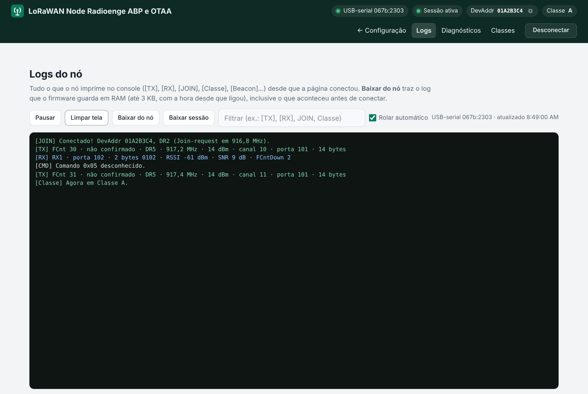
</p>
<p align="center">
  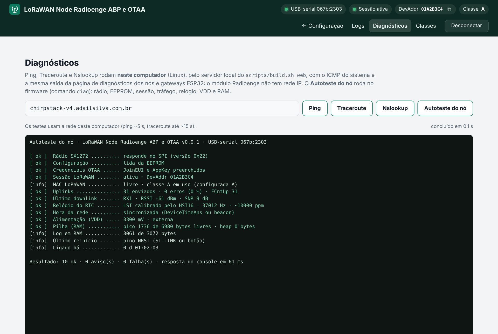
</p>
<p align="center">
  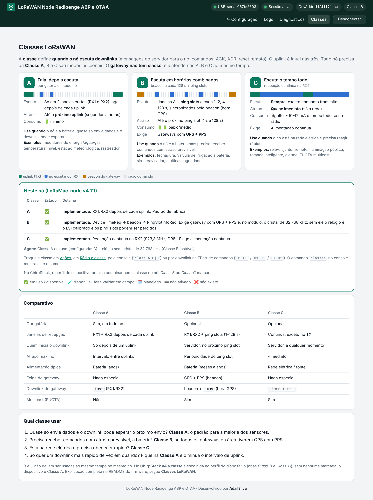
</p>

**Onde os diagnósticos rodam.** O módulo Radioenge não tem Wi-Fi nem IP, então Ping, Traceroute e Nslookup rodam **no computador** em que a página está aberta:

- **Com o servidor local** (`sh scripts/build.sh web`, que roda o [`scripts/web_server.py`](scripts/web_server.py) em `http://127.0.0.1:8101`): a página chama `GET /diag_run?t=ping|trace|dns&h=<host>`. **Ping** manda 5 pacotes ICMP de 32 bytes, 1 por segundo, com o programa `ping` do sistema; **Traceroute** manda um ping com TTL 1, 2, 3… até 15 saltos; **Nslookup** usa o DNS do sistema (A/AAAA, ou PTR para um IP). A saída tem este formato (`PING host (ip): 32 bytes de dados`, `seq=0 sem resposta (1 s)`, estatísticas). Como é ICMP de verdade, um destino com o ICMP bloqueado aparece **sem resposta**, igual ao terminal e ao ESP32. Só IPv4, como no ESP32. O servidor só aceita conexões de `127.0.0.1` e destinos com letras, números, `.`, `-`, `:` e `_`, sem passar por um shell.
- **Página aberta direto do disco (`file://`) ou pelo GitHub Pages:** ela procura o servidor local em `http://127.0.0.1:8101` e, se ele estiver rodando, usa os mesmos testes (o servidor libera só as origens `file://`, `https://<usuário>.github.io` e `localhost`). Sem o servidor, **Ping** e **Traceroute** não rodam e dizem para abrir o `build.sh web`: o navegador não envia ICMP, e a página não mostra nada no lugar de um ping. O **Nslookup** continua pelo DNS-over-HTTPS (`dns.google`).
- **Autoteste do nó**: roda no firmware (`diag`/`jdiag`), pela mesma ligação USB-serial ou Bluetooth, e mostra também o tempo de resposta do console.

**Exportar, importar e padrão de fábrica** (seção **Manutenção**):

<p align="center">
  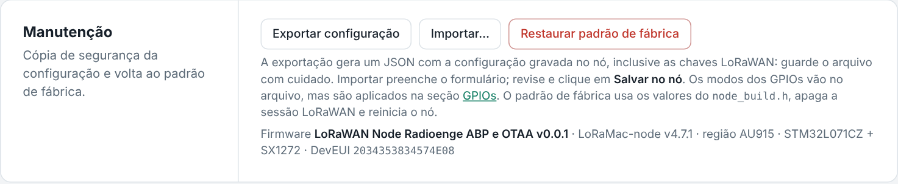
</p>

- **Exportar configuração** lê a configuração gravada no nó (`jconfig`) e baixa um JSON `radioenge_<abp|otaa>_<deveui>_<AAAAMMDD>.json` (o `abp`/`otaa` é a ativação em uso). Ele tem todos os campos do formulário, **inclusive as chaves LoRaWAN** (guarde com cuidado) e a ativação (`njm`), e campos `_mode`, `_fw`, `_ver`, `_deveui` e `_exported` para identificação.
- **Importar…** só preenche o formulário com o arquivo: revise e clique em **Salvar no nó** (a página manda os `set` que mudaram e o `save`). Um arquivo de outra ativação (ABP num nó em OTAA, ou o contrário) pede confirmação e leva a ativação junto (`njm`); os arquivos dos antigos firmwares separados, que não têm o `njm`, usam o `_mode`. Campos que faltam no arquivo ficam como estão.
- **Restaurar padrão de fábrica** manda `factory` (no OTAA, com a opção de zerar também o DevNonce: `factory nonce`): volta aos valores do `node_build.h`, apaga a sessão LoRaWAN e reinicia o nó. Exporte antes se quiser guardar a configuração.

Se o nó reiniciar (depois de um `save` que muda a sessão, por exemplo), a página percebe o banner e volta ao modo app sozinha. Se o cabo sair ou o Bluetooth cair, ela volta à tela de conexão. A página segue o tema claro/escuro do sistema e funciona na largura de um celular.

---

## 📱 App Android (USB OTG e Bluetooth)

O app Flutter em `app_flutter/` (**Radioenge Node ABP e OTAA**) é uma interface para este mesmo console da UART. É **um app só para as duas ativações**: ele lê a ativação em uso no nó (`info`/`jconfig`) e mostra as credenciais, as chaves de sessão e os botões (**Refazer JOIN** ou **Reativar ABP**) de acordo; a troca é na aba **Config.** (`AT+NJM`). Ele conecta por **USB OTG** (adaptador USB-serial) ou por **Bluetooth BLE** (módulo BLE-serial).

| Aba | O que tem |
|---|---|
| **Status** | sessão, DevAddr, classe em uso, beacon, uplinks/erros/ACKs, próximo envio (DR · dBm · MHz da última transmissão · intervalo), último downlink (porta, dados, RSSI, SNR), hora GPS, relógio, VDD, modo de energia e o cartão **Chaves de sessão** (DevAddr, NwkSKey e AppSKey: Mostrar/Ocultar e Copiar). Atualiza a cada 5 s |
| **Config.** | todos os campos do `set`, com validação, inclusive os dos comandos AT: ativação ABP/OTAA (`AT+NJM`), `AT+AJOIN`, `AT+TXP`, máscara de canais (`AT+CHMASK`), janelas RX/JOIN, `AT+PNM`, `AT+DCS`, `AT+NBTRIALS`, keepalive, FPort dos comandos AT e velocidade da serial (`AT+BAUDRATE`, o app troca a velocidade do adaptador USB junto); manda só o que mudou e depois `save`. O formulário vem do `jconfig` (a configuração gravada no nó); **Ler do nó**, na barra de baixo, lê de novo |
| **Logs** | eventos `[TX]`, `[RX]`, `[JOIN]`, `[Classe]`, `[Beacon]` com cores; **Pausar**, **Limpar tela**, **Baixar** (do nó: o log em RAM pelo `jlog`; ou a sessão do app), **Rolar automático** e filtro; embaixo, o campo para os comandos do console |
| **Diagnóst.** | **Ping**, **Traceroute** e **Nslookup** feitos **pelo celular** (o módulo não tem IP: `ping` do Android, traceroute com `ping -t <ttl>` de 1 a 15 saltos, DNS do sistema; sem o `ping`, a ida e volta de uma conexão TCP) e o **Autoteste do nó** (`jdiag`) |
| **Manutenção** | uplink agora (texto ou hex; com FPort, confirmado e tentativas vai por `AT+SENDB` / `AT+TXBCFM`), **GPIOs** (os mesmos da página WEB: modo, pull, Aplicar, saídas 0/1, leituras, bateria e serial transparente), **Relés e PZEM** (os mesmos da página WEB), Classe A/B/C, refaz o JOIN / reativa a sessão ABP, `DeviceTimeReq`, recalibrar o relógio, reiniciar, **Exportar configuração** / **Importar…** (o mesmo JSON da página WEB) e padrão de fábrica |
| 🎓 **Classes LoRaWAN** (ícone do topo) | resumo das classes e o que este nó suporta |

### Ligações do app

O console fica na **USART1** (`CONSOLE_UART=1`, padrão): pino **2** = RX do módulo, pino **3** = TX do módulo, **115200 8N1**, nível de **3,3 V**.

**USB OTG**: celular → cabo/adaptador OTG → adaptador USB-serial de 3,3 V (CP210x, CH340/CH341, FTDI ou PL2303). Ao plugar, o Android oferece abrir o app. Detalhes no [passo a passo do adaptador USB-serial](#-passo-a-passo-adaptador-usb-serial-externo).

| Adaptador USB-serial | Módulo Radioenge |
|---|---|
| TX | pino 2 (RX) |
| RX | pino 3 (TX) |
| GND | GND |

**Bluetooth BLE**: módulo BLE-serial de 3,3 V com **Nordic UART Service** (6E400001…) ou **HM-10 / JDY-08 / JDY-23 / CC254x** (serviço FFE0, característica FFE1).

| Módulo BLE | Módulo Radioenge |
|---|---|
| TXD | pino 2 (RX) |
| RXD | pino 3 (TX) |
| GND | GND |
| VCC | 3V3 |

- O módulo BLE precisa estar em **115200**. O HM-10 sai de fábrica em 9600: ligue-o antes a um adaptador USB-serial e mande `AT+BAUD4`.
- Com `lowpower 2`, o primeiro caractere só acorda o MCU. O app manda um `\r` antes de cada comando para isso. Para usar o app, `lowpower 1` (padrão) é o mais confortável.

### Gerar e instalar o app

Precisa do Flutter 3.24 ou mais novo e do Android SDK. Com o Flutter 3.24 exatamente, depois do `./setup.sh` use `compileSdk = 35` em `android/app/build.gradle` (o `file_picker`, usado para baixar os logs e exportar/importar a configuração, exige esse valor); nas versões novas do Flutter não é preciso mexer em nada.

```sh
cd app_flutter
./setup.sh                  # flutter create (só cria o que falta) + flutter pub get
flutter analyze && flutter test
flutter run                 # celular ligado por USB, com a depuração USB ativa
flutter build apk --release # gera build/app/outputs/flutter-apk/app-release.apk
```

O `setup.sh` não sobrescreve `lib/`, `pubspec.yaml`, `AndroidManifest.xml`, `MainActivity.kt` nem `res/xml/device_filter.xml`. Ele só gera o restante do projeto Android (Gradle, ícones).

### Protocolo do app (modo app do console)

O app manda `mode app` ao conectar. Nesse modo o firmware desliga o eco e o prompt, e cada comando termina numa linha `@OK`, `@OK restart` (a mudança só vale depois de reiniciar) ou `@ERR <motivo>`.

| Comando | Resposta |
|---|---|
| `info` | `@I {json}`: firmware, versão, pilha, MCU, rádio, região, ativação, DevEUI |
| `jstatus` | `@S {json}`: os mesmos dados do `status`. Classe: `maccls` = a que a LoRaMac-node usa de fato, `cfgcls` = a gravada, `cls` = o estado do firmware. `cfgrev` = revisão da configuração (muda a cada alteração; a página e o app releem o `jconfig` quando ela muda) |
| `jconfig` | `@C {json}`: toda a configuração (payload em hex) |
| `jkeys` | `@K {json}`: chaves da sessão em uso |
| `jio` | `@IO {"con2","bat","tr","pz","rel","g":[[modo,pull,valor],...]}`: GPIOs (modo -1 = não configurado; valor 0/1, 0..4095 na analógica, -1 sem leitura), bateria do `AT+BAT`, serial transparente ativa, modo PZEM ligado e máscara dos pinos de relé |
| `jdev` | `@DV {"umode","rq","rmap","rpul","rcfg","pq","pon","pbusy","padr":[..],"pz":[{"ok","age","v","i","p","e","f","pf","al"}],"v1c","v1u","boot"}`: relés (quantidade, mapa, pulsos, `AT+RELECFG`), PZEM (endereços e últimas leituras, nas unidades do protocolo) e contadores do protocolo V1 |
| `AT+...` | os comandos AT da Radioenge: a resposta original (`AT OK`, `AT PARAM ERROR`, `AT TX OK`...) numa linha e depois `@OK` / `@ERR` |
| `jdiag` | `@D {"items":[{"n","l","v"}],"ok","warn","fail"}`: autoteste (`l` = `ok`, `aviso`, `falha` ou `info`) |
| `jlog <de>` | linhas `@L <texto>` do log em RAM e `@LN {"start","next","end","size"}`; o app repete com `next` até chegar em `end` |
| `set <campo> <valor>`, `save`, `send`, `class`, `join`, `devtime`, `clock recal`, `reboot`, `factory` | os mesmos do terminal |

As outras linhas (eventos) continuam como texto e vão para a aba Logs. Se o nó reiniciar, o app reconhece o banner e entra no modo app de novo. Num terminal serial, `mode human` (ou um reinício) volta ao modo normal.

### Estrutura do app

```
app_flutter/
├── lib/main.dart                 início do app (um app só para ABP e OTAA)
├── lib/core/app_info.dart        nome do app (Radioenge Node ABP e OTAA)
├── lib/core/transport.dart       interface de transporte por linhas
├── lib/core/usb_transport.dart   USB OTG (usb_serial)
├── lib/core/ble_transport.dart   Bluetooth BLE (flutter_blue_plus: NUS / HM-10)
├── lib/core/node_link.dart       fila de comandos, @OK/@ERR, JSON, atualização a cada 5 s
├── lib/core/net_diag.dart        ping, traceroute e nslookup feitos pelo celular
├── lib/core/file_io.dart         salvar/abrir arquivos (logs, exportar/importar)
├── lib/ui/                       telas: Conectar, Status, Config., Logs, Diagnóst., Manutenção, Classes LoRaWAN
├── test/format_test.dart         testes das funções de hex/tempo
├── android/app/src/main/         AndroidManifest (USB host + BLE), filtro de adaptadores USB
└── setup.sh
```

---

## 💾 Valores de fábrica e EEPROM

Os padrões ficam em [`app/node_build.h`](app/node_build.h), inclusive a **ativação de fábrica** (`NODE_ACTIVATION`, OTAA) e as credenciais de fábrica das duas ativações. O que estiver gravado na EEPROM vale mais que o `node_build.h`, e regravar o firmware não apaga a EEPROM.

| Região da EEPROM (6 KB) | Conteúdo |
|---|---|
| `0x0000–0x0FFF` | Contexto da LoRaMac-node (sessão, FCnt, DevNonce, canais, Classe B), ~1,8 KB em uso |
| `0x1000–0x15FF` | Configuração do nó (`NodeConfig_t` + CRC32) |
| `0x1600–0x16FF` | Metadados: impressão das credenciais (inclusive a ativação), último DevNonce e marcas de migração |
| `0x1700–0x17FF` | Estado dos relés: anel de 32 registros de 8 bytes (contador, mapa, verificação) |

- A configuração está na **versão 3** (v2 = campos dos comandos AT; v3 = relés, PZEM e conteúdo do uplink periódico, nos bytes que vinham antes da área reservada). Uma EEPROM gravada por uma versão anterior do firmware (v2, sem relés/PZEM, ou v1) é **migrada sozinha** no boot, conferindo o CRC no tamanho antigo: credenciais, sessão LoRaWAN, FCnt, DevNonce e GPIOs continuam, e os campos novos recebem os padrões de fábrica (`AT+TELEM=1`, nenhum relé, um PZEM em `f8` se GPIO0/GPIO1 estiverem livres). A impressão das credenciais não inclui os campos novos, então a sessão LoRaWAN não é apagada. Uma configuração que não passa na validação volta inteira ao padrão de fábrica (como nas versões anteriores).
- Padrões dos comandos AT (`app/node_build.h`): `AJOIN 1`, `PNM 1`, `DCS 0`, `RX2FQ 923300000`, `RX2DR 8`, `RX1DL 1000`, `RX2DL 2000`, `JN1DL 5000`, `JN2DL 6000`, `NBTRIALS 8`, `BAUDRATE 115200`, `KEEPALIVE 0:5:0:60000`, AT por downlink na porta **103**, GPIOs não configurados.
- Ao mudar **credenciais, sub-banda, canal de 500 kHz, máscara (`AT+CHMASK`) ou ativação (`AT+NJM`)**, o contexto da LoRaMac-node é apagado e a sessão recomeça. Intervalo, classe, DR, potência etc. valem na hora.
- **Desgaste da EEPROM:** a EEPROM de dados do STM32L0 aguenta ~100 mil gravações por byte. Por isso só os bytes que mudaram são gravados, e o FCnt (que muda a cada uplink) vai para a EEPROM a cada **32 uplinks**. Ao reiniciar, o firmware soma 32 ao FCnt de uplink restaurado para nunca repetir um contador. O ChirpStack aceita esse salto.
- O **DevNonce** (LoRaWAN 1.0.4) nunca volta para trás: ele é guardado à parte e sobrevive à troca de chaves e ao `factory`. Com `factory nonce` ele zera, e aí o ChirpStack recusa os primeiros JOINs até você limpar os *DevNonces* do dispositivo lá.
- Do antigo firmware ABP ou OTAA para este: a ativação já está na configuração (v2), e a impressão das credenciais é ajustada no 1º boot (marca `NODE_META_FP_UNIFIED`), então a sessão LoRaWAN, o FCnt e o DevNonce continuam ([detalhes](#-abp-e-otaa-num-firmware-só)).
- A **classe** tem dois registros na EEPROM: a gravada na configuração (`class`) e a do contexto da LoRaMac-node. Quando a sessão volta da EEPROM numa classe diferente da gravada (ex.: contexto antigo em C, configuração em A), o firmware volta para a gravada e avisa no log (`[Classe] O contexto da EEPROM estava em Classe C; a gravada é a A.`); depois disso, a cada 5 s ele confere a classe em uso na MAC. A página e o app mostram a classe em uso no nó (`maccls`) e a gravada.
- O **Do zero** (`sh scripts/build.sh erase`) apaga a EEPROM inteira, inclusive o DevNonce e o FCnt. Regravar com o **Atualizar** mantém tudo.
- Com `deveui auto` cada módulo tem o seu DevEUI (derivado do ID único do STM32). Ele aparece no boot e no `config`: cadastre esse valor no ChirpStack.
- **ABP:** o **FCnt** de uplink fica no contexto da LoRaMac-node na EEPROM e continua de onde parou depois de reiniciar. Se você mudar as chaves ou o DevAddr, ele recomeça do zero: no ChirpStack, marque *Disable frame-counter validation* ou zere os contadores do dispositivo.

---

## 📝 Cadastro no ChirpStack

**Perfil do dispositivo (Device profile):**

| Campo | Valor |
|---|---|
| Region | AU915 (sub-banda igual à do gateway; padrão SB1) |
| MAC version | **LoRaWAN 1.0.3** nos perfis de exemplo abaixo (os usados no ChirpStack de referência); **LoRaWAN 1.0.4** também serve |
| Regional parameters revision | **B** nos perfis de exemplo; **RP002-1.0.3** com MAC 1.0.4 |
| Supports OTAA | **sim** com o nó em OTAA (`njm 1`, padrão); **não** com o nó em ABP (`njm 0`) |
| Class-B | marcada só se o nó for usar a Classe B (ping-slot periodicity = `ping`) |
| Class-C | marcada só se o nó for usar a Classe C; depois de marcar ou desmarcar, refaça o JOIN (OTAA) ou reative a sessão (ABP) ([por quê](#classe-c-no-chirpstack-só-vale-depois-de-um-novo-join-otaa-ou-da-reativação-abp)) |
| Payload codec | o que preferir (o payload padrão é o texto `AdailSilva-IoT`) |

### Perfis de dispositivo de exemplo (32)

**32 perfis = 2 configurações de região** (`au915_0` / `au915_1`) **× 2 revisões** (A / B) **× 2 ativações** (ABP / OTAA) **× 4 combinações de classe** (A / A+B / A+B+C / A+C). Campos de cada aba, cadastro passo a passo e equivalência no ChirpStack v3: [`doc/CHIRPSTACK_DEVICE_PROFILES.md`](doc/CHIRPSTACK_DEVICE_PROFILES.md).

O perfil acompanha a **ativação** (`njm`) e a **classe** gravadas no nó. Com a sub-banda 1 (padrão), revisão B:

| Classe no nó | Nó em ABP (`njm 0`) | Nó em OTAA (`njm 1`) |
|:---:|---|---|
| A | **#25** `Device Profile - AU915_1 - 1.0.3 - B - ABP - Class A` | **#29** `Device Profile - AU915_1 - 1.0.3 - B - OTAA - Class A` |
| B | **#26** `Device Profile - AU915_1 - 1.0.3 - B - ABP - Class A+B` | **#30** `Device Profile - AU915_1 - 1.0.3 - B - OTAA - Class A+B` |
| C | **#28** `Device Profile - AU915_1 - 1.0.3 - B - ABP - Class A+C` | **#32** `Device Profile - AU915_1 - 1.0.3 - B - OTAA - Class A+C` |

Com a sub-banda 0, use o perfil `AU915_0` de mesmo nome (subtraia 16 do número). No ChirpStack de referência o EndDevice roda com os perfis **#28** (ABP) e **#32** (OTAA), em Classe C.

- **Classe B:** os perfis de exemplo usam *ping-slot periodicity* **every 128 seconds**, que corresponde a `set ping 7` no nó (o padrão do firmware é `ping 4` = 16 s). Os dois lados precisam bater: mude o nó ou o perfil.
- **A+B+C:** evite com o nó em Classe C. Com Class-B marcada, o ChirpStack recalcula a classe a cada uplink pelo bit *Class B* do FCtrl (1 → B, 0 → A) e o nó volta a ser tratado como Classe A.
- Depois de trocar o perfil ou a classe, refaça o JOIN (OTAA) ou reative a sessão (ABP): o ChirpStack só lê a Classe C nesse momento.

A coluna **Region configuration** precisa ser a mesma sub-banda do gateway e do nó: `au915_0` = sub-banda 0 (canais 0–7 + 64) e `au915_1` = sub-banda 1 (canais 8–15 + 65).

| # | Nome do perfil (*Name*) | Region configuration | Revisão | Supports OTAA | Class-B | Class-C |
|---:|---|:---:|:---:|:---:|:---:|:---:|
| 1 | `Device Profile - AU915_0 - 1.0.3 - A - ABP - Class A` | `au915_0` | A | — | — | — |
| 2 | `Device Profile - AU915_0 - 1.0.3 - A - ABP - Class A+B` | `au915_0` | A | — | ✅ | — |
| 3 | `Device Profile - AU915_0 - 1.0.3 - A - ABP - Class A+B+C` | `au915_0` | A | — | ✅ | ✅ |
| 4 | `Device Profile - AU915_0 - 1.0.3 - A - ABP - Class A+C` | `au915_0` | A | — | — | ✅ |
| 5 | `Device Profile - AU915_0 - 1.0.3 - A - OTAA - Class A` | `au915_0` | A | ✅ | — | — |
| 6 | `Device Profile - AU915_0 - 1.0.3 - A - OTAA - Class A+B` | `au915_0` | A | ✅ | ✅ | — |
| 7 | `Device Profile - AU915_0 - 1.0.3 - A - OTAA - Class A+B+C` | `au915_0` | A | ✅ | ✅ | ✅ |
| 8 | `Device Profile - AU915_0 - 1.0.3 - A - OTAA - Class A+C` | `au915_0` | A | ✅ | — | ✅ |
| 9 | `Device Profile - AU915_0 - 1.0.3 - B - ABP - Class A` | `au915_0` | B | — | — | — |
| 10 | `Device Profile - AU915_0 - 1.0.3 - B - ABP - Class A+B` | `au915_0` | B | — | ✅ | — |
| 11 | `Device Profile - AU915_0 - 1.0.3 - B - ABP - Class A+B+C` | `au915_0` | B | — | ✅ | ✅ |
| 12 | `Device Profile - AU915_0 - 1.0.3 - B - ABP - Class A+C` | `au915_0` | B | — | — | ✅ |
| 13 | `Device Profile - AU915_0 - 1.0.3 - B - OTAA - Class A` | `au915_0` | B | ✅ | — | — |
| 14 | `Device Profile - AU915_0 - 1.0.3 - B - OTAA - Class A+B` | `au915_0` | B | ✅ | ✅ | — |
| 15 | `Device Profile - AU915_0 - 1.0.3 - B - OTAA - Class A+B+C` | `au915_0` | B | ✅ | ✅ | ✅ |
| 16 | `Device Profile - AU915_0 - 1.0.3 - B - OTAA - Class A+C` | `au915_0` | B | ✅ | — | ✅ |
| 17 | `Device Profile - AU915_1 - 1.0.3 - A - ABP - Class A` | `au915_1` | A | — | — | — |
| 18 | `Device Profile - AU915_1 - 1.0.3 - A - ABP - Class A+B` | `au915_1` | A | — | ✅ | — |
| 19 | `Device Profile - AU915_1 - 1.0.3 - A - ABP - Class A+B+C` | `au915_1` | A | — | ✅ | ✅ |
| 20 | `Device Profile - AU915_1 - 1.0.3 - A - ABP - Class A+C` | `au915_1` | A | — | — | ✅ |
| 21 | `Device Profile - AU915_1 - 1.0.3 - A - OTAA - Class A` | `au915_1` | A | ✅ | — | — |
| 22 | `Device Profile - AU915_1 - 1.0.3 - A - OTAA - Class A+B` | `au915_1` | A | ✅ | ✅ | — |
| 23 | `Device Profile - AU915_1 - 1.0.3 - A - OTAA - Class A+B+C` | `au915_1` | A | ✅ | ✅ | ✅ |
| 24 | `Device Profile - AU915_1 - 1.0.3 - A - OTAA - Class A+C` | `au915_1` | A | ✅ | — | ✅ |
| 25 | `Device Profile - AU915_1 - 1.0.3 - B - ABP - Class A` | `au915_1` | B | — | — | — |
| 26 | `Device Profile - AU915_1 - 1.0.3 - B - ABP - Class A+B` | `au915_1` | B | — | ✅ | — |
| 27 | `Device Profile - AU915_1 - 1.0.3 - B - ABP - Class A+B+C` | `au915_1` | B | — | ✅ | ✅ |
| 28 | `Device Profile - AU915_1 - 1.0.3 - B - ABP - Class A+C` | `au915_1` | B | — | — | ✅ |
| 29 | `Device Profile - AU915_1 - 1.0.3 - B - OTAA - Class A` | `au915_1` | B | ✅ | — | — |
| 30 | `Device Profile - AU915_1 - 1.0.3 - B - OTAA - Class A+B` | `au915_1` | B | ✅ | ✅ | — |
| 31 | `Device Profile - AU915_1 - 1.0.3 - B - OTAA - Class A+B+C` | `au915_1` | B | ✅ | ✅ | ✅ |
| 32 | `Device Profile - AU915_1 - 1.0.3 - B - OTAA - Class A+C` | `au915_1` | B | ✅ | — | ✅ |

Legenda: ✅ marcado · — desmarcado. Todos os 32 usam **Region** `AU915` e **MAC version** `LoRaWAN 1.0.3`.

**Dispositivo em OTAA:** DevEUI = o que o nó mostra no boot (`config`), JoinEUI = `joineui`. Na aba **OTAA keys**, Application key = `appkey`.

Se o ChirpStack recusar o JOIN com *DevNonce has already been used*, é porque o contador voltou (EEPROM apagada ou `factory nonce`): limpe os DevNonces do dispositivo ou deixe o nó continuar tentando (ele avança sozinho).

**Dispositivo em ABP:** na aba **Activation**, preencha o *Device address*, a *Network session key* e a *Application session key* e copie os mesmos valores para o nó (ou pela página WEB / app, seção **Ativação**):

```
> set njm 0
> set devaddr 260CAFE1
> set nwkskey 000102030405060708090A0B0C0D0E0F
> set appskey F0E0D0C0B0A090807060504030201000
> save
```

O firmware usa LoRaWAN 1.0.x no ABP: a NwkSKey vale para FNwkSIntKey, SNwkSIntKey e NwkSEncKey.

---

## 📨 Downlinks: reset remoto e comandos

**Reset remoto**: na FPort `rstport` (padrão **101**), um downlink com exatamente os bytes de `rstcmd` (padrão `AD A1 DE AD BE EF 0D 0A`, em base64 `raHerb7vDQo=`) reinicia o módulo depois de `rstdelay` ms.

**Comandos** na FPort `cmdport` (padrão **102**):

| Bytes | Efeito |
|---|---|
| `01 00` / `01 01` / `01 02` | Classe A / B / C (grava) |
| `02 hh ll` | intervalo de uplink em segundos, 16 bits (grava) |
| `03 nn` | periodicidade do ping slot, 0–7 (grava) |
| `04 00` / `04 01` | uplink não confirmado / confirmado (grava) |
| `05` | manda um uplink agora |

**Protocolo ADAILSILVA_V1**: comandos na FPort **10**, respostas na **11** e telemetria na **20** (veja [Protocolo ADAILSILVA_V1](#-protocolo-adailsilva_v1-e-codec-do-chirpstack)). As FPorts `cmdport`, `atport` e `rstport` não podem ser 10.

**Comandos AT** na FPort `atport` (padrão **103**): o downlink é o texto do comando (`AT+WPIN=3:1`, vários separados por `;`) e a resposta volta num uplink na mesma porta. **Serial transparente** na FPort **4** (com `AT+GPIOC=0:3:0`): o downlink sai pelos pinos GPIO1/GPIO0. Todo downlink também aparece no console como `RX:<hex>:<RSSI>:<SNR>`, como no firmware original. Veja [`doc/COMANDOS_AT_RADIOENGE.md`](doc/COMANDOS_AT_RADIOENGE.md).

| Porta | Uso |
|---:|---|
| 2 | uplink de interrupção de GPIO (8 bytes) |
| 4 | serial transparente (uplink e downlink) |
| 10 | comandos do protocolo ADAILSILVA_V1 (downlink) |
| 11 | respostas do protocolo ADAILSILVA_V1 (uplink) |
| 20 | telemetria ADAILSILVA_V1 em TLV (uplink periódico com `AT+TELEM=1`) |
| `kaPort` (5) | keepalive (`AT+KEEPALIVE`, 16 bytes) |
| 101 | uplink periódico com payload fixo (`port`, com `AT+TELEM=0`) e reset remoto (`rstport`) |
| 102 | comandos binários (`cmdport`) |
| 103 | comandos AT por downlink (`atport`) |

Na Classe A o downlink chega no próximo uplink; na B, no próximo ping slot; na C, na hora.

---

## 💡 LEDs e consumo

| LED | Significado |
|---|---|
| 🔴 vermelho (PB5) | piscada: uplink enviado; aceso um instante: JOIN sem resposta; na inicialização: Classe A |
| 🟢 verde (PB8) | duas piscadas: downlink recebido (uma: beacon); na inicialização: Classe C (os dois: Classe B) |
| 🟡 amarelo (PB9) | piscada: linha recebida na serial de comandos |

A mesma sinalização do firmware original da Radioenge.

Entre um evento e outro o MCU dorme em **STOP**. O RTC acorda para as janelas RX, os beacons e os ping slots, e a UART acorda para o console:

| `lowpower` | Comportamento |
|---|---|
| 0 | sem STOP, só SLEEP (para depurar) |
| 1 | STOP com o HSI16 ligado para o USART: o console nunca perde caractere (~0,1 mA a mais) |
| 2 | STOP mais econômico: o primeiro caractere digitado só acorda o MCU (tecle Enter antes do comando) |

Na Classe C o rádio fica em recepção o tempo todo (da ordem de 10 mA), e isso domina o consumo.

---

## 🏗️ Arquitetura do firmware

```
 app/main.c ─ LmHandler (LoRaMac-node) ─ LoRaMac (MAC, Classes A/B/C, AU915)
     │                                        │
     ├─ app/console.c (UART) ─ app/at_cmd.c (comandos AT da Radioenge)
     ├─ app/node_io.c (GPIOs, ADC, interrupções, keepalive, serial transparente)
     ├─ app/node_relay.c (relés) · app/node_pzem.c (PZEM-004T, Modbus na USART2)
     ├─ app/node_v1.c (protocolo ADAILSILVA_V1: portas 10, 11 e 20)
     │                                        └─ radio/sx1272 ── board/RadioengeL071/sx1272-board.c
     ├─ app/node_config.c (EEPROM)                                 (SPI1, DIO0–3, PA_BOOST, chave RXTX)
     ├─ app/node_log.c (log em RAM: log, jlog)
     ├─ app/node_diag.c (autoteste: diag, jdiag)
     └─ board/RadioengeL071 (clock, RTC + calibração do LSI, UART, EEPROM, STOP, LEDs)
```

| Arquivo | Conteúdo |
|---|---|
| [`app/main.c`](app/main.c) | laço principal, callbacks da LmHandler, troca de classe, uplink periódico, downlinks, LEDs |
| [`app/console.c`](app/console.c) | comandos da UART (texto e, pelo `at_cmd.c`, AT) |
| [`app/at_cmd.c`](app/at_cmd.c) | comandos AT do firmware Radioenge: interpretador, respostas `AT ...`, AT por downlink |
| [`app/node_io.c`](app/node_io.c) | GPIOs (`AT+GPIOC`/`WPIN`/`RPIN`/`ADC`), interrupções, pacotes de keepalive e interrupção, serial transparente (USART2), `AT+BAT` |
| [`app/node_relay.c`](app/node_relay.c) | relés: pinos, ativo em 0/1, ligar/desligar/máscara/pulso (`TimerEvent`), estados no anel da EEPROM |
| [`app/node_pzem.c`](app/node_pzem.c) | PZEM-004T v3: Modbus RTU assíncrono na USART2 (fila, TX/RX por interrupção, timeout de 500 ms), CRC-16, conversão para o bloco do protocolo |
| [`app/node_v1.c`](app/node_v1.c) | protocolo ADAILSILVA_V1: opcodes, deduplicação por `seq`, fila de respostas, telemetria TLV dividida pelo DR |
| [`app/node_config.c`](app/node_config.c) | configuração na EEPROM, validação, impressão das credenciais |
| [`app/node_log.c`](app/node_log.c) | log do nó em RAM (buffer circular de 3 KB com a hora desde que ligou), alimentado pelo `_write` do `printf` |
| [`app/node_diag.c`](app/node_diag.c) | autoteste: rádio, EEPROM, credenciais, sessão, tráfego, relógio, VDD, pilha, log e causa do reinício |
| [`app/node_build.h`](app/node_build.h) | ativação de fábrica (OTAA; ABP por `AT+NJM`) e os valores de fábrica das duas ativações |
| [`board/RadioengeL071/`](board/RadioengeL071) | port da LoRaMac-node para o módulo (derivado da NucleoL073) |
| [`board/RadioengeL071/rtc-board.c`](board/RadioengeL071/rtc-board.c) | RTC, detecção do LSE e calibração do LSI |
| [`board/RadioengeL071/sx1272-board.c`](board/RadioengeL071/sx1272-board.c) | PA_BOOST, chave de antena PB13/PB12, faixa 902–928 MHz |
| [`board/RadioengeL071/board-config.h`](board/RadioengeL071/board-config.h) | pinagem |
| [`lib/LoRaMac-node/`](lib/LoRaMac-node) | LoRaMac-node v4.7.1 (só o necessário; mudanças marcadas com `RADIOENGE`) |
| [`lib/STM32CubeL0/`](lib/STM32CubeL0) | HAL e CMSIS do STM32CubeL0 V1.12.0 |

Mudanças na LoRaMac-node (procure por `RADIOENGE`):

- `Commissioning.h`: `OVER_THE_AIR_ACTIVATION` vem do build (sempre 1: é só o padrão da LmHandler, o `app/main.c` aplica o `AT+NJM`), e o ABP usa LoRaWAN 1.0.x (`ABP_ACTIVATION_LRWAN_VERSION_V10x`).
- `se-identity.h`: `STATIC_DEVICE_ADDRESS = 1` (o DevAddr vem da EEPROM, nunca aleatório).
- `system/timer.c`: o tempo absoluto vem de `RtcGetTimerValueMs( )`, contínuo quando a taxa do LSI é recalibrada.
- `LmHandler.c`/`.h`: `LmHandlerSetActivationType( )`, para o `AT+NJM` trocar ABP ↔ OTAA em tempo de execução.
- `NvmDataMgmt.c`: grava o FCnt a cada `NVM_FCNT_STORE_PERIOD` (32) uplinks, para poupar a EEPROM.
- O build compila `RegionBaseUS.c` junto com o `RegionAU915.c`. O CMake original da LoRaMac-node só faz isso com a US915 ligada, e o AU915 sozinho não liga.

---

## 🚀 Repositório no GitHub, Releases e GitHub Pages

O [`scripts/create_github_repo.sh`](scripts/create_github_repo.sh) cria o repositório público **`Node_STM32_SX1272_RD49C_Radioenge_ABP_e_OTAA_IO`** com o GitHub CLI (`gh auth login` antes), envia o código, aplica a descrição e os tópicos, liga o **GitHub Pages** (fonte: GitHub Actions) e cria a tag `v0.0.1`, que dispara a primeira Release. Se a pasta já tem histórico git, ele é mantido e só o `origin` passa a apontar para o repositório novo. As pastas `build/`, `logs/` e `configurations_backup/` nunca vão para o GitHub. O script não renomeia nenhum repositório existente no seu GitHub (`OLD_REPOS` vazio).

```bash
cd ~/Apps/lorawan_workspace/Node_STM32_SX1272_RD49C_Radioenge_ABP_e_OTAA_IO
sh scripts/create_github_repo.sh              # público
sh scripts/create_github_repo.sh --private    # privado (no plano gratuito o Pages não fica disponível)
sh scripts/create_github_repo.sh --sync       # já existe: só descrição, tópicos, Pages e tags
VER=0.0.2 sh scripts/create_github_repo.sh    # outra primeira versão
```

O GitHub Actions ([`.github/workflows/build.yml`](.github/workflows/build.yml)) faz, a cada push:

| Evento | Resultado |
|---|---|
| push / pull request | compila com o `arm-none-eabi-gcc`, roda o teste do codec (`doc/codec/teste_codec.js`) e guarda `.hex`, `.bin` e `.elf` como artefatos |
| tag `vX.Y.Z` | Release `vX.Y.Z` com `Node_STM32_SX1272_RD49C_Radioenge_ABP_e_OTAA_IO-X.Y.Z.{hex,bin,elf}` e `SHA256SUMS.txt` (`-rc1` vira pré-release) |
| push no `main` | publica a página WEB em `https://<seu-usuário>.github.io/Node_STM32_SX1272_RD49C_Radioenge_ABP_e_OTAA_IO/` |

A versão gravada no firmware (banner, `info`, página e app) vem da tag (`FW_VERSION`, no `CMakeLists.txt`): não é preciso editar o `node_build.h`. Para publicar uma versão nova: `git tag -a v0.0.2 -m v0.0.2 && git push origin v0.0.2`.

---

## 📁 Estrutura do repositório

```
Node_STM32_SX1272_RD49C_Radioenge_ABP_e_OTAA_IO/
├── app/                      main.c, console.c, at_cmd.[ch], node_io.[ch], node_relay.[ch], node_pzem.[ch], node_v1.[ch], node_config.[ch], node_log.[ch], node_diag.[ch], node_build.h, app.h
├── board/RadioengeL071/      port da placa (+ cmsis/: startup, linker, hal_conf)
├── lib/LoRaMac-node/         LoRaMac-node v4.7.1 (Semtech)
├── lib/STM32CubeL0/          HAL + CMSIS do STM32L0 (ST)
├── cmake/                    toolchain arm-none-eabi
├── scripts/build.sh          build, clean, unlock, erase, upload, flash, monitor, info, web
├── scripts/web_server.py     serve a página WEB e faz ping/traceroute/nslookup neste computador
├── scripts/create_github_repo.sh  cria o repositório no GitHub (tópicos, tag, Pages)
├── web/index.html            página WEB (Web Serial / Web Bluetooth), um arquivo só
├── app_flutter/              app Android (USB OTG + Bluetooth BLE), com a seção Relés e PZEM
├── configurations_backup/    configurações exportadas pela página/app (local, fora do GitHub)
├── .github/workflows/        build, Releases e GitHub Pages
├── doc/CHIRPSTACK_DEVICE_PROFILES.md  cadastro no ChirpStack: os 32 perfis de dispositivo de exemplo
├── doc/COMANDOS_AT_RADIOENGE.md  referência dos comandos AT (compatíveis com o firmware Radioenge, mais os de relés e PZEM)
├── doc/PROTOCOLO_ADAILSILVA_V1.md  contrato do protocolo binário (portas 10, 11 e 20)
├── doc/codec/                codecs do ChirpStack v4 e v3 (codec_adailsilva_v1_chirpstack_v4.js / _v3.js) e o teste (teste_codec.js)
├── doc/images/               ligações, pinagem, telas da página WEB (web/: OTAA e ABP) e radioenge_enddevice/ (imagens do manual Radioenge)
├── CMakeLists.txt
└── LICENSE
```

---

## 🧰 Comandos de diagnóstico

Comandos usados para resolver os problemas da primeira gravação deste módulo (clone ST-LINK V2J37S7 sem RST, cabo PL2303 de 4 fios, OpenOCD 0.12.0, Linux, 08/11/2026). Rode de dentro da pasta do projeto. A explicação de cada erro está em [Solução de problemas](#-solução-de-problemas).

### Porta serial (USB-serial)

```bash
ls -l /dev/serial/by-id/                  # adaptador reconhecido? (PL2303: usb-Prolific_Technology_Inc._USB-Serial_Controller-if00-port0)
ls /dev/ttyUSB* /dev/ttyACM*              # nome da porta
groups | grep dialout                     # permissão (senão: sudo usermod -aG dialout $USER e entre de novo na sessão)
sudo dmesg | tail -20                     # o que o kernel disse ao plugar
sudo fuser -v /dev/ttyUSB0                # quem está usando a porta
sudo fuser -k /dev/ttyUSB0                # fecha quem está usando a porta
sudo systemctl stop ModemManager          # se o fuser mostrar o ModemManager
```

### Console

```bash
sh scripts/build.sh monitor /dev/ttyUSB0  # 115200 8N1; Enter mostra o prompt; RESET no GND mostra o boot; sair: Ctrl+A e Ctrl+X
sh scripts/build.sh monitor /dev/serial/by-id/usb-Prolific_Technology_Inc._USB-Serial_Controller-if00-port0
picocom -b 9600 /dev/ttyUSB0              # firmware AT de fábrica (antes do unlock): 9600, mande AT + Enter
```

- **Teste de laço do cabo:** solte o branco e o verde do módulo e encoste um no outro. No picocom, o que você digita tem que voltar na tela.
- **Nada aparece no boot:** inverta o branco e o verde. Neste módulo, era isso.
- **Alimentação:** entre o pino 4 (VCC) e o pino 1 (GND) tem que dar ≈ 5 V (fio vermelho). O 3,3 V do ST-LINK no VCC fica abaixo da faixa do regulador.

### Página WEB no navegador

```bash
sh scripts/build.sh web                   # http://localhost:8101 (Chrome, Edge, Opera ou Firefox 151+)
snap list 2>/dev/null | grep -i chrom     # Chromium do snap?
sudo snap connect chromium:raw-usb        # libera a porta serial para o Chromium do snap (reabra o navegador)
```

Feche o picocom antes de conectar a página. No Linux os dois conseguem abrir a porta juntos, sem erro, mas os bytes se dividem entre eles e os dois mostram texto picotado. Confira com `sudo fuser -v /dev/ttyUSB0`: só o navegador pode aparecer.

### Autoteste, log e classes no console

```
diag          # autoteste: rádio (SPI), EEPROM, credenciais, sessão, tráfego, relógio, VDD, pilha, reinício
log           # log do nó em RAM (até 3 KB), inclusive o que aconteceu antes de você abrir o terminal
log clear     # apaga o log
classes       # classes LoRaWAN A, B e C e o que este nó suporta
```

Exemplo do `diag` (módulo sem o cristal de 32,768 kHz, Classe A, em OTAA):

```
Autoteste do nó (LoRaWAN Node Radioenge Atuadores e Sensores v0.0.1):
  [ ok ]  Rádio SX1272 .......... responde no SPI (versão 0x22)
  [ ok ]  Configuração .......... lida da EEPROM
  [ ok ]  Credenciais OTAA ...... JoinEUI e AppKey preenchidos
  [ ok ]  Sessão LoRaWAN ........ ativa · DevAddr 01A2B3C4
  [info]  MAC LoRaWAN ........... livre · classe A em uso (configurada A)
  [ ok ]  Uplinks ............... 31 enviados · 0 erros (0 %) · FCntUp 31
  [ ok ]  Último downlink ....... RX1 · RSSI -61 dBm · SNR 9 dB
  [ ok ]  Relógio do RTC ........ LSI calibrado pelo HSI16 · 37012 Hz · ~10000 ppm
  [info]  Hora da rede .......... não sincronizada
  [ ok ]  Alimentação (VDD) ..... 3300 mV · externa
  [ ok ]  Pilha (RAM) ........... pico 1736 de 6980 bytes livres · heap 0 bytes
  [info]  Log em RAM ............ 3061 de 3072 bytes
  [info]  Último reinício ....... pino NRST (ST-LINK ou botão)
  [info]  Ligado há ............. 0 d 01:02:03
Resultado: 9 ok · 0 aviso(s) · 0 falha(s).
Ping, traceroute e nslookup: na página WEB (Diagnósticos) ou no app, pelo computador/celular.
```

Em ABP, as linhas das credenciais e da sessão ficam assim:

```
  [ ok ]  Credenciais ABP ....... DevAddr e chaves preenchidos
  [ ok ]  Sessão LoRaWAN ........ ativa · DevAddr 260CAFE1
```

Os números acima são ilustrativos: confira os do seu módulo. Itens em **[AVISO]** ou **[FALHA]** indicam o que olhar (por exemplo, `[FALHA] Credenciais` com as chaves zeradas, ou `[AVISO] Relógio do RTC` com a Classe B sem o cristal).

Na página WEB, o autoteste está em **Diagnósticos → Autoteste do nó**, e o log em **Logs → Baixar do nó**. Ping, traceroute e nslookup para o ChirpStack rodam no computador (veja [Onde os diagnósticos rodam](#-página-web-usb-serial-e-bluetooth-pelo-navegador)):

```bash
curl -s 'http://localhost:8101/diag_run?t=ping&h=chirpstack-v4.adailsilva.com.br'    # com o build.sh web aberto
curl -s 'http://localhost:8101/diag_run?t=trace&h=8.8.8.8'
curl -s 'http://localhost:8101/diag_run?t=dns&h=chirpstack-v4.adailsilva.com.br'
```

### Gravação pelo SWD (`build.sh`)

```bash
sh scripts/build.sh info                  # chip, os 2 bancos e o RDP (0x1ff80000: ...aa = sem proteção, ...bb = nível 1)
sh scripts/build.sh unlock                # só se o RDP não for aa; depois DESLIGUE E LIGUE a alimentação
sh scripts/build.sh erase                 # apaga os 2 bancos e zera a EEPROM (sem mass_erase)
sh scripts/build.sh flash /dev/ttyUSB0    # compila, grava e abre o console
USE_DEBUGGER=ON sh scripts/build.sh upload   # firmware com o SWD ativo no STOP (regrava sem segurar o RESET)
OCD_RESET=hw sh scripts/build.sh flash    # só com um ST-LINK cujo RST funcione (conexão sob reset)
```

Com o firmware deste projeto já gravado (sem `USE_DEBUGGER`), o SWD não responde enquanto o nó dorme (`init mode failed`): **segure o RESET no GND antes de rodar o comando e solte em `>>> Conectando`**.

Salvar o log de qualquer comando:

```bash
mkdir -p logs && LOG=logs/radioenge_$(date +%Y%m%d_%H%M%S).log && \
script -f -q -c "sh scripts/build.sh info" "$LOG" ; \
sed -r 's/\x1B\[[0-9;]*[mK]//g; s/\r//g' "$LOG" > "${LOG%.log}_limpo.log"
```

### OpenOCD à mão (sem o fio de RST)

Todos começam igual: liga o debug no STOP e tenta parar o núcleo por 10 s.

```bash
OCD="openocd -f interface/stlink.cfg -f target/stm32l0_dual_bank.cfg -c 'reset_config none' -c init \
  -c 'for {set i 0} {\$i < 100} {incr i} { catch {mww 0x40015804 7}; if {![catch {halt 100}]} break }'"
```

```bash
# ver o chip e o RDP
eval "$OCD -c 'flash info 0' -c 'flash info 1' -c 'mdw 0x1FF80000' -c resume -c shutdown"

# registradores da flash: PECR, SR, OPTR, WRPROT1
eval "$OCD -c 'catch {reset halt}' -c 'mdw 0x40022004' -c 'mdw 0x40022018' -c 'mdw 0x4002201c' -c 'mdw 0x40022020' -c shutdown"

# apagar a flash (reset por software + limpa as flags de erro antes)
eval "$OCD -c 'catch {reset halt}' -c 'mww 0x40022018 0x00032F02' -c 'flash erase_sector 0 0 last' -c 'flash erase_sector 1 0 last' -c shutdown"

# tirar a proteção (RDP -> 0xAA); depois desligue e ligue a alimentação
eval "$OCD -c 'mdw 0x1FF80000' -c 'stm32lx unlock 0' -c shutdown"

# gravar sem o "program" (que exige o RST)
eval "$OCD -c 'catch {reset halt}' -c 'mww 0x40022018 0x00032F02' -c 'flash write_image erase build/FIRMWARE.elf' -c 'verify_image build/FIRMWARE.elf' -c 'reset run' -c shutdown"

# onde o firmware está parado (precisa do USE_DEBUGGER=ON) e tradução para função/linha
eval "$OCD -c 'reg pc' -c 'reg lr' -c resume -c shutdown"
arm-none-eabi-addr2line -f -e build/FIRMWARE.elf <pc> <lr>

# testa a USART1 sem o firmware: escreve "OK" direto no TX (deixe o picocom aberto em outro terminal)
eval "$OCD -c 'mdw 0x40021034' -c 'mdw 0x4002104c' -c 'mdw 0x50000400' -c 'mdw 0x50000420' -c 'mdw 0x40013800 4' -c 'mdw 0x4001381c' \
  -c 'mww 0x40013828 0x4F' -c 'sleep 5' -c 'mww 0x40013828 0x4B' -c 'sleep 5' -c 'mww 0x40013828 0x0D' -c 'sleep 5' -c 'mww 0x40013828 0x0A' -c resume -c shutdown"
```

Troque `FIRMWARE` por `radioenge_node_abp_otaa`. Endereços lidos no último comando: `RCC_APB2ENR` (USART1 ligada, bit 14), `RCC_CCIPR` (relógio da USART1), `GPIOB_MODER`/`AFRL` (PB6/PB7 na função UART), `USART1_CR1..BRR` e `USART1_ISR`.

---

## 🩺 Solução de problemas

| Sintoma | O que verificar |
|---|---|
| Antes: depois de horas, o nó parava de ser ouvido pelo gateway até ser reiniciado | Rádio resetado por queda de tensão ou pico no RESET: o SX1272 volta ao FSK com a sync word 0x12 e o nó "transmite" sem o gateway ouvir | O **watchdog do rádio** corrige sozinho (`[Rádio] ... reiniciando o rádio (sessão LoRaWAN mantida)` → `[Rádio] Pronto de novo`); o `status` mostra a linha `rádio` e o JSON traz `rrec`. Mais de 3 recuperações por hora: alimentação de 3,3 V, desacoplamento, antena |
| `diag` mostra a causa do reinício **watchdog (IWDG)** | O MCU travou (laço preso no driver, SPI) e o IWDG reiniciou o módulo | A sessão volta da EEPROM sozinha. Se repetir, verifique a alimentação e mande o log (`log`) |
| `No ST-LINK detected` / `ST-LINK not found` | Linux: regras do udev e sair/entrar na sessão; Windows: driver do ST-LINK (STSW-LINK009); WSL2: `usbipd attach` do ST-LINK; troque o cabo/porta USB |
| `No STM32 target found` / `Error: init mode failed` | Modo **Under reset** com o fio RST ligado, ou segure o RESET no GND ao iniciar; confira SWDIO/SWCLK/GND e a alimentação do módulo |
| "Read protection" ao gravar | Falta o `sh scripts/build.sh unlock` (RDP 0xBB → 0xAA) |
| `arm-none-eabi-gcc não encontrado` | STM32CubeCLT instalado? Abra um terminal novo (o `PATH` muda só depois de sair e entrar), ou use `STM32CLT_PATH=/caminho` |
| `sh: ... Syntax error` ao rodar o script | Use `sh scripts/build.sh ...` a partir da pasta do projeto, com os arquivos baixados pelo git (fins de linha LF, não CRLF) |
| macOS bloqueia o `STM32_Programmer_CLI` | **Ajustes do Sistema → Privacidade e Segurança → Abrir Mesmo Assim** |
| Console sem nada | RX/TX trocados (TX do adaptador no pino **2**), 115200 8N1, adaptador de 3,3 V. Com `CONSOLE_UART=2` o console vai para GPIO0/GPIO1 |
| Porta serial não aparece (`/dev/ttyUSB*`, `COMx`) | Só o ST-LINK/V2 plugado: ele não tem porta serial, ligue um adaptador USB-serial ([passo a passo](#-passo-a-passo-adaptador-usb-serial-externo)); Windows/macOS: driver do chip; cabo USB só de carga |
| OpenOCD: `timed out while waiting for target halted` / `Unable to reset target` | O núcleo está em STOP e o RST do ST-LINK não funciona (comum nos clones V2). Use o `build.sh` atual (`OCD_RESET=sw`, o padrão) e, se precisar, segure o RESET no GND e solte em `>>> Conectando`. Veja [Ligações para gravar e para o console](#-ligações-para-gravar-e-para-o-console) |
| OpenOCD: `stm32lx mass erase failed` | O `mass_erase` depende de recarregar as option bytes, o que derruba a conexão sem o fio de RST. O `build.sh` atual apaga por setor e zera a EEPROM sem ele |
| OpenOCD: `init mode failed (unable to connect to the target)` | O firmware deste projeto está dormindo em STOP com o debug desligado. Segure o RESET no GND antes de rodar o comando e solte em `>>> Conectando`, ou compile com `USE_DEBUGGER=ON` |
| OpenOCD: `failed erasing sectors 0 to 23` | Flash travada pelo firmware anterior: o `build.sh` atual faz `reset halt` e limpa o `FLASH_SR` antes de gravar. Logo depois de um `unlock`, desligue e ligue a alimentação antes de gravar |
| OpenOCD: `no flash bank found for address 0x08018000` | Usando o `target/stm32l0.cfg`, que só tem o banco 0 (96 KB): use o `target/stm32l0_dual_bank.cfg` |
| Página WEB ou app: `O nó não respondeu ao "mode app"`, com o picocom funcionando | Firmware antigo: o comando chega inteiro de uma vez, o 1º byte só acorda o MCU do STOP e os seguintes se perdiam enquanto ele reconfigurava o relógio. Grave o firmware atual (fica 3 s acordado depois de receber algo no console) e use a página atual (manda `\r`, espera 60 ms e depois o comando). Sem regravar: no picocom, `set lowpower 0` e `save` (desliga o STOP) |
| Página WEB: `O nó não respondeu ao "mode app"` logo depois de um `build.sh flash` | O `flash` grava **e abre o picocom**, que continua lendo a porta junto com o navegador. Feche o picocom (**Ctrl+A** e **Ctrl+X**) antes de conectar a página, ou grave com `build.sh upload` (não abre o console) |
| Página WEB: texto picotado nos Logs (letras faltando, JSON quebrado, `@0`, `ERRse`), formulário com valores estranhos e **Salvar no nó** sempre em "Sem alterações" | **Dois programas lendo a mesma porta**: no Linux o picocom e o navegador (ou duas abas) abrem o `/dev/ttyUSB0` juntos e os bytes se dividem entre eles. Feche o picocom (**Ctrl+A** e **Ctrl+X**) e as outras abas, confira com `sudo fuser -v /dev/ttyUSB0` (só o navegador) e reconecte a página |
| Status com **Relógio: LSE (cristal), 32768 Hz, ~50 ppm** num módulo sem cristal, **Ligado há 00:00:00** parado, sessão presa em JOIN/ativação e **Uplinks 0** | Firmware antigo: o oscilador LSE deu "pronto" (LSERDY) sem cristal, captando ruído em PC14/PC15, e o RTC ficou parado. O firmware atual mede o LSE com o TIM21 e só o aceita perto de 32,768 kHz; senão usa o LSI calibrado. Grave o firmware atual (`sh scripts/build.sh upload`, mantém a EEPROM). O banner deve mostrar *LSI calibrado pelo HSI16* |
| Console mudo, mas o nó transmite | Branco e verde trocados: inverta os dois. Confira também os ≈ 5 V entre os pinos 4 e 1 (fio vermelho) |
| Cabo PL2303 de 4 fios: console sem nada | Branco e verde com as cores invertidas no cabo: troque os dois de lugar ([exemplo](#exemplo-cabo-pl2303-de-4-fios-vermelho-branco-preto-e-verde)). No Windows, código 10 no Gerenciador de Dispositivos: clone do PL2303HX, use um driver antigo da Prolific |
| `/dev/ttyUSB0` aparece e some (CH340, Ubuntu) | O `brltty` tomou o adaptador: `sudo apt remove brltty` e plugue de novo |
| `Permission denied` na porta, ou a página não consegue abrir | Usuário fora do grupo `dialout` (`sudo usermod -aG dialout $USER`, depois saia e entre da sessão) |
| `Device or resource busy` / *Failed to open serial port* | Outro programa está com a porta (picocom, `monitor`, outra aba da página): feche-o |
| Caracteres estranhos no console | Velocidade diferente de 115200 8N1, ou adaptador com sinais em 5 V (jumper em 3V3) |
| Primeiro caractere some | `lowpower 2`: tecle Enter antes, ou use `set lowpower 1` |
| `[TX] AVISO: N bytes não cabem no DR atual` | O DR2 do AU915 (com dwell time) leva só 11 bytes: use `set dr 3` ou mais, ou um payload menor. **Logo depois do JOIN, com DR3 ou mais configurado** (o aviso dizia `máx. 11` e o uplink seguinte saía no DR5): firmware antigo. O JOIN deixava a MAC no DR do Join-request (DR2 no AU915) e o 1º uplink saía vazio, só com o cabeçalho; o firmware atual volta ao DR configurado assim que o Join-accept chega. Quando o payload não cabe de verdade, a linha do `[TX]` mostra `sem payload (N bytes não couberam…)` |
| `Sem Join-accept` em sequência (OTAA) | DevEUI/JoinEUI/AppKey iguais aos do ChirpStack; sub-banda igual à do gateway; perfil com MAC 1.0.4; DevNonce já usado (veja *DevNonces* no ChirpStack) |
| Uplinks não chegam (ABP) | DevAddr e chaves iguais às da aba *Activation*; perfil **sem** *Supports OTAA*; *Disable frame-counter validation* se você zerou a EEPROM |
| O nó faz JOIN, mas o dispositivo foi cadastrado em ABP (ou o contrário) | A ativação do nó (`AT+NJM=?`, `config` → `njm`, ou o menu **Ativação** da página) tem que ser a mesma do cadastro no ChirpStack: troque uma das duas |
| Depois de atualizar do antigo firmware ABP ou OTAA, o nó mudou de ativação | Não deve acontecer com o **Atualizar** (a ativação fica na EEPROM). Depois de um **Do zero** ou de um `factory`, o nó volta ao padrão de fábrica (OTAA): `set njm 0` + `save`, ou importe a configuração exportada |
| Classe B não entra | Gateway com GPS **e** PPS transmitindo beacon; perfil com Class-B; sem cristal LSE os ping slots falham (veja `clock`) |
| Downlinks da Classe C se perdem | O perfil precisa ter Class-C marcada **e** o nó estar em C (`status`) |
| Página e app mostram **Classe A**, mas o ChirpStack mostra `deviceClassEnabled: CLASS_C` no evento `up` e manda o downlink na hora, sem esperar um uplink. Parece que a Classe C "ficou gravada" mesmo depois de regravar o firmware | Quem está em C é o **ChirpStack**, não o nó. No LoRaWAN 1.0.x o nó não tem como avisar a classe: a cada JOIN o ChirpStack grava C se o **perfil do dispositivo** tiver Class-C marcada (ex.: um perfil "1.0.3 - B/C" com as duas marcadas). O downlink sai na RX2 (923,3 MHz) a qualquer hora e o nó em A só o ouve se ele cair numa janela RX1/RX2 logo depois de um uplink. Escolha um dos dois: (1) nó em C (página: **Rádio e classe** → **Classe C** → **Salvar no nó**, ou **Ações** → **Classe C**), ou (2) perfil sem Class-C (ou com outro perfil para a Classe A) e **refaça o JOIN** para o ChirpStack regravar a classe ([detalhes](#classe-c-no-chirpstack-só-vale-depois-de-um-novo-join-otaa-ou-da-reativação-abp)) |
| Nó em Classe C e perfil com Class-C, mas o downlink só sai depois do próximo uplink (como na Classe A) | O ChirpStack gravou a classe `A` na sessão: Class-C foi marcada depois do JOIN (OTAA) ou da ativação (ABP). Confira o `enabled_class` e refaça o JOIN ou reative a sessão ABP no ChirpStack ([passo a passo](#classe-c-no-chirpstack-só-vale-depois-de-um-novo-join-otaa-ou-da-reativação-abp)) |
| `Adiado (janela reservada do beacon)` | Normal na Classe B: o uplink sai 3 s depois |

---

## 📜 Créditos e licenças

- Firmware (`app/`, `scripts/`, documentação): MIT, © Adail dos Santos Silva ([`LICENSE`](LICENSE)).
- [LoRaMac-node](https://github.com/Lora-net/LoRaMac-node) v4.7.1: © Semtech / STACKFORCE, Revised BSD ([`lib/LoRaMac-node/LICENSE`](lib/LoRaMac-node/LICENSE)). A Semtech arquivou o projeto em 02/11/2026; o sucessor é o [USP / LoRa Basics Modem](https://github.com/Lora-net/usp).
- STM32CubeL0 V1.12.0 (HAL e CMSIS): © STMicroelectronics, BSD-3-Clause; CMSIS Core © Arm, Apache-2.0.
- Pinagem e imagens do módulo: [Radioenge-Module](https://github.com/ricaun/Radioenge-Module), © Luiz Henrique Cassettari (ricaun), MIT.

<p align="center">LoRaWAN Node Radioenge Atuadores e Sensores · Desenvolvido por <a href="https://k8s.adailsilva.com.br/"><b>AdailSilva</b></a></p>
