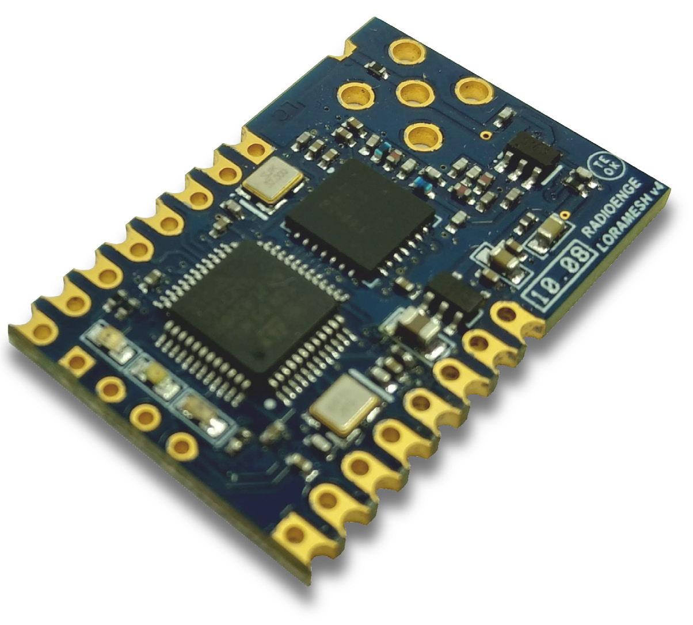
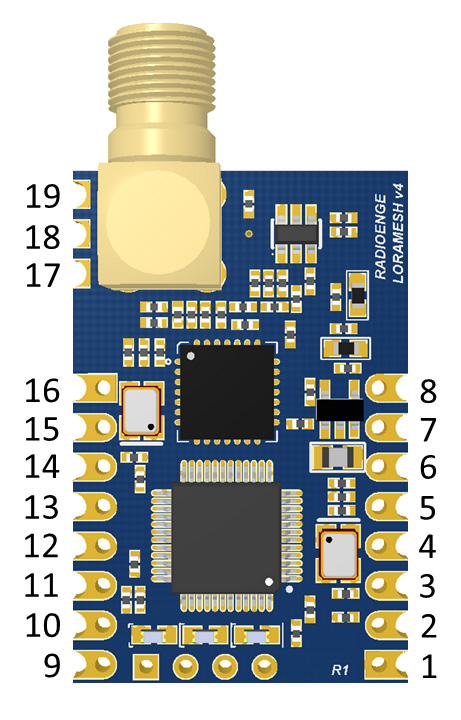
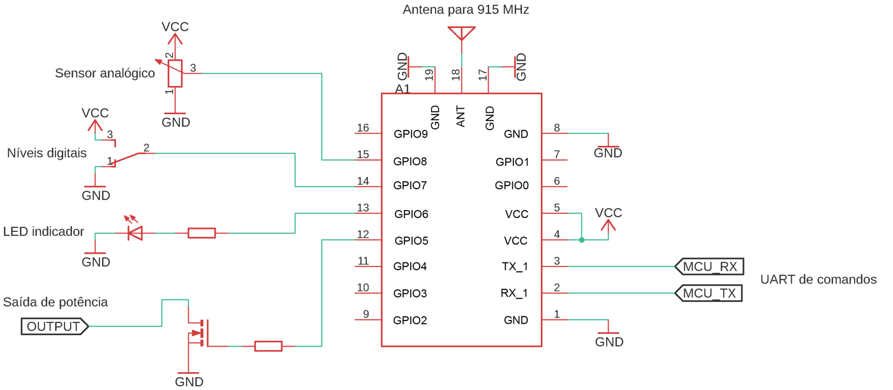
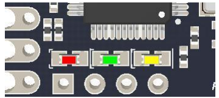
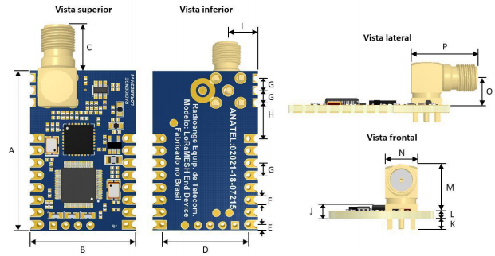
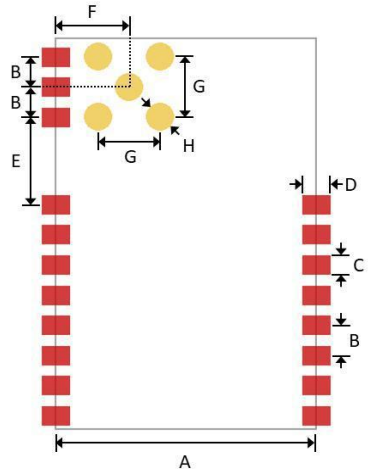

# Comandos AT do firmware Radioenge neste firmware

Este firmware substitui o firmware AT de fábrica do **Módulo LoRaWAN EndDevice Radioenge** (STM32L071CZT6 + SX1272, placa RD49C / "LoRaMESH v4"), mas **mantém o mesmo conjunto de comandos AT** do firmware original (`Lora_AT_v1r3s35`, o `.rad` distribuído pela Radioenge com o *SW_EndDevice_Radioenge*). Um programa, Arduino ou script feito para o módulo de fábrica continua funcionando, e ainda ganha as Classes A, B e C da LoRaMac-node v4.7.1.

O `.rad` original é cifrado (Intel HEX com blocos de 64 bits cifrados, só o bootloader da Radioenge decifra), então o comportamento foi reproduzido a partir dos manuais da Radioenge (rev. mar/2019 e abr/2021) e da tabela de comandos do firmware. O bootloader da Radioenge é apagado na primeira gravação (RDP), por isso os comandos de atualização do *SW_EndDevice* (`AT+ATUALIZAFW`, `AT+ATIVABANCO`, `AT+APAGABANCO`) não existem aqui: a gravação é pelo ST-LINK.

<p align="center">
  
  
</p>
<p align="center"><sub>Imagens do Manual de Utilização do Mote LoRa Radioenge (rev. mar/2019).</sub></p>

---

## 1. Formato

Os comandos AT entram **na mesma UART do console** (pinos 2 e 3, 115200 8N1 por padrão). Linhas que começam com `AT` vão para o interpretador AT; as outras são os comandos de texto do console (`status`, `config`, `set`...). Os dois convivem.

| Forma | Uso | Exemplo |
|---|---|---|
| `AT+CMD=?` | lê; devolve **só o valor** | `AT+ADR=?` → `1` |
| `AT+CMD=valor` | grava na EEPROM e aplica | `AT+ADR=1` → `AT OK` |
| `AT+CMD` | executa | `AT+JOIN` |
| `AT+CMD?` | ajuda do comando | `AT+SEND?` |
| `AT` | teste | `AT OK` |
| `ATZ` | reinicia o módulo | `AT OK` |
| `AT?` ou `AT+HELP` | lista os comandos | |

Maiúsculas ou minúsculas tanto faz, e espaços em volta do `=` são aceitos (`AT+KEEPALIVE = 1:35:1:60000`). EUIs e chaves aceitam `:` entre os bytes ou os dígitos seguidos, e são lidos com `:` e em minúsculas, **MSB primeiro** (a mesma ordem do ChirpStack).

### Respostas

| Resposta | Quando |
|---|---|
| `AT OK` | comando aceito |
| `AT ERROR` | comando desconhecido, ou operação que não vale no estado atual (ex.: `AT+WPIN` num pino que não é saída) |
| `AT PARAM ERROR` | parâmetro fora da faixa |
| `AT BUSY ERROR` | a MAC ainda está tratando o envio anterior (janelas RX, beacon, ping slot) |
| `AT TX OK` | uplink entregue ao rádio |
| `AT TX LENGTH ERROR` | payload maior que o permitido pelo DR atual |
| `AT NO NETWORK JOINED` | sem sessão (OTAA sem JOIN, ou `AT+AJOIN=0` sem `AT+JOIN`) |
| `AT ACK OK` / `AT ACK ERROR` | depois de um envio confirmado: ACK recebido / acabaram as tentativas |
| `AT JOIN OK` / `AT JOIN ERROR` | resultado do `AT+JOIN` (OTAA) |
| `AT ALREADY JOINED` | `AT+JOIN` com sessão ativa |
| `RX:<hex>:<RSSI>:<SNR>` | todo downlink recebido, como no original (ex.: `RX:0102030506:-105:5`) |

---

## 2. Lista completa

| Comando | Lê / grava | Faixa e observações | Padrão |
|---|---|---|---|
| `ATZ` | executa | reinicia | |
| `AT+DEUI` | lê (grava também) | 8 bytes; `AT+DEUI=auto` volta ao ID único do STM32 | ID do STM32 |
| `AT+DADDR` | ambos | 4 bytes. No OTAA, `=?` mostra o DevAddr da sessão (`00:00:00:00` sem JOIN) | `00:00:00:00` |
| `AT+APPKEY` | ambos | 16 bytes (OTAA). Grava também a NwkKey quando as duas eram iguais (LoRaWAN 1.0.x) | `node_build.h` |
| `AT+APPSKEY` | ambos | 16 bytes (ABP). No OTAA com sessão, `=?` mostra a chave derivada no JOIN | zeros |
| `AT+NWKSKEY` | ambos | 16 bytes (ABP). No OTAA com sessão, `=?` mostra a chave derivada no JOIN | zeros |
| `AT+APPEUI` | ambos | AppEUI / JoinEUI, 8 bytes | `node_build.h` |
| `AT+ADR` | ambos | 0 / 1 | 0 |
| `AT+TXP` | ambos | 0 = EIRP máx. (30 dBm, limitado ao +20 dBm do SX1272), 1..14 = máx. − 2·n dB, 15 = mínimo | equivalente a 14 dBm |
| `AT+DR` | ambos | **2..6** (AU915 com dwell time de 400 ms) | 5 |
| `AT+DCS` | ambos | duty cycle ETSI 0 / 1 (AU915 não exige) | 0 |
| `AT+PNM` | ambos | rede pública 0 / 1 (sync word 0x34 / 0x12) | 1 |
| `AT+RX2FQ` | ambos | 923300000..927500000 Hz | 923300000 |
| `AT+RX2DR` | ambos | 8..13 | 8 |
| `AT+RX1DL` | ambos | 1000..15000 ms; subir acima da RX2 empurra a RX2 para RX1 + 1000. `=?` mostra o valor em uso na MAC (no OTAA vem do Join-accept) | 1000 |
| `AT+RX2DL` | ambos | maior que a RX1, até 16000 ms | 2000 |
| `AT+JN1DL` | ambos | 1000..15000 ms (empurra a JN2 do mesmo jeito) | 5000 |
| `AT+JN2DL` | ambos | maior que a JN1 | 6000 |
| `AT+NJM` | ambos | **0 = ABP, 1 = OTAA**, troca a ativação sem regravar o firmware (um firmware só para as duas) | 1 (OTAA, `node_build.h`) |
| `AT+NWKID` | ambos | 4 bytes | `00:00:00:00` |
| `AT+CLASS` | ambos | `A`, `C` e também **`B`** | A |
| `AT+JOIN` | executa | OTAA: até `NBTRIALS` Join-requests, depois `AT JOIN OK` ou `AT JOIN ERROR`. ABP: `AT ERROR` | |
| `AT+AJOIN` | ambos | 1 = JOIN automático no boot, refeito até conseguir; 0 = espera o `AT+JOIN` | 1 |
| `AT+NJS` | lê | 0 sem sessão, 1 com sessão | |
| `AT+SEND` | grava | `porta:texto`, porta 1..223, confirmação do `AT+CFM` | |
| `AT+SENDB` | grava | `porta:hex` | |
| `AT+TXCFM` | grava | `porta:confirmado:tentativas:texto` (independe do `CFM` e do `NBTRIALS`) | |
| `AT+TXBCFM` | grava | `porta:confirmado:tentativas:hex` | |
| `AT+VER` | lê | versão deste firmware | |
| `AT+CFM` | ambos | 0 / 1 (vale para `SEND`, `SENDB` e o uplink periódico) | 0 |
| `AT+SNR` | lê | SNR do último downlink (dB) | |
| `AT+RSSI` | lê | RSSI do último downlink (dBm) | |
| `AT+BAT` | lê | 1 = 1,8 V ... 254 = 3,6 V (VDD do STM32), 255 = sem medida | |
| `AT+BAUDRATE` | ambos | 9600, 19200, 43000, 115200 (ou o índice 0..3 do firmware antigo); outro valor = 9600, como no manual. Responde `AT OK` na velocidade antiga e troca | **115200** |
| `AT+NBTRIALS` | ambos | 0..79. No confirmado vale até 15 (limite da LoRaMac-node); no `AT+JOIN`, o número todo | 8 |
| `AT+KEEPALIVE` | ambos | `habilitado:porta:confirmado:periodicidade_ms` (≥ 5000) | `0:5:0:60000` |
| `AT+CHMASK` | ambos | grava `CH0:CH1:CH2:CH3:CH4:CH5` (16 bits cada), lê os 24 dígitos seguidos | SB1 + 500 kHz |
| `AT+ADC` | grava | `pino` (0, 1, 7, 8): 0..4095 | |
| `AT+GPIOC` | ambos | `pino:modo:pull` (seção 3); `=?` mostra `modo:pull` dos 10 GPIOs | não configurados |
| `AT+WPIN` | grava | `pino:nível` (pino em modo 1 ou 2) | |
| `AT+RPIN` | grava | `pino`: digital 0/1, analógico 0..4095 | |

> **Credenciais, canais e `AT+NJM`** mudam a sessão LoRaWAN: são gravados na hora (`AT OK`) e o módulo **reinicia 5 s depois do último comando AT**, para uma sequência como `AT+DADDR` → `AT+NWKSKEY` → `AT+APPSKEY` valer de uma vez. `AT+JOIN` ou `ATZ` antes disso reiniciam na hora (o `AT+JOIN` continua depois do boot e responde `AT JOIN OK` / `AT JOIN ERROR`). O resto (ADR, DR, classe, keepalive...) vale sem reiniciar.

### Máscara de canais (`AT+CHMASK`)

`CH0` = canais 1–16 de 125 kHz (bit 0 = canal 1, 915,2 MHz) · `CH1` = 17–32 · `CH2` = 33–48 · `CH3` = 49–64 · `CH4` = canais 65–72 de 500 kHz (byte alto sempre `00`) · `CH5` = sempre `0000`.

| Rede | Comando | Equivale a |
|---|---|---|
| ChirpStack `au915_1`, TTN e os gateways ESP32 deste projeto | `AT+CHMASK=ff00:0000:0000:0000:0002:0000` | `set subband 1` + `set ch500 1` (padrão) |
| ChirpStack `au915_0` / Everynet | `AT+CHMASK=00ff:0000:0000:0000:0001:0000` | `set subband 0` + `set ch500 1` |
| Everynet sem 500 kHz | `AT+CHMASK=00ff:0000:0000:0000:0000:0000` | `set subband 0` + `set ch500 0` |

Uma máscara que bate com uma sub-banda vira `subband`/`ch500`; qualquer outra fica gravada como máscara livre (`subband 9` no `config`).

---

## 3. GPIOs, entradas analógicas e interrupções

| GPIO | Pino do módulo | STM32 | Analógica | Interrupção | Outra função |
|---|---:|---|:---:|:---:|---|
| GPIO0 | 6 | PA3 | ✅ (ADC_IN3) | — | RX da serial transparente |
| GPIO1 | 7 | PA2 | ✅ (ADC_IN2) | ❌ ¹ | TX da serial transparente |
| GPIO2 | 9 | PA15 | — | ✅ ² | |
| GPIO3 | 10 | PA10 | — | — | |
| GPIO4 | 11 | PA9 | — | ✅ | |
| GPIO5 | 12 | PA8 | — | ✅ | |
| GPIO6 | 13 | PB15 | — | ✅ ² | |
| GPIO7 | 14 | PA0 | ✅ (ADC_IN0) | — | |
| GPIO8 | 15 | PA1 | ✅ (ADC_IN1) | — | |
| GPIO9 | 16 | PB11 | — | ✅ | |

¹ O manual permite, mas aqui a linha EXTI2 é a do DIO1 do SX1272 (PB2): o `AT+GPIOC=1:6..8` responde `AT PARAM ERROR`.
² PA15 e PB15 dividem a linha EXTI15: só um dos dois como interrupção por vez.

| Modo | Função | | Pull | |
|---:|---|---|---:|---|
| 0 | entrada digital | | 0 | sem resistor |
| 1 | saída push-pull | | 1 | pull-up |
| 2 | saída open-drain | | 2 | pull-down |
| 3 | função alternativa push-pull (GPIO0/GPIO1: serial transparente) | | | |
| 4 | função alternativa open-drain (GPIO0/GPIO1: serial transparente) | | | |
| 5 | entrada analógica (GPIO0, 1, 7, 8) | | | |
| 6 / 7 / 8 | interrupção na subida / descida / nas duas | | | |

A configuração dos pinos (`AT+GPIOC`) fica na EEPROM e volta a cada boot; o nível das saídas (`AT+WPIN`) não é gravado (as saídas voltam em 0), para não gastar a EEPROM com um pino que muda o tempo todo. Pinos nunca configurados ficam em alta impedância (modo analógico do STM32, o de menor consumo).

<p align="center">
  
</p>
<p align="center"><sub>Exemplo de aplicação do manual da Radioenge: sensor analógico, nível digital, LED e saída de potência nos GPIOs.</sub></p>

### Pacote de interrupção (porta 2)

Uma borda num pino em modo 6, 7 ou 8 manda um uplink na **porta 2** (confirmação do `AT+CFM`), no formato da Tabela 13 do manual, com o byte LSB dos pinos que o manual omite:

| Byte | Conteúdo |
|---:|---|
| 0 | nível de bateria (escala do `AT+BAT`) |
| 1 | reservado (`00`) |
| 2 | número do GPIO que gerou a interrupção |
| 3–4 | estado das entradas digitais (bit n = GPIOn), MSB e LSB |
| 5 | SNR do último downlink |
| 6–7 | RSSI do último downlink (MSB, LSB) |

### Keepalive (`AT+KEEPALIVE`)

A cada `periodicidade` ms (com sessão ativa) sai um uplink de 16 bytes na porta escolhida (Tabela 9 do manual):

| Byte | Conteúdo |
|---:|---|
| 0 | nível de bateria |
| 1 | reservado (`00`) |
| 2 | `FF` |
| 3–4 | estado das entradas digitais (MSB, LSB) |
| 5–6 / 7–8 / 9–10 / 11–12 | AD0 (GPIO0) / AD1 (GPIO1) / AD2 (GPIO7) / AD3 (GPIO8), 0..4095 (0 se o pino não for analógico) |
| 13 | SNR do último downlink |
| 14–15 | RSSI do último downlink (MSB, LSB) |

O keepalive é independente do uplink periódico do console (`interval`/`payload`). Para usar só os comandos AT, como no módulo de fábrica: `set interval 0` + `save` desliga o periódico.

### Serial transparente (porta 4)

`AT+GPIOC=0:3:0` (ou `1:3:0`; `:4:` para open-drain) liga a **USART2** em GPIO1 (TX, pino 7) e GPIO0 (RX, pino 6), na mesma velocidade do `AT+BAUDRATE`. O que chega nela vira um uplink na **porta 4** depois de 50 ms sem bytes (ou a cada 64 bytes), e todo downlink na **porta 4** sai por ela, sem RSSI/SNR. Não existe com o console em `CONSOLE_UART=2` (o console já usa esses pinos).

---

## 4. Comandos AT por downlink (porta 103)

Os mesmos comandos funcionam **via rádio**, como diz o manual ("configuráveis tanto pela interface serial de comandos como via rádio"): um downlink na FPort `atport` (padrão **103**, `set atport 0` desliga) com o texto do comando em ASCII. Vários comandos vão separados por `;`. As respostas voltam num uplink na mesma porta, separadas por `\n` (até 64 bytes, cortadas no máximo do DR).

| Downlink (texto) | Base64 para o ChirpStack | Resposta (uplink na 103) |
|---|---|---|
| `AT+WPIN=3:1` | `QVQrV1BJTj0zOjE=` | `AT OK` |
| `AT+RPIN=7;AT+BAT=?` | `QVQrUlBJTj03O0FUK0JBVD0/` | `2048\n254` |
| `AT+KEEPALIVE=1:5:0:300000` | `QVQrS0VFUEFMSVZFPTE6NTowOjMwMDAwMA==` | `AT OK` |

---

## 5. Roteiros prontos

**ChirpStack v4, OTAA, sub-banda 1** (o JoinEUI e a AppKey vêm do cadastro do dispositivo):

```
AT+NJM=1
AT+APPEUI=b2:f6:34:a1:e6:2c:10:c7
AT+APPKEY=6f:c5:7c:4c:da:46:dd:c5:02:bc:b7:85:5e:4e:94:ae
AT+CHMASK=ff00:0000:0000:0000:0002:0000
AT+JOIN                          -> (reinicia) ... AT JOIN OK
AT+SEND=5:teste                  -> AT TX OK
```

**ChirpStack v4, ABP** (aba *Activation* do dispositivo):

```
AT+NJM=0
AT+DADDR=26:0c:af:e1
AT+NWKSKEY=00:01:02:03:04:05:06:07:08:09:0a:0b:0c:0d:0e:0f
AT+APPSKEY=f0:e0:d0:c0:b0:a0:90:80:70:60:50:40:30:20:10:00
                                 (reinicia 5 s depois)
AT+SENDB=5:416461696c53696c7661  -> AT TX OK
```

**TTN** (manual da Radioenge): `AT+CHMASK=ff00:0000:0000:0000:0002:0000`, `AT+JN1DL=5000`, `AT+JN2DL=6000` e, no ABP, `AT+RX1DL=1000`, `AT+RX2DL=2000`.
**Everynet**: `AT+CHMASK=00ff:0000:0000:0000:0000:0000`, `AT+JN1DL=5000`, `AT+JN2DL=6000` e, no ABP, `AT+RX1DL=5000`, `AT+RX2DL=6000`.

> No manual aparece `AT+RX2FQ=92330000` (8 dígitos): é erro de digitação. O valor certo é `923300000` Hz, e o firmware recusa o de 8 dígitos com `AT PARAM ERROR`.

---

## 6. LEDs (iguais ao original)

<p align="center">
  
</p>

| LED | Significado |
|---|---|
| 🔴 vermelho (PB5) | pisca a cada transmissão; aceso um instante = JOIN sem resposta; na inicialização, pisca em **Classe A** |
| 🟢 verde (PB8) | pisca duas vezes a cada downlink (e uma a cada beacon); na inicialização, pisca em **Classe C** (os dois na **Classe B**) |
| 🟡 amarelo (PB9) | pisca a cada linha recebida na serial de comandos |

`set leds 0` apaga todos.

---

## 7. Na página WEB e no app

Todos os parâmetros dos comandos AT também ficam no formulário da página WEB e do app (gravados com `set` + `save`, pelo console), e as ações nas seções de GPIOs e de uplink. O campo de comando da aba Logs continua aceitando qualquer `AT+...`.

| Comando AT | Página WEB | App Android | Pelo console (`set`) |
|---|---|---|---|
| `AT+NJM` | Ativação → ABP / OTAA | Config. → Ativação | `set njm 0\|1` |
| `AT+AJOIN` | Ativação (OTAA) → JOIN automático no boot | Config. → Ativação | `set ajoin 0\|1` |
| `AT+DEUI`, `AT+DADDR`, `AT+APPEUI`, `AT+APPKEY`, `AT+NWKSKEY`, `AT+APPSKEY`, `AT+NWKID` | Ativação | Config. → Ativação | `set deveui/devaddr/joineui/appkey/nwkskey/appskey/netid` |
| `AT+CHMASK` | Rádio e classe → Sub-banda: Máscara personalizada | Config. → Rádio LoRa | `set chmask <24 hex>` |
| `AT+TXP` | Rádio e classe → Potência por índice | Config. → Rádio LoRa | `set txp 0..15\|255` |
| `AT+ADR`, `AT+DR`, `AT+CLASS` | Rádio e classe | Config. → Rádio LoRa / Classe | `set adr / dr / class` |
| `AT+RX1DL`, `AT+RX2DL`, `AT+RX2FQ`, `AT+RX2DR`, `AT+JN1DL`, `AT+JN2DL` | Rádio e classe → Janelas de recepção e rede | Config. → Janelas de recepção e rede | `set rx1dl / rx2dl / rx2fq / rx2dr / jn1dl / jn2dl` |
| `AT+PNM`, `AT+DCS` | Rádio e classe → Rede pública / Duty cycle | Config. → Janelas de recepção e rede | `set pnm / dcs` |
| `AT+CFM`, `AT+NBTRIALS` | Uplink → Confirmado / Tentativas | Config. → Uplink | `set confirmed / nbtrials` |
| `AT+KEEPALIVE` | Uplink → Keepalive | Config. → Keepalive | `set keepalive <h:porta:c:ms>` |
| porta dos comandos AT | Downlinks → FPort dos comandos AT | Config. → Downlinks | `set atport` |
| `AT+BAUDRATE` | Energia e serial → Velocidade da serial | Config. → Energia e serial | `set baud` |
| `AT+GPIOC`, `AT+WPIN`, `AT+RPIN`, `AT+ADC`, `AT+BAT` | GPIOs | Manutenção → GPIOs | (só AT; `jio` mostra o estado) |
| `AT+SEND`, `AT+SENDB`, `AT+TXCFM`, `AT+TXBCFM` | Ações → Uplink agora (FPort, Confirmado, Tentativas) | Manutenção → Uplink agora | `send` |
| `AT+JOIN`, `AT+NJS` | Status / Ações → Refazer JOIN; Status → Sessão | Status / Manutenção | `join` |
| `AT+SNR`, `AT+RSSI`, `AT+VER` | Status → Último downlink; Ações → Firmware | Status | `status` |
| `ATZ` | Ações → Reiniciar | Manutenção → Reiniciar | `reboot` |
| `AT+TELEM` | Uplink → Conteúdo do uplink periódico | Config. → Uplink | `set uplinkmode 0\|1` |
| `AT+RELECFG`, `AT+RELE`, `AT+RELEPULSO` | Relés e PZEM → Relés / Pinos dos relés | Manutenção → Relés e PZEM | `rele`, `rele 0 liga`, `rele pulso 1 1 3000` |
| `AT+PZEMCFG`, `AT+PZEM` | Relés e PZEM → PZEM-004T v3 | Manutenção → Relés e PZEM | `pzem`, `pzem ler` (`jdev` mostra o estado) |

No formulário, o `save` aplica PNM, DCS, janelas RX/JOIN e keepalive na hora; credenciais, canais e `njm` reiniciam o nó. A troca de velocidade responde `@OK baud` ainda na velocidade antiga e só então muda: a página reabre a porta USB-serial e o app troca a velocidade do adaptador USB sozinhos (com Bluetooth, configure o módulo BLE na mesma velocidade).

## 8. Relés, PZEM-004T e telemetria (comandos novos deste firmware)

Comandos que **não existem no firmware de fábrica**: configuram os relés, os medidores de energia PZEM-004T v3 e o conteúdo do uplink periódico do protocolo **ADAILSILVA_V1** ([`PROTOCOLO_ADAILSILVA_V1.md`](PROTOCOLO_ADAILSILVA_V1.md)). Seguem o mesmo formato dos outros (`=?` lê, `=valor` grava na EEPROM e aplica na hora). Também funcionam por downlink na porta 103.

| Comando | Valores | Exemplo | Resposta |
|---|---|---|---|
| `AT+TELEM` | `0` payload fixo (`payload`) na FPort `port` · `1` telemetria V1 na porta 20 (padrão) | `AT+TELEM=1` | `AT OK` |
| `AT+RELECFG` | `pinos:ativo_baixo`; `pinos` = GPIOs separados por vírgula (canal 0 = o primeiro); `ativo_baixo` = um valor para todos ou um por relé · `=0` remove todos | `AT+RELECFG=4,5:1` · `AT+RELECFG=4,5,9:1,1,0` | `AT OK`; `=?` → `4,5,9:1,1,0` ou `0` |
| `AT+RELE` | `canal:ação` · canal `0..7` ou `255` (todos) · ação `0` desliga, `1` liga, `2` alterna | `AT+RELE=0:1` · `AT+RELE=255:0` | `AT OK`; `=?` → `qtd:mapa` (ex. `2:0001`) |
| `AT+RELEPULSO` | `canal:estado:ms` · estado `0/1` durante o pulso · `100..86400000` ms | `AT+RELEPULSO=1:1:5000` | `AT OK` |
| `AT+PZEMCFG` | endereços Modbus em hexadecimal, separados por vírgula (até 4) · `f8` = genérico, só com **um** medidor · `=0` desliga o modo PZEM | `AT+PZEMCFG=f8` · `AT+PZEMCFG=01,02` | `AT OK`; `=?` → `f8`, `01,02` ou `0` |
| `AT+PZEM` | `=?` últimas leituras (uma linha por medidor) · `=canal` lê agora | `AT+PZEM=0` | `AT OK` e, quando a resposta Modbus chega, `PZEM0: 230,0 V · 0,500 A · 120,0 W · 12345 Wh · 60,0 Hz · FP 0,95 · alarme não · há 0 s` (ou `PZEM0: sem resposta (FALHA_PERIFERICO)`) |
| `AT+PZEMZERA` | `canal`: zera a energia acumulada (função Modbus 0x42) | `AT+PZEMZERA=0` | `AT OK`, depois `PZEM0: energia zerada` |
| `AT+PZEMLIM` | `canal:watts` (0..23000): limite do alarme de potência (registrador 0x0001) | `AT+PZEMLIM=0:2300` | `AT OK`, depois `PZEM0: limite de potência gravado no medidor` |
| `AT+PZEMEND` | `01..f7`: troca o endereço Modbus do medidor (registrador 0x0002). Só com **um** medidor configurado e ligado | `AT+PZEMEND=02` | `AT OK`, depois `PZEM0: endereço Modbus agora 02 (gravado)` |

Respostas de erro: `AT PARAM ERROR` (valor fora da faixa ou combinação recusada; o `AT+RELECFG` e o `AT+PZEMCFG` escrevem antes uma linha com o motivo, ex. `AT+RELECFG: GPIO1 está com a serial (PZEM ou transparente)`), `AT ERROR` (relé ou medidor não configurado) e `AT BUSY ERROR` (fila do PZEM cheia: tente de novo).

### Regras dos pinos

- **Relés:** qualquer GPIO0..GPIO9 do módulo (os pinos do rádio SX1272 não são GPIOs do módulo e nunca podem ser relés). GPIO0 e GPIO1 só quando não estão com a serial (PZEM ou transparente). O pino vira **saída push-pull** e passa a ser **só do relé**: `AT+GPIOC` e `AT+WPIN` nele respondem `AT ERROR` até ele sair da lista do `AT+RELECFG` (aí volta para "não configurado", alta impedância). `AT+RPIN` continua lendo o nível.
- **Ativo em nível baixo** (`:1`): o relé liga com o pino em 0, como nos módulos de relé com optoacoplador mais comuns. O nível certo é escrito **antes** de o pino virar saída: no boot o relé não dá pulso falso.
- **Estados gravados:** cada mudança de estado vai para a EEPROM (num anel de 32 registros, para gastar a EEPROM 32 vezes menos) e volta no boot. Repetir o mesmo estado não grava nada. Um pulso em andamento não é gravado: depois de um reinício o relé volta ao estado anterior ao pulso.
- **PZEM × serial transparente:** os dois usam GPIO0 (RX) e GPIO1 (TX) e a USART2, então são **exclusivos**, e **a configuração mais recente vence**: `AT+PZEMCFG=f8` desliga a serial transparente (e qualquer outro modo de GPIO0/GPIO1); `AT+GPIOC=0:3:0` (ou qualquer `AT+GPIOC` em GPIO0/GPIO1) desliga o modo PZEM (`AT+PZEMCFG=?` passa a responder `0`). O PZEM é sempre 9600 8N1, qualquer que seja o `AT+BAUDRATE`. Com o console em `CONSOLE_UART=2` não há PZEM nem serial transparente.
- **De fábrica:** um PZEM no endereço genérico `f8` e nenhum relé. Um módulo que já usava a serial transparente antes desta versão (ou outro modo em GPIO0/GPIO1) continua com ela e fica sem PZEM.

### Roteiro: dois relés e um PZEM

```
AT+RELECFG=4,5:1          relé 0 = GPIO4, relé 1 = GPIO5, ativos em 0
AT OK
AT+PZEMCFG=f8             um medidor em GPIO0/GPIO1
AT OK
AT+RELE=0:1               liga o relé 0 (e manda uma telemetria com os relés)
AT OK
AT+RELE=?
2:0001
AT+RELEPULSO=1:1:3000     relé 1 ligado por 3 s; no fim, telemetria com os relés
AT OK
AT+PZEM=0
AT OK
PZEM0: 229,8 V · 0,412 A · 85,3 W · 1520 Wh · 60,0 Hz · FP 0,90 · alarme não · há 0 s
```

No console de texto: `rele`, `rele 0 liga`, `rele todos desliga`, `rele pulso 1 1 3000`, `pzem`, `pzem ler [canal]`, `set uplinkmode 0|1` e `jdev` (JSON `@DV` para a página WEB e o app).

## 9. Diferenças em relação ao firmware de fábrica

| Item | Firmware Radioenge | Este firmware |
|---|---|---|
| Classes | A e C | **A, B e C** (`AT+CLASS=B`) |
| Pilha | LoRaWAN 1.0.3 | LoRaMac-node v4.7.1, LoRaWAN 1.0.4, RP002-1.0.3 |
| Velocidade de fábrica | 9600 | **115200** (a página WEB e o app usam 115200). `AT+BAUDRATE=9600` deixa igual ao original |
| `AT+DR` | 0..13 | 2..6 (DR0/DR1 recusados: dwell time de 400 ms no AU915; DR8..13 são de downlink) |
| Portas de aplicação | 0..255 | 1..223 (0 é da MAC, 224 da certificação) |
| `AT+NBTRIALS` | 0..79 | 0..79; no confirmado, até 15 por uplink |
| `AT+TXCFM` | texto (manual 2021); hex nas versões antigas | texto; `AT+TXBCFM` é o de hex |
| Pacote de interrupção | 7 bytes (só o MSB das entradas) | 8 bytes (MSB e LSB das entradas) |
| GPIO1 como interrupção | permitido | recusado (EXTI2 é do rádio) |
| Credenciais/canais/NJM | valem na hora | reinício automático 5 s depois (sessão nova e limpa) |
| Leitura | só AT | AT **e** console de texto, página WEB e app (com campos para todos os parâmetros, seção de GPIOs e o campo de comando aceitando AT) |
| Atualização | bootloader + `SW_EndDevice_Radioenge` (`.rad`) | ST-LINK (SWD); o bootloader de fábrica é apagado |
| Relés, PZEM-004T e protocolo binário | não existem | `AT+RELECFG`, `AT+RELE`, `AT+RELEPULSO`, `AT+PZEMCFG`, `AT+PZEM`... (seção 8) e o protocolo ADAILSILVA_V1 nas portas 10, 11 e 20 |

<p align="center">
  
  
</p>
<p align="center"><sub>Dimensões (33 × 22 × 3 mm) e footprint recomendado, do manual da Radioenge (rev. abr/2021).</sub></p>
